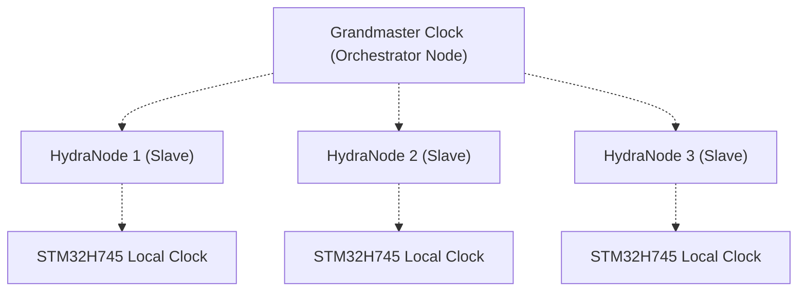

<!-- =============================================================================
HYDRA-UMC-SWARM-SYNC - CRDT state reconciliation for the swarm
Copyright (C) JuanenRac (Electro Hobby 3D) <electrohobby3d@gmail.com>
GPL-3.0-or-later - see LICENSE
============================================================================= -->

<p align="center">
  
</p>

# 🐝 HYDRA-UMC-SWARM-SYNC

<p align="center">🇺🇸 <b>English</b> | <a href="README_spa.md">🇪🇸 Español</a> | <a href="README_fra.md">🇫🇷 Français</a> | <a href="README_ita.md">🇮🇹 Italiano</a> | <a href="README_deu.md">🇩🇪 Deutsch</a> | <a href="README_zho.md">🇨🇳 简体中文</a> | <a href="README_jpn.md">🇯🇵 日本語</a> | <a href="README_por.md">🇵🇹 Português</a></p>

### 📡 CRDT State Reconciliation & Multi-Node Synchronization

<p align="center">
  
  
  
  
  
</p>

---

> **Safety and security status:** this ecosystem is not a certified safety system. There is no hardware E-STOP path, no firmware-enforced limits or interlocks and no verified motion command yet; firmware images are checked with CRC-32 and an Ed25519 signature, and a release build refuses the published development keys (the tool heads and expansion boards behind the relay still run URTC bootloaders, which take a shared-key HMAC-SHA256 instead of a signature); TLS and mutual TLS are optional and off by default; no custom board has been populated or tested yet. Read the [security baseline](https://github.com/JuanenRac/HYDRA-UMC-DOCS/blob/main/docs/SECURITY_BASELINE.md) and the [threat model](https://github.com/JuanenRac/HYDRA-UMC-DOCS/blob/main/docs/THREAT_MODEL.md) before relying on any statement here for the safety of a person.

---

## 📋 At a glance

| | |
|---|---|
| Version | `0.1.8` |
| Maturity | Functional |
| Tests | 105 (`cargo test`) |
| Stack | Rust / CRDT (LWW-Element-Map) / Lamport logical clock / JSON/HTTP |
| Target | The Raspberry Pi CM5 of a HYDRA-UMC cell |
| On real hardware | Not yet: no run on real hardware is recorded for this version |

**Jump to:** [Overview](#-overview) · [Architecture](#-architecture) · [Security & Safety](#-security--safety) · [Configuration](#-configuration) · [Quick start](#-quick-start) · [Testing](#-testing) · [Troubleshooting](#-troubleshooting) · [Repository Structure](#-repository-structure) · [Related Projects](#-related-projects)

## 🚦 Project status

Each line is one part of this repository and the light says how far it is today. It is written from what the repository can show (tests, builds, runs), not from what is planned.

🟢 Done and verified · 🟡 Works, with known limits · 🟠 Partly done or not verified yet · 🔴 Not done or not working

| Area | State | What it means here |
|---|---|---|
| Software | 🟡 | Works for its main purpose; the honesty check above lists what is still missing |
| Tests | 🟢 | 105 automated tests, run on every change |
| Real hardware | 🔴 | Not yet: no run on real hardware is recorded for this version |
| Documentation | 🟢 | README in eight languages, checked against the manifest on every change |

## 🎯 Overview

**HYDRA-UMC-SWARM-SYNC** is the state-reconciliation layer of the distributed factory: a CRDT (a last-writer-wins map ordered by a Lamport logical clock) that lets every controller merge its view of the swarm without a central arbiter. A precisely synchronized global clock (PTP / IEEE 1588) is the long-term goal and is not implemented: see the roadmap.

Starting and ending the trajectories of several arms at the same microsecond, or performing joint assembly, needs that clock and is future work.

### Key Features:
* ⏱️ **Logical Clock, Not Hardware PTP Sync Yet:** `src/lamport.rs` implements a real, tested Lamport logical clock - the ordering primitive the CRDT merge below actually needs. Sub-100ns jitter and PTP (IEEE 1588) hardware timestamping are the eventual goal (see ARCHITECTURE below), not something this crate measures or implements today - there is no NIC/hardware-timer code anywhere in this repository, and `src/lamport.rs`'s own header comment says so explicitly.
* 🔄 **CRDT State Reconciliation (real today):** `src/crdt.rs`'s LWW-Element-Map merges multiple cells' state deterministically - proven commutative, associative and idempotent by property tests, not synchronized start/stop of robot trajectory commands (that orchestration lives in HYDRA-UMC-ORCHESTRATOR/HYDRA-UMC-JOB-DISPATCHER, not here).
* 📡 **No Hardware Timestamping Yet:** leveraging real CM5/STM32 hardware timers is future work - this crate is pure software (Rust binary), with no hardware-facing code at all.
* 🛡️ **Reconnection-Resilient CRDT Merge (real today):** a real 4-cell simulated test (`cargo test`) proves convergence holds across multiple rounds of partition and partial reconnection - this is resilience to a cell going offline and rejoining later, not measured resilience to live network packet jitter/delay, which this crate doesn't instrument.
* 🔍 **Real Conflict Visibility & Swarm-Scale Convergence Proof (v0):** `merge_report()` returns a real, per-key record of every genuine write conflict resolved during reconciliation - which cell beat which other cell, and by what stamp. A 4-cell simulated test proves convergence holds across multiple rounds of partition and partial reconnection, not just a single two-cell merge.
* 💾 **Real Per-Node Persistence (`--state-file`):** `serve` mode's own CRDT state now survives a real process restart (`src/store.rs`) - every `POST /reconcile` merges into and durably updates this node's own state instead of starting from a blank slate every call, verified against an actual killed-and-relaunched binary, not just in-process tests. Unset, it stays the original memory-only behavior. See `docs/CLI_REFERENCE.md`.
* 🔁 **Exchange of full state and a gossip client:** `GET /state?full=1` answers every entry with its time, writer and generation, deleted keys (tombstones) included, and `POST /merge` takes them, so a node can be brought up to date from another one whatever either wrote and deleted meanwhile; a `Write` of a scenario can now carry `"deleted": true`. Entries are checked before they touch the map (size, a time no more than `--max-time-jump` ahead, a generation no more than `--max-generation-jump` ahead of the key's own). With `--peer http://host:port` (repeat for each node) the node asks its peers for their state every `--gossip-interval-ms` (at least 1000) and, with `--gossip-push`, sends its own; the peers share `SWARM_SYNC_SHARED_SECRET`, and `GET /stats` reports each peer. The generation is compared before the time (a replica that deleted and recreated a key more often wins over a later plain write), and a reported conflict now says both generations. *(tried between nodes on one machine; never across a real partition)*
* 🔐 **Real Opt-In Shared-Secret Authentication (`SWARM_SYNC_SHARED_SECRET`):** unset, this project keeps its original LAN-trust posture - any caller can `POST /reconcile` or `GET /state`. Set (env var only, never a CLI flag - a shared secret belongs in the environment/systemd unit, not a process listing), both routes require a matching `Authorization: Bearer <token>`, checked in constant time. `GET /stats` stays open either way.
* 🧱 **Refuses to be an open node on the network, and bounded bodies (v0):** `serve` on an address other than loopback needs `SWARM_SYNC_SHARED_SECRET` (or an explicit `--allow-anonymous` for a lab), because a node that merges whatever any machine on the network sends it lets that machine rewrite the swarm's view of itself; request bodies over 1 MiB are refused with `413` before they are read; and the state file is forced to disk before it replaces the previous one, so a power cut cannot leave a truncated or empty state behind. *(implemented)*
* 📜 **Conflict history:** `GET /conflicts` lists the conflicts this node resolved (key, winning writer, losing writer and time), newest first, up to the latest 200 or `?limit=N`; `/stats` only kept the last one. It asks for the shared secret when one is set, like `/state`.

## 🧩 Role in HYDRA-UMC

**HYDRA-UMC-SWARM-SYNC** merges the views of the swarm that each cell holds into one result that does not depend on the order of the merge: a last-writer-wins map with a Lamport logical clock. It runs from a scenario file or as a small HTTP node that keeps its state on disk and can gossip with peers; it is not a hardware time source.

## 🏛️ Architecture

<p align="center">
  
</p>

<details>
<summary>Text version of the diagram (Mermaid)</summary>



</details>

### SYNC HIERARCHY

> Dotted arrows are planned, not implemented: there is no PTP code in this repository.

### ARCHITECTURE & DESIGN DECISIONS

* **Why CRDT-based sync, not a single source of truth.** Multiple HYDRA-UMC cells can run semi-autonomously and reconnect later - a CRDT merge strategy converges without a central arbiter deciding whose state 'wins', which a naive last-write-wins approach can't guarantee across a real network partition.
* **Why this is a sibling, not a submodule, of HYDRA-UMC-ORCHESTRATOR.** State reconciliation is a continuous background concern independent of any single orchestration decision - keeping it a separate process means an orchestrator restart doesn't interrupt an in-flight merge.
* **Why the CRDT merge is real today but PTP hardware sync is not.** `src/crdt.rs` implements a real LWW-Element-Map (Last-Writer-Wins Map), a state-based CRDT whose `merge` is provably commutative, associative and idempotent - not just "seems to converge on one example", see that module's own property tests. `src/lamport.rs` backs it with a real Lamport logical clock. PTP (IEEE 1588, sub-100ns hardware timestamping) is a fundamentally different, hardware-dependent problem - it needs real NICs/hardware timers to mean anything, and stays deferred until there's real hardware to validate it against. A logical clock is what the CRDT merge actually needs to resolve conflicts deterministically, and that part is real and tested today.
* **How this fits the rest of the ecosystem.** A sibling service under HYDRA-UMC-ORCHESTRATOR, alongside HYDRA-UMC-PATH-PLANNER-3D, HYDRA-UMC-JOB-DISPATCHER and HYDRA-UMC-NODE-HEALING - keeps every cell's own view of swarm state consistent regardless of which one currently holds the orchestrator role. (Nothing calls it yet: that integration is planned.)
* **Why `merge_report()` is a new method instead of changing what `merge()` returns.** `merge()` stays a pure, cheap, obviously-correct black box - that simplicity is what makes it easy to trust. `merge_report()` layers real conflict visibility on top for a caller (an operator, a debugging tool) that specifically wants to know what a reconciliation overwrote, without forcing every caller of the hot-path `merge()` to pay for or handle that bookkeeping.
* **Why conflict reports show stamp order, not causal "happened-before".** A Lamport clock guarantees that true causal happens-before implies an earlier stamp - but the converse doesn't hold: an earlier stamp does NOT prove two events were causally related rather than merely concurrent. `MergeConflict` is deliberately honest about reporting only what a Lamport clock can actually prove (a consistent total order), not a causality claim a vector clock would be needed to make.

**Typed robot state.** What a node replicates under the key `robot_state/<robot_id>` is a `RobotState` of the SDK, not a free string: before it touches the map (`POST /reconcile` and `POST /merge`) the value must be JSON, pass the vendored schema (Draft 2020-12, formats checked), carry the `robot_id` of the key and a unit-length pose quaternion; otherwise the request is a `422`. A deletion is always accepted and every other key stays untyped. The missions are not typed yet.

## 🔒 Security & Safety

| Threat | Defence | Where |
|---|---|---|
| A machine on the network rewrites the swarm's view of itself | `serve` refuses to listen on a non-loopback address without `SWARM_SYNC_SHARED_SECRET` (exit code 2); `--allow-anonymous` is an explicit lab choice | `src/main.rs` |
| A write stamped near the largest time wins every conflict for ever | A request may move a time at most `--max-time-jump` past the newest time held, and a generation at most `--max-generation-jump` (1000 by default) past the key's own | `src/entries.rs` |
| A huge or slow request starves the node | A body over 1 MiB is refused with 413 before it is read, and four worker threads serve requests so one slow upload holds only one of them | `src/server.rs` |
| A power cut leaves a truncated state file | The state is written to a temporary file, forced to disk and renamed over the real one | `src/store.rs` |

## ⚙️ Configuration

| Variable | Default | What it sets |
|---|---|---|
| `--addr` | `127.0.0.1` | address of the HTTP node |
| `--port` | `8112` | port of the HTTP node |
| `--state-file` / `SWARM_SYNC_STATE_FILE` | none | file that keeps the state between runs |
| `SWARM_SYNC_SHARED_SECRET` | none | shared secret that a network node requires from callers and sends to peers |
| `--max-time-jump` | `1000000` | how far past the newest time a request may write |
| `--max-generation-jump` | `1000` | how far past a key's generation an entry may be |
| `--presence` | `delete-wins` | how a delete and a concurrent add of the same key are resolved: `delete-wins` or `add-wins` (every node of a swarm must use the same) |
| `--peer URL`, `--gossip-interval-ms`, `--gossip-push` | off; at least 1000 ms between rounds, 10000 by default | peers to ask for their state, the pause between rounds, and whether to push back |

## 🚀 Quick start

Requires the stable Rust toolchain (edition 2021) with `cargo`.

```bash
./build.sh  # Linux, macOS (build.bat on Windows)
./run.sh scenarios/example.json
./run.sh serve --port 8112 --state-file data/state.json
```

## 🧪 Testing

105 automated tests run with `cargo test`. They need no hardware and nothing outside this machine.

The CI runs `HYDRA_UMC_CI=1 python tools/ci_validate.py`, which checks the manifest, the documents, the eight READMEs and the pictures.

## 🏗️ Build & Release

A real, tested CRDT merge - not just a skeleton that compiles: it
reconciles a multi-cell JSON scenario and prints the converged state.

```bash
# Windows
build.bat
run.bat scenarios/example.json

# Linux / macOS
./build.sh
./run.sh scenarios/example.json
```

`build.sh`/`build.bat` never change the version (only `python tools/hydra_project_tool.py bump` raises it) and then run `cargo build --release`.
`run.sh`/`run.bat` execute the resulting binary directly, forwarding any
arguments (the scenario path) to it.

A scenario is a JSON file with a `cells` array - each cell has an `id`
(for readability), a `writer` ID, and a list of `writes`
(`{key, value, time}`, `time` being an explicit Lamport timestamp,
replayed rather than generated live - the same "explicit, deterministic
input" pattern HYDRA-UMC-PATH-PLANNER-3D's `seed` uses). Each cell's writes are folded into its own map, then every cell's map is merged left to right with `merge_report()`, so every real conflict along the way is recorded in the result. That the merge gives the same state in any order is a property of the CRDT itself, pinned by the property tests in `src/crdt.rs`, not re-checked on every call.

Running it against `scenarios/example.json` (where `cell-a` and `cell-b`
both wrote to `cell-a-node-2`) shows the real conflict resolution, not
just the final opaque result:

```bash
./run.sh scenarios/example.json
```
```json
{
  "cells_merged": 2,
  "merged_state": { "...": "..." },
  "conflicts_resolved": 1,
  "conflicts": [
    { "key": "cell-a-node-2",
      "local_time": 2, "local_writer": 1, "local_value": "ok",
      "remote_time": 3, "remote_writer": 2, "remote_value": "unhealthy",
      "kept_remote": true }
  ],
  "next_local_time": 6
}
```

```bash
cargo test   # the Lamport clock, and the CRDT itself - including direct
             # checks that merge is commutative, associative and
             # idempotent (not just "looks right" on one example), a
             # deterministic-tie-break test for truly concurrent writes,
             # merge_report()'s own conflict-detection behavior, and a
             # 4-cell simulation proving convergence across multiple
             # rounds of partition and partial reconnection - 105 tests total
```

The same `reconcile()` call is also reachable over a real JSON/HTTP API
(`src/server.rs`, `tiny_http`, blocking, no async runtime) instead of a
local scenario file - `run.sh serve [--addr ADDR] [--port PORT]` starts
it (default `127.0.0.1:8112`), exposing `POST /reconcile` (scenario in
the request body, same JSON shape) and `GET /stats`. This is what
`systemd/hydra-umc-swarm-sync.service` runs unattended on the CM5. Full
usage, exit codes, and the complete route reference are in
[`docs/CLI_REFERENCE.md`](docs/CLI_REFERENCE.md).

## 🩺 Troubleshooting

| You see | Because | Do |
|---|---|---|
| `[swarm-sync] fatal: ...` + exit code 2 | The port is taken, the address is not loopback and there is no secret, or the state file exists but cannot be read | Read the message after `fatal:`; set `SWARM_SYNC_SHARED_SECRET`, change the port or fix the file |
| HTTP 413 | The request body is larger than 1 MiB | Send a smaller scenario or split it |

## 📂 Repository Structure

<p align="center">
  
</p>

<details>
<summary>Text version of the tree</summary>

```text
HYDRA-UMC-SWARM-SYNC/
├── src/                       source code
│   ├── main.rs                CLI entry point: loads a scenario, reconciles, prints JSON
│   ├── lamport.rs             LamportClock - the logical clock behind the CRDT's ordering
│   ├── crdt.rs                LwwMap - the real CRDT: set/get/merge/snapshot
│   ├── entries.rs             Stamped entries: GET /state?full=1, POST /merge and their checks
│   ├── gossip.rs              Anti-entropy client: asks the peers for their state
│   ├── reconcile.rs           Real reconciliation, split out so server.rs can reach it too
│   ├── server.rs              Plain JSON/HTTP surface (tiny_http) - POST /reconcile over the network
│   └── store.rs               Real opt-in per-node persistence (--state-file): a crash-safe JSON state file
├── scenarios/                 example scenarios
├── tests/                     startup.rs: the binary refuses to start on an unreadable state file, a bad max time jump or unusable gossip settings
├── schemas/                   vendored JSON Schemas of the SDK contracts
├── docs/                      documents of the project
├── images/                    banner and the pictures of the README
├── systemd/                   service unit
├── tools/                     project tools and CI checks
├── .github/                   CI workflow and issue templates
├── Cargo.toml                 Rust package manifest (name, version, deps)
├── bump_version.py            explicit version bump
├── bump_manifest_version.py   Syncs hydra-umc.project.json's version to the native one (--sync)
├── CHANGELOG.md               what changed in each version
├── build-test.sh              non-mutating build check
├── build.sh                   builds and checks; never changes the version
├── hydra-umc.project.json     manifest: version, maturity, family
├── run.sh                     starts the program
└── test.sh                    runs the tests
```

</details>

## 🗺️ Roadmap & Known limits

**Known limits today**

* **Phase 1:** Deterministic swarm synchronization over TSN and sub-ms jitter reduction.
* **Phase 2:** 3D Path planning with dynamic obstacle avoidance in multi-robot cells.
* **Phase 3:** Multi-robot job dispatching optimization using real-time resource availability.
* **Phase 4:** Support for wireless PTP sync over Wi-Fi 6 (High-Reliability Mode) and sub-100ns accuracy validation.

## 🌍 Languages

This README and the documents of the repository exist in eight languages: English, Spanish, German, French, Italian, Japanese, Chinese and Portuguese (Portugal). They are written together and checked in the CI so that the eight files have the same sections and the same links. This repository has no screen or message catalogue of its own, so there are no interface strings to translate.

## 🔗 Related Projects

This project is part of the HYDRA-UMC robotics ecosystem by the same author (JuanenRac / Electro Hobby 3D). Worth knowing about, since a request might actually be about one of these rather than this repository.

**Parent Project**
- **[HYDRA-UMC-ORCHESTRATOR](https://github.com/JuanenRac/HYDRA-UMC-ORCHESTRATOR)** — integration hub with a real gRPC/Protobuf health-report contract and mission state machine; the parent this repo is one specific orchestration service of, within its own swarm-coordination layer.

**Sibling Projects** — the other orchestration services of HYDRA-UMC-ORCHESTRATOR's own swarm-coordination layer
- **[HYDRA-UMC-PATH-PLANNER-3D](https://github.com/JuanenRac/HYDRA-UMC-PATH-PLANNER-3D)** — real RRT-based 3D path planner with real obstacle/workspace collision validation.
- **[HYDRA-UMC-JOB-DISPATCHER](https://github.com/JuanenRac/HYDRA-UMC-JOB-DISPATCHER)** — real priority-based job queue with deduplication, over a real HTTP API.
- **[HYDRA-UMC-NODE-HEALING](https://github.com/JuanenRac/HYDRA-UMC-NODE-HEALING)** — real gRPC-based fleet health watchdog with retry/backoff and identity-mismatch detection.

**Also Part of the Ecosystem**

*Core Hardware & Platform*
- **[HYDRA-UMC](https://github.com/JuanenRac/HYDRA-UMC)** — the robot-arm motherboard design: CM5 host + dual-core STM32H745, meant to orchestrate up to 8 tool arms over CAN-OTA/SPI-OTA (firmware at an early stage; no populated board yet).
- **[HYDRA-UMC-OS](https://github.com/JuanenRac/HYDRA-UMC-OS)** — reproducible Raspberry Pi OS product layer for the CM5: read-only agent, validated config/profiles, WiFi first-contact provisioning.
- **[HYDRA-UMC-SDK](https://github.com/JuanenRac/HYDRA-UMC-SDK)** — the shared JSON-Schema contract and software job-gate boundary every bridge validates its commands against (not a certified safety function).
- **[HYDRA-UMC-CONNECTOR-HUB](https://github.com/JuanenRac/HYDRA-UMC-CONNECTOR-HUB)** — declarative adapter-manifest registry and validator for external-machine connectors; extends the SDK's own contract idea to external machines without replacing the industrial-gateway projects.

*Core Backend & Clients*
- **[HYDRA-UMC-SERVER](https://github.com/JuanenRac/HYDRA-UMC-SERVER)** — the real headless backend (REST/WebSocket) every control client actually talks to.
- **[HYDRA-UMC-STUDIO](https://github.com/JuanenRac/HYDRA-UMC-STUDIO)** — web control dashboard with real-time multi-robot 3D visualization.
- **[HYDRA-UMC-SUITE](https://github.com/JuanenRac/HYDRA-UMC-SUITE)** — desktop (PySide6) swarm command center for multiple servers at once, packaged as a standalone executable.
- **[HYDRA-UMC-ANDROID-CONTROL](https://github.com/JuanenRac/HYDRA-UMC-ANDROID-CONTROL)** — native Android control app with biometric login and a paired Wear OS companion.
- **[HYDRA-UMC-IOS-CONTROL](https://github.com/JuanenRac/HYDRA-UMC-IOS-CONTROL)** — iOS/iPadOS control app (Flutter) with real-time WebSocket sync.
- **[HYDRA-UMC-DSI](https://github.com/JuanenRac/HYDRA-UMC-DSI)** — native touch UI for the onboard 7" DSI touchscreen, embedded on the CM5 itself.
- **[HYDRA-UMC-EDITOR-URDF](https://github.com/JuanenRac/HYDRA-UMC-EDITOR-URDF)** — desktop graphical URDF creator/editor that pushes finished models into STUDIO's own catalog.
- **[HYDRA-UMC-EDITOR-STL](https://github.com/JuanenRac/HYDRA-UMC-EDITOR-STL)** — desktop STL model editor, transforming/replacing/removing/adding real parts in the same model catalog HYDRA-UMC-EDITOR-URDF also edits.
- **[HYDRA-UMC-BRIDGE-AMR](https://github.com/JuanenRac/HYDRA-UMC-BRIDGE-AMR)** — coordination boundary for AGV/AMR fleets via a VDA 5050 MQTT publisher (tested against an emulated fleet only).
- **[HYDRA-UMC-BRIDGE-CNC](https://github.com/JuanenRac/HYDRA-UMC-BRIDGE-CNC)** — high-level CNC-cell coordinator with GRBL status/control-byte access (tested against an emulator only).
- **[HYDRA-UMC-BRIDGE-DROIDS](https://github.com/JuanenRac/HYDRA-UMC-BRIDGE-DROIDS)** — coordination boundary for legged/humanoid droids, with a Boston Dynamics Spot command sender (tested against an emulator only).
- **[HYDRA-UMC-BRIDGE-LASER](https://github.com/JuanenRac/HYDRA-UMC-BRIDGE-LASER)** — laser-cell coordinator reading 3 key/enclosure/interlock GPIO signals (tested against a fake chip only; it cannot arm or fire a laser).
- **[HYDRA-UMC-BRIDGE-OPENPNP](https://github.com/JuanenRac/HYDRA-UMC-BRIDGE-OPENPNP)** — safe high-level board-flow coordinator for OpenPnP pick-and-place.
- **[HYDRA-UMC-BRIDGE-PRINTER3D](https://github.com/JuanenRac/HYDRA-UMC-BRIDGE-PRINTER3D)** — safe coordination boundary for Moonraker/Klipper 3D printers, with real gated job commands.
- **[HYDRA-UMC-BRIDGE-ROS2](https://github.com/JuanenRac/HYDRA-UMC-BRIDGE-ROS2)** — coordinator with a lazily imported rclpy ROS 2 transport (not yet run against a ROS 2 installation).
- **[HYDRA-UMC-BRIDGE-UAV](https://github.com/JuanenRac/HYDRA-UMC-BRIDGE-UAV)** — coordination boundary for camera-equipped UAVs, with a MAVLink command sender (tested against an emulator only).

*URTC Tool Platform*
- **[URTC](https://github.com/JuanenRac/URTC)** — firmware for the physical Universal Robot Tool Controller PCB, 25+ tool profiles over CAN bus.
- **[URTC-FLASHER](https://github.com/JuanenRac/URTC-FLASHER)** — desktop GUI flashing tool for URTC boards, CAN-OTA plus full-chip SWD/JTAG.
- **[URTC-TESTER](https://github.com/JuanenRac/URTC-TESTER)** — desktop live CAN-bus diagnostic tool for URTC boards, one panel per tool profile.
- **[URTC-WEB-STUDIO](https://github.com/JuanenRac/URTC-WEB-STUDIO)** — browser-based alternative to URTC-TESTER via the Web Serial API, no local install needed.
- **[URTC-GATEWAY](https://github.com/JuanenRac/URTC-GATEWAY)** — gateway in front of the URTC CAN bus: an allowed list of identifiers, a rate limit and a session key; software tested on a computer, not yet on a real bus.

*Vision AI Node (Hailo-8)*
- **[HYDRA-UMC-VISION-NODE](https://github.com/JuanenRac/HYDRA-UMC-VISION-NODE)** — integration hub for the Hailo-8 vision pipeline, with a real per-stage hardware-readiness check.
- **[HYDRA-UMC-DETECTION-HEF](https://github.com/JuanenRac/HYDRA-UMC-DETECTION-HEF)** — real compiled-model registry with Hailo-architecture/checksum safe-load verification.
- **[HYDRA-UMC-VISION-STREAMER](https://github.com/JuanenRac/HYDRA-UMC-VISION-STREAMER)** — real GStreamer pipeline + MediaMTX config generator with a real HailoRT integration boundary.
- **[HYDRA-UMC-VISUAL-SERVOING-API](https://github.com/JuanenRac/HYDRA-UMC-VISUAL-SERVOING-API)** — Position-Based Visual Servoing correction law with authorisation gated on the zone state; no camera pose estimation yet.
- **[HYDRA-UMC-SAFETY-ZONES](https://github.com/JuanenRac/HYDRA-UMC-SAFETY-ZONES)** — v0 zone-breach, calibration-freshness and E-STOP-request logic that takes object positions from a file; no detector feeds it and no physical E-STOP is wired to it yet.

*Cognitive AI Node (Hailo-10)*
- **[HYDRA-UMC-COGNITIVE-NODE](https://github.com/JuanenRac/HYDRA-UMC-COGNITIVE-NODE)** — integration hub for the Hailo-10 cognitive pipeline (LLM/VLA/voice orchestration).
- **[HYDRA-UMC-VLA-ENGINE](https://github.com/JuanenRac/HYDRA-UMC-VLA-ENGINE)** — real action-token encoding/decoding and trajectory generation for a Vision-Language-Action model.
- **[HYDRA-UMC-VOICE-UI](https://github.com/JuanenRac/HYDRA-UMC-VOICE-UI)** — real voice front-end (VAD + intent parser) with a bounded, confirmation-gated Watch relay.
- **[HYDRA-UMC-SEMANTIC-PLANNER](https://github.com/JuanenRac/HYDRA-UMC-SEMANTIC-PLANNER)** — real rule-based task decomposition and semantic error recovery over MCU error codes.
- **[HYDRA-UMC-DOCS-QA](https://github.com/JuanenRac/HYDRA-UMC-DOCS-QA)** — real stdlib-only TF-IDF document search over this ecosystem's own Markdown docs.
- **[HYDRA-UMC-LOCAL-TECHNICIAN](https://github.com/JuanenRac/HYDRA-UMC-LOCAL-TECHNICIAN)** — local, policy-gated AI maintenance technician for the ecosystem itself - observes, diagnoses and proposes fixes; the two highest risk levels are deliberately not implemented yet.

*Digital Twin & Simulation*
- **[HYDRA-UMC-TWIN](https://github.com/JuanenRac/HYDRA-UMC-TWIN)** — integration hub for the digital-twin engine, with a real version-compatibility sync contract.
- **[HYDRA-UMC-HIL-BRIDGE](https://github.com/JuanenRac/HYDRA-UMC-HIL-BRIDGE)** — hardware-in-the-loop router with a software collision interlock between simulation and real hardware (tested without real hardware).
- **[HYDRA-UMC-PHYSICS-REPLICA](https://github.com/JuanenRac/HYDRA-UMC-PHYSICS-REPLICA)** — real forward kinematics and joint-limit validation over a real URDF subset.
- **[HYDRA-UMC-SYNTHETIC-DATA-GEN](https://github.com/JuanenRac/HYDRA-UMC-SYNTHETIC-DATA-GEN)** — real procedural 2D scene generator with YOLO/COCO annotation export.

*Data & Analytics*
- **[HYDRA-UMC-DATALAKE](https://github.com/JuanenRac/HYDRA-UMC-DATALAKE)** — real sqlite3-backed time-series store with a real ingest/query HTTP API.
- **[HYDRA-UMC-ANOMALY-DETECTOR](https://github.com/JuanenRac/HYDRA-UMC-ANOMALY-DETECTOR)** — real FFT + statistical baseline anomaly detector with drift monitoring.
- **[HYDRA-UMC-PRODUCTION-REPORTS](https://github.com/JuanenRac/HYDRA-UMC-PRODUCTION-REPORTS)** — real OEE/availability calculation over DATALAKE history, with reproducible CSV export.
- **[HYDRA-UMC-TELEMETRY-COLLECTOR](https://github.com/JuanenRac/HYDRA-UMC-TELEMETRY-COLLECTOR)** — real CAN/WebSocket ingestion pipeline into DATALAKE, with sequence deduplication.

*Industrial Gateway*
- **[HYDRA-UMC-GATEWAY-INDUSTRIAL](https://github.com/JuanenRac/HYDRA-UMC-GATEWAY-INDUSTRIAL)** — integration hub relaying to industrial protocols, with a real command allowlist/backpressure layer.
- **[HYDRA-UMC-OPCUA-SERVER](https://github.com/JuanenRac/HYDRA-UMC-OPCUA-SERVER)** — real OPC-UA address space, verified with a real binary-protocol client session.
- **[HYDRA-UMC-MQTT-BROKER](https://github.com/JuanenRac/HYDRA-UMC-MQTT-BROKER)** — real MQTT broker with optional per-client authentication and topic ACLs.
- **[HYDRA-UMC-MTCONNECT-ADAPTER](https://github.com/JuanenRac/HYDRA-UMC-MTCONNECT-ADAPTER)** — real MTConnect `/probe` and `/current` XML endpoints with degraded-mode output.

*Complementary Tools & Ecosystem Operations*
- **[HYDRA-UMC-DASHBOARD-AI](https://github.com/JuanenRac/HYDRA-UMC-DASHBOARD-AI)** — Smart Summaries and Anomaly Highlighting panels over DATALAKE/ANOMALY-DETECTOR, with an honest statistical fallback.
- **[HYDRA-UMC-TOOL-CLI](https://github.com/JuanenRac/HYDRA-UMC-TOOL-CLI)** — fleet CLI with a real, stable exit-code contract, a genuine live client of HYDRA-UMC-SERVER's own API.
- **[HYDRA-UMC-WATCH](https://github.com/JuanenRac/HYDRA-UMC-WATCH)** — WearOS companion app with haptic alert patterns and a paired-phone voice relay (not yet run on a physical watch).
- **[URTC-SMART-RACK](https://github.com/JuanenRac/URTC-SMART-RACK)** — firmware for a board-mounting rack with real tool-ID decoding and Smart Idle pre-heating logic.
- **[URTC-VISION-TOOL](https://github.com/JuanenRac/URTC-VISION-TOOL)** — firmware plus a real Python vision companion for a thermal/RGB inspection tool head.
- **[HYDRA-UMC-UPDATER](https://github.com/JuanenRac/HYDRA-UMC-UPDATER)** — administrative desktop tool that discovers, clones and updates every repo in this ecosystem.
- **[HYDRA-UMC-OS-REBUILDER](https://github.com/JuanenRac/HYDRA-UMC-OS-REBUILDER)** — Windows/Linux desktop tool that builds a ready-to-flash CM5 image pre-loaded with the ecosystem's most current versions, with Raspberry-Pi-Imager-style first-boot Wi-Fi/user/SSH configuration.
- **[HYDRA-UMC-OPS-AGENT](https://github.com/JuanenRac/HYDRA-UMC-OPS-AGENT)** — maintenance-incident coordinator: a low-privilege edge role collects a sanitized inventory/health snapshot, a control-plane role renders it read-only and asks an AI provider to suggest a diagnosis - never applies a patch or deploys anything.
- **[HYDRA-UMC-DEV-SERVER](https://github.com/JuanenRac/HYDRA-UMC-DEV-SERVER)** — reproducible development host (Raspberry Pi 5 / CM5) that stores the ecosystem's source and runs bounded build/test tasks under a durable queue; a dedicated dev role, explicitly not an operational CM5.

## 📚 Documentation

Where to read more:

* [Security baseline of the ecosystem](https://github.com/JuanenRac/HYDRA-UMC-DOCS/blob/main/docs/SECURITY_BASELINE.md)
* [Threat model of the ecosystem](https://github.com/JuanenRac/HYDRA-UMC-DOCS/blob/main/docs/THREAT_MODEL.md)
* [Changelog of this repository](CHANGELOG.md)
* [License of this repository](LICENSE.md)

## 🤝 Contributing & Community

* Before a pull request run `HYDRA_UMC_CI=1 py -3 tools/ci_validate.py` (or `HYDRA_UMC_CI=1 python3 tools/ci_validate.py`): it must print `CI_VALIDATION=PASS`. Do not run `build.sh` or `build.bat` for this check; building is not a check.
* The eight READMEs are written from one source in HYDRA-UMC-DOCS; do not edit them by hand. Change the source and write them again with `tools/make_readmes.py`.
* Do not state in a README what has not run: say "simulated" or "not tried on hardware" where that is the truth.
* See [CONTRIBUTING.md](CONTRIBUTING.md), the [code of conduct](CODE_OF_CONDUCT.md), [SECURITY.md](SECURITY.md) and [SUPPORT.md](SUPPORT.md).

## 👤 AUTHOR

**JuanenRac (Electro Hobby 3D)** · electrohobby3d@gmail.com

## 📜 LICENSE

GPL-3.0-or-later - [LICENSE](LICENSE).
