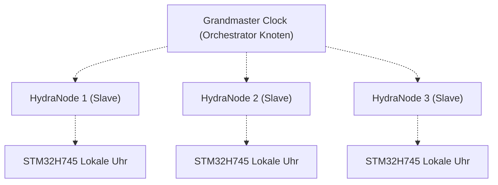

<!-- =============================================================================
HYDRA-UMC-SWARM-SYNC - CRDT state reconciliation for the swarm
Copyright (C) JuanenRac (Electro Hobby 3D) <electrohobby3d@gmail.com>
GPL-3.0-or-later - see LICENSE
============================================================================= -->

<p align="center">
  
</p>

# 🐝 HYDRA-UMC-SWARM-SYNC

<p align="center"><a href="README.md">🇺🇸 English</a> | <a href="README_spa.md">🇪🇸 Español</a> | <a href="README_fra.md">🇫🇷 Français</a> | <a href="README_ita.md">🇮🇹 Italiano</a> | 🇩🇪 <b>Deutsch</b> | <a href="README_zho.md">🇨🇳 简体中文</a> | <a href="README_jpn.md">🇯🇵 日本語</a> | <a href="README_por.md">🇵🇹 Português</a></p>

### 📡 CRDT-Zustandsabgleich & Multi-Knoten-Synchronisation

<p align="center">
  
  
  
  
  
</p>

---

> **Stand von Sicherheit (Safety) und Security:** Dieses Ökosystem ist kein zertifiziertes Sicherheitssystem. Es gibt noch keinen Hardware-E-STOP-Pfad, keine von der Firmware durchgesetzten Grenzen oder Verriegelungen und keinen verifizierten Bewegungsbefehl; Firmware-Images werden mit CRC-32 und einer Ed25519-Signatur geprüft, und ein Release-Build verweigert die veröffentlichten Entwicklungsschlüssel (die Werkzeugköpfe und Erweiterungsplatinen hinter dem Relais laufen noch mit URTC-Bootloadern, die statt einer Signatur ein HMAC-SHA256 mit gemeinsamem Schlüssel verwenden); TLS und gegenseitiges TLS sind optional und standardmäßig aus; noch keine eigene Platine wurde bestückt oder getestet. Lesen Sie die [Sicherheitsbasis](https://github.com/JuanenRac/HYDRA-UMC-DOCS/blob/main/docs/SECURITY_BASELINE.md) und das [Bedrohungsmodell](https://github.com/JuanenRac/HYDRA-UMC-DOCS/blob/main/docs/THREAT_MODEL.md), bevor Sie sich für die Sicherheit einer Person auf eine Aussage hier verlassen.

---

## 📋 Auf einen Blick

| | |
|---|---|
| Version | `0.1.5` |
| Reifegrad | Funktionsfähig |
| Tests | 105 (`cargo test`) |
| Technik | Rust / CRDT (LWW-Element-Map) / Lamport logical clock / JSON/HTTP |
| Ziel | Der Raspberry Pi CM5 einer HYDRA-UMC-Zelle |
| Auf echter Hardware | Noch nicht: für diese Version ist kein Lauf auf echter Hardware vermerkt |

**Springe zu:** [Überblick](#-überblick) · [Architektur](#-architektur) · [Sicherheit und Schutz](#-sicherheit-und-schutz) · [Konfiguration](#-konfiguration) · [Schnellstart](#-schnellstart) · [Tests](#-tests) · [Fehlerbehebung](#-fehlerbehebung) · [Struktur des Repositorys](#-struktur-des-repositorys) · [Verwandte Projekte](#-verwandte-projekte)

## 🚦 Projektstatus

Jede Zeile ist ein Teil dieses Repositorys, und die Ampel sagt, wie weit er heute ist. Sie beruht auf dem, was das Repository zeigen kann (Tests, Builds, Läufe), nicht auf dem, was geplant ist.

🟢 Fertig und überprüft · 🟡 Funktioniert, mit bekannten Grenzen · 🟠 Teilweise fertig oder noch nicht überprüft · 🔴 Nicht gemacht oder funktioniert nicht

| Bereich | Stand | Was das hier bedeutet |
|---|---|---|
| Software | 🟡 | Funktioniert für seinen Hauptzweck; die Ehrlichkeitsprüfung oben nennt, was noch fehlt |
| Tests | 🟢 | 105 automatische Tests, bei jeder Änderung ausgeführt |
| Echte Hardware | 🔴 | Noch nicht: für diese Version ist kein Lauf auf echter Hardware vermerkt |
| Dokumentation | 🟢 | README in acht Sprachen, bei jeder Änderung gegen das Manifest geprüft |

## 🎯 Überblick

**HYDRA-UMC-SWARM-SYNC** ist die Zustandsabgleich-Schicht der verteilten Fabrik: ein CRDT (eine Last-Writer-Wins-Map, geordnet durch eine logische Lamport-Uhr), mit dem jeder Controller seine Sicht auf den Schwarm ohne zentralen Schiedsrichter zusammenführen kann. Eine präzise synchronisierte globale Uhr (PTP / IEEE 1588) ist das langfristige Ziel und nicht umgesetzt: siehe Roadmap.

Die Trajektorien mehrerer Arme in derselben Mikrosekunde zu starten und zu beenden oder gemeinsam zu montieren, braucht diese Uhr und ist zukünftige Arbeit.

### Hauptmerkmale:
* ⏱️ **Logische Uhr, noch keine Hardware-PTP-Sync:** `src/lamport.rs` implementiert eine echte, getestete Lamport-Logikuhr - die Ordnungsprimitive, die der CRDT-Merge unten tatsächlich braucht. Sub-100-ns-Jitter und PTP-(IEEE-1588-)Hardware-Zeitstempelung sind das langfristige Ziel (siehe ARCHITEKTUR weiter unten), aber nichts, was dieses Crate heute misst oder implementiert - es gibt nirgendwo in diesem Repository NIC-/Hardware-Timer-Code, und `src/lamport.rs`'s eigener Header-Kommentar sagt das explizit.
* 🔄 **CRDT-Zustandsabstimmung (heute real):** Das LWW-Element-Map von `src/crdt.rs` mischt den Zustand mehrerer Zellen deterministisch - durch Property-Tests als kommutativ, assoziativ und idempotent bewiesen, kein synchronisierter Start/Stopp von Roboter-Trajektorienbefehlen (diese Orchestrierung liegt in HYDRA-UMC-ORCHESTRATOR/HYDRA-UMC-JOB-DISPATCHER, nicht hier).
* 📡 **Noch keine Hardware-Zeitstempelung:** die Nutzung echter CM5-/STM32-Hardware-Timer ist zukünftige Arbeit - dieses Crate ist reine Software (Rust-Binary), ganz ohne hardware-nahen Code.
* 🛡️ **Wiederverbindungsresistenter CRDT-Merge (heute real):** ein echter simulierter 4-Zellen-Test (`cargo test`) beweist, dass die Konvergenz über mehrere Runden von Partitionierung und teilweiser Wiederverbindung hinweg hält - das ist Widerstandsfähigkeit gegenüber einer offline gehenden und später wieder beitretenden Zelle, keine gemessene Widerstandsfähigkeit gegenüber echtem Netzwerk-Paket-Jitter/-Verzögerung, was dieses Crate nicht misst.
* 🔍 **Echte Konfliktsichtbarkeit & Konvergenzbeweis auf Schwarmebene (v0):** `merge_report()` liefert einen echten, pro Schlüssel aufgeschlüsselten Datensatz jedes echten Schreibkonflikts, der während der Abstimmung aufgelöst wurde - welche Zelle welche andere geschlagen hat, und mit welchem Zeitstempel. Ein simulierter 4-Zellen-Test beweist, dass die Konvergenz über mehrere Runden von Partitionierung und teilweiser Wiederverbindung hinweg hält, nicht nur bei einem einzigen Merge zwischen zwei Zellen.
* 💾 **Echte Persistenz pro Knoten (`--state-file`):** Der eigene CRDT-Zustand des `serve`-Modus übersteht jetzt einen echten Prozessneustart (`src/store.rs`) - jeder `POST /reconcile` wird in den Zustand dieses Knotens eingemischt und dauerhaft aktualisiert, statt bei jedem Aufruf bei null anzufangen - verifiziert gegen einen echten abgebrochenen und neu gestarteten Prozess, nicht nur In-Process-Tests. Ohne Angabe bleibt das ursprüngliche, rein speicherbasierte Verhalten erhalten. Siehe `docs/CLI_REFERENCE.md`.
* 🔁 **Austausch des vollen Zustands und ein Gossip-Client:** `GET /state?full=1` antwortet mit jedem Eintrag samt Zeit, Schreiber und Generation, gelöschte Schlüssel (Tombstones) eingeschlossen, und `POST /merge` nimmt sie entgegen, so dass ein Knoten von einem anderen auf den Stand gebracht werden kann, was auch immer beide inzwischen geschrieben und gelöscht haben; ein `Write` eines Szenarios kann nun `"deleted": true` tragen. Einträge werden geprüft, bevor sie die Map berühren (Größe, eine Zeit höchstens `--max-time-jump` voraus, eine Generation höchstens `--max-generation-jump` vor der des Schlüssels). Mit `--peer http://host:port` (für jeden Knoten wiederholen) fragt der Knoten seine Peers alle `--gossip-interval-ms` (mindestens 1000) nach ihrem Zustand und sendet mit `--gossip-push` auch seinen eigenen; die Peers teilen `SWARM_SYNC_SHARED_SECRET`, und `GET /stats` meldet jeden Peer. Die Generation wird vor der Zeit verglichen (eine Replik, die einen Schlüssel öfter gelöscht und neu angelegt hat, gewinnt gegen einen späteren einfachen Schreibvorgang), und ein gemeldeter Konflikt nennt nun beide Generationen. *(zwischen Knoten auf einem Rechner erprobt; nie über eine echte Partition)*
* 🔐 **Echte optionale Authentifizierung per gemeinsamem Geheimnis (`SWARM_SYNC_SHARED_SECRET`):** ohne Konfiguration behält dieses Projekt seine ursprüngliche LAN-Vertrauensposition bei - jeder Aufrufer kann `POST /reconcile` oder `GET /state` ausführen. Konfiguriert (nur per Umgebungsvariable, nie per CLI-Flag - ein gemeinsames Geheimnis gehört in die Umgebung/systemd-Unit, nicht in eine Prozessliste), verlangen beide Routen einen passenden `Authorization: Bearer <token>`, geprüft in konstanter Zeit. `GET /stats` bleibt in beiden Fällen offen.
* 🧱 **Weigert sich, ein offener Knoten im Netzwerk zu sein, und begrenzte Anfragekörper (v0):** `serve` auf einer anderen Adresse als Loopback braucht `SWARM_SYNC_SHARED_SECRET` (oder ein ausdrückliches `--allow-anonymous` fürs Labor), denn ein Knoten, der alles übernimmt, was ihm irgendein Rechner im Netzwerk schickt, lässt diesen Rechner die Selbstsicht des Schwarms umschreiben; Anfragekörper über 1 MiB werden mit `413` abgelehnt, bevor sie gelesen werden; und die Zustandsdatei wird auf den Datenträger erzwungen, bevor sie die vorherige ersetzt, sodass ein Stromausfall keinen abgeschnittenen oder leeren Zustand hinterlassen kann. *(implementiert)*
* 📜 **Konfliktverlauf:** `GET /conflicts` listet die Konflikte, die dieser Knoten gelöst hat (Schlüssel, gewinnender Schreiber, unterlegener Schreiber und Zeit), neueste zuerst, bis zu den letzten 200 oder `?limit=N`; `/stats` hielt nur den letzten fest. Es verlangt das gemeinsame Geheimnis, wenn eines gesetzt ist, wie `/state`.

## 🧩 Rolle in HYDRA-UMC

**HYDRA-UMC-SWARM-SYNC** führt die Sicht auf den Schwarm, die jede Zelle hat, zu einem Ergebnis zusammen, das nicht von der Reihenfolge der Zusammenführung abhängt: eine Last-Writer-Wins-Map mit einer logischen Lamport-Uhr. Er läuft mit einer Szenariodatei oder als kleiner HTTP-Knoten, der seinen Zustand auf der Platte hält und mit Nachbarn tratschen kann; er ist keine Hardware-Zeitquelle.

## 🏛️ Architektur

<p align="center">
  
</p>

<details>
<summary>Textversion des Diagramms (Mermaid)</summary>



</details>

### SYNCHRONISATIONSHIERARCHIE

> Gepunktete Pfeile sind geplant, nicht umgesetzt: Dieses Repository enthält keinen PTP-Code.

### ARCHITEKTUR & DESIGNENTSCHEIDUNGEN

* **Warum CRDT-basierte Synchronisation statt einer einzigen Quelle der Wahrheit.** Mehrere HYDRA-UMC-Zellen können halbautonom laufen und sich später wieder verbinden - eine CRDT-Merge-Strategie konvergiert ohne zentralen Schiedsrichter, der entscheidet, welcher Zustand 'gewinnt', was ein naiver Last-Write-Wins-Ansatz bei einer echten Netzwerkpartition nicht garantieren kann.
* **Warum es Geschwister, kein Submodul, von HYDRA-UMC-ORCHESTRATOR ist.** Zustandsabgleich ist ein fortlaufendes Hintergrundanliegen, unabhängig von jeder einzelnen Orchestrierungsentscheidung - es als separaten Prozess zu halten bedeutet, dass ein Neustart des Orchestrators einen laufenden Merge nicht unterbricht.
* **Warum der CRDT-Merge heute schon echt ist, die PTP-Hardware-Synchronisation aber nicht.** `src/crdt.rs` implementiert eine echte LWW-Element-Map (Last-Writer-Wins-Map), einen zustandsbasierten CRDT, dessen `merge` nachweislich kommutativ, assoziativ und idempotent ist - nicht nur "scheint an einem Beispiel zu konvergieren", siehe die eigenen Property-Tests dieses Moduls. `src/lamport.rs` untermauert das mit einer echten Lamport-Logikuhr. PTP (IEEE 1588, Hardware-Zeitstempelung mit Sub-100ns-Genauigkeit) ist ein grundlegend anderes, hardwareabhängiges Problem - es braucht echte NICs/Hardware-Timer, um überhaupt Sinn zu ergeben, und bleibt zurückgestellt, bis es echte Hardware gibt, gegen die man es validieren kann. Eine Logikuhr ist das, was der CRDT-Merge tatsächlich braucht, um Konflikte deterministisch aufzulösen, und dieser Teil ist heute echt und getestet.
* **Wie sich das ins restliche Ökosystem einfügt.** Ein Geschwisterdienst unter HYDRA-UMC-ORCHESTRATOR, neben HYDRA-UMC-PATH-PLANNER-3D, HYDRA-UMC-JOB-DISPATCHER und HYDRA-UMC-NODE-HEALING - hält die eigene Sicht jeder Zelle auf den Schwarmzustand konsistent, unabhängig davon, welche gerade die Orchestrator-Rolle innehat. (Noch ruft es nichts auf: Diese Integration ist geplant.)
* **Warum `merge_report()` eine neue Methode ist, statt zu ändern, was `merge()` zurückgibt.** `merge()` bleibt eine reine, günstige, offensichtlich korrekte Blackbox - diese Einfachheit macht sie leicht vertrauenswürdig. `merge_report()` legt darüber echte Konfliktsichtbarkeit für einen Aufrufer (einen Operator, ein Debugging-Tool), der speziell wissen will, was eine Abstimmung überschrieben hat, ohne jeden Aufrufer des heißen Pfads `merge()` zu zwingen, diese Buchführung zu bezahlen oder zu handhaben.
* **Warum Konfliktberichte die Zeitstempel-Reihenfolge zeigen, nicht kausales "happened-before".** Eine Lamport-Uhr garantiert, dass ein echtes kausales happens-before einen früheren Zeitstempel impliziert - aber die Umkehrung gilt nicht: Ein früherer Zeitstempel beweist NICHT, dass zwei Ereignisse kausal zusammenhingen statt nur nebenläufig zu sein. `MergeConflict` ist absichtlich ehrlich und meldet nur, was eine Lamport-Uhr tatsächlich beweisen kann (eine konsistente Gesamtordnung), keine Kausalitätsaussage, für die eine Vektoruhr nötig wäre.

**Typisierter Roboterzustand.** Was ein Knoten unter dem Schlüssel `robot_state/<robot_id>` repliziert, ist ein `RobotState` des SDK und keine freie Zeichenkette: Bevor der Wert die Karte berührt (`POST /reconcile` und `POST /merge`), muss er JSON sein, das mitgelieferte Schema bestehen (Draft 2020-12, Formate geprüft), die `robot_id` des Schlüssels tragen und ein Posen-Quaternion mit Einheitslänge haben; sonst ist die Anfrage ein `422`. Ein Löschen wird immer akzeptiert, und jeder andere Schlüssel bleibt untypisiert. Die Missionen sind noch nicht typisiert.

## 🔒 Sicherheit und Schutz

| Bedrohung | Abwehr | Wo |
|---|---|---|
| Ein Rechner im Netz schreibt die Sicht des Schwarms auf sich selbst um | `serve` weigert sich, auf einer Nicht-Loopback-Adresse ohne `SWARM_SYNC_SHARED_SECRET` zu lauschen (Exit-Code 2); `--allow-anonymous` ist eine ausdrückliche Laborentscheidung | `src/main.rs` |
| Ein Schreibvorgang mit einer Zeit nahe dem Maximum gewinnt für immer jeden Konflikt | Eine Anfrage darf eine Zeit höchstens `--max-time-jump` über die neueste gehaltene Zeit hinaus verschieben und eine Generation höchstens `--max-generation-jump` (Standard 1000) über die eigene des Schlüssels | `src/entries.rs` |
| Eine riesige oder langsame Anfrage legt den Knoten lahm | Ein Body über 1 MiB wird vor dem Lesen mit 413 abgelehnt, und vier Arbeitsthreads bedienen Anfragen, sodass ein langsamer Upload nur einen davon blockiert | `src/server.rs` |
| Ein Stromausfall hinterlässt eine abgeschnittene Zustandsdatei | Der Zustand wird in eine temporäre Datei geschrieben, auf die Platte gezwungen und über die echte umbenannt | `src/store.rs` |

## ⚙️ Konfiguration

| Variable | Standard | Was sie festlegt |
|---|---|---|
| `--addr` | `127.0.0.1` | Adresse des HTTP-Knotens |
| `--port` | `8112` | Port des HTTP-Knotens |
| `--state-file` / `SWARM_SYNC_STATE_FILE` | keiner | Datei, die den Zustand zwischen Läufen behält |
| `SWARM_SYNC_SHARED_SECRET` | keiner | gemeinsames Geheimnis, das ein Netzknoten von Aufrufern verlangt und an Nachbarn sendet |
| `--max-time-jump` | `1000000` | wie weit eine Anfrage über die neueste Zeit hinaus schreiben darf |
| `--max-generation-jump` | `1000` | wie weit ein Eintrag über der Generation des Schlüssels liegen darf |
| `--peer URL`, `--gossip-interval-ms`, `--gossip-push` | aus; mindestens 1000 ms zwischen Runden, Standard 10000 | Nachbarn, deren Zustand erfragt wird, die Pause zwischen Runden und ob zurückgeschickt wird |

## 🚀 Schnellstart

Benötigt die stabile Rust-Toolchain (Edition 2021) mit `cargo`.

```bash
./build.sh  # Linux, macOS (build.bat on Windows)
./run.sh scenarios/example.json
./run.sh serve --port 8112 --state-file data/state.json
```

## 🧪 Tests

105 automatische Tests laufen mit `cargo test`. Sie brauchen weder Hardware noch etwas außerhalb dieses Rechners.

Die CI führt `HYDRA_UMC_CI=1 python tools/ci_validate.py` aus; das prüft das Manifest, die Dokumente, die acht READMEs und die Bilder.

## 🏗️ Build und Veröffentlichung

Ein echter, getesteter CRDT-Merge - nicht nur ein kompilierbares
Skelett: er gleicht ein JSON-Szenario mit mehreren Zellen ab und gibt den
konvergierten Zustand aus.

```bash
# Windows
build.bat
run.bat scenarios/example.json

# Linux / macOS
./build.sh
./run.sh scenarios/example.json
```

`build.sh`/`build.bat` ändern die Version nie (nur `python tools/hydra_project_tool.py bump` erhöht sie) und führen anschließend
`cargo build --release` aus. `run.sh`/`run.bat` führen die resultierende
Binärdatei direkt aus und reichen jedes Argument (den Szenariopfad)
weiter.

Ein Szenario ist eine JSON-Datei mit einem `cells`-Array - jede Zelle hat
eine `id` (zur Lesbarkeit), eine `writer`-ID und eine Liste von `writes`
(`{key, value, time}`, wobei `time` ein expliziter Lamport-Zeitstempel
ist, wiedergegeben statt live erzeugt - dasselbe Muster "expliziter,
deterministischer Input", das der `seed` von HYDRA-UMC-PATH-PLANNER-3D
verwendet). Die Schreibvorgänge jeder Zelle werden in ihre eigene Map gefaltet, dann wird die Map jeder Zelle von links nach rechts mit `merge_report()` gemergt, sodass jeder echte Konflikt im Ergebnis erfasst wird. Dass der Merge in jeder Reihenfolge denselben Zustand ergibt, ist eine Eigenschaft des CRDT selbst, festgelegt durch die Property-Tests in `src/crdt.rs`, und wird nicht bei jedem Aufruf neu geprüft.

Beim Ausführen gegen `scenarios/example.json` (wo sowohl `cell-a` als
auch `cell-b` nach `cell-a-node-2` geschrieben haben) zeigt sich die
echte Konfliktauflösung, nicht nur das undurchsichtige Endergebnis:

```bash
./run.sh scenarios/example.json
```
```json
{
  "cells_merged": 2,
  "merged_state": { "...": "..." },
  "conflicts_resolved": 1,
  "conflicts": [
    { "key": "cell-a-node-2",
      "local_time": 2, "local_writer": 1, "local_value": "ok",
      "remote_time": 3, "remote_writer": 2, "remote_value": "unhealthy",
      "kept_remote": true }
  ],
  "next_local_time": 6
}
```

```bash
cargo test   # die Lamport-Uhr, und den CRDT selbst - einschließlich
             # direkter Prüfungen, dass merge kommutativ, assoziativ und
             # idempotent ist (nicht nur "sieht auf einem Beispiel richtig
             # aus"), eines deterministischen Tie-Break-Tests für wirklich
             # nebenläufige Schreibvorgänge, des eigenen
             # Konflikterkennungsverhaltens von merge_report(), und einer
             # 4-Zellen-Simulation, die Konvergenz über mehrere Runden von
             # Partitionierung und teilweiser Wiederverbindung beweist -
             # 105 Tests insgesamt
```

Derselbe Aufruf von `reconcile()` ist außerdem über eine echte JSON/HTTP-API
(`src/server.rs`, `tiny_http`, blockierend, ohne Async-Runtime) statt
über eine lokale Szenariodatei erreichbar - `run.sh serve [--addr ADDR] [--port PORT]`
startet sie (Standard `127.0.0.1:8112`) und stellt `POST /reconcile`
(Szenario im Request-Body, gleiche JSON-Form) sowie `GET /stats` bereit.
Genau das führt `systemd/hydra-umc-swarm-sync.service` unbeaufsichtigt
auf dem CM5 aus. Die vollständige Verwendung, die Exit-Codes und die
komplette Routenreferenz stehen in
[`docs/CLI_REFERENCE.md`](docs/CLI_REFERENCE.md).

## 🩺 Fehlerbehebung

| Du siehst | Weil | Tu |
|---|---|---|
| `[swarm-sync] fatal: ...` + exit code 2 | Der Port ist belegt, die Adresse ist nicht Loopback und es gibt kein Geheimnis, oder die Zustandsdatei existiert, ist aber nicht lesbar | Die Meldung nach `fatal:` lesen; `SWARM_SYNC_SHARED_SECRET` setzen, den Port ändern oder die Datei reparieren |
| HTTP 413 | Der Anfrage-Body ist größer als 1 MiB | Ein kleineres Szenario senden oder aufteilen |

## 📂 Struktur des Repositorys

<p align="center">
  
</p>

<details>
<summary>Textversion des Baums</summary>

```text
HYDRA-UMC-SWARM-SYNC/
├── src/                       Quellcode
│   ├── main.rs                CLI-Einstiegspunkt: lädt ein Szenario, gleicht ab, gibt JSON aus
│   ├── lamport.rs             LamportClock - die Logikuhr hinter der Ordnung des CRDT
│   ├── crdt.rs                LwwMap - der echte CRDT: set/get/merge/snapshot
│   ├── entries.rs             Stamped entries: GET /state?full=1, POST /merge and their checks
│   ├── gossip.rs              Anti-entropy client: asks the peers for their state
│   ├── reconcile.rs           Echter Abgleich, ausgelagert damit server.rs ihn auch nutzen kann
│   ├── server.rs              Einfache JSON/HTTP-Oberfläche (tiny_http) - POST /reconcile übers Netz
│   └── store.rs               Echte optionale Persistenz pro Knoten (--state-file): eine absturzsichere JSON-Zustandsdatei
├── scenarios/                 Beispielszenarien
├── tests/                     startup.rs: das Programm verweigert den Start bei unlesbarer Zustandsdatei, ungültigem maximalem Zeitsprung oder unbrauchbaren Gossip-Einstellungen
├── schemas/                   mitgelieferte JSON-Schemas der SDK-Verträge
├── docs/                      Dokumente des Projekts
├── images/                    Banner und Bilder der README
├── systemd/                   Dienst-Unit
├── tools/                     Projektwerkzeuge und CI-Prüfungen
├── .github/                   CI-Workflow und Issue-Vorlagen
├── Cargo.toml                 Rust-Paketmanifest (Name, Version, Abhängigkeiten)
├── bump_version.py            ausdrückliche Versionserhöhung
├── bump_manifest_version.py   Synchronisiert die Version von hydra-umc.project.json mit der nativen (--sync)
├── CHANGELOG.md               was sich in jeder Version geändert hat
├── build-test.sh              Build-Prüfung ohne Änderungen
├── build.sh                   baut und prüft; ändert nie die Version
├── hydra-umc.project.json     Manifest: Version, Reifegrad, Familie
├── run.sh                     startet das Programm
└── test.sh                    führt die Tests aus
```

</details>

## 🗺️ Roadmap und bekannte Grenzen

**Bekannte Grenzen heute**

* **Phase 1:** Deterministische Schwarm-Synchronisation über TSN und Sub-ms-Jitter-Reduzierung.
* **Phase 2:** 3D-Pfadplanung mit dynamischer Hindernisvermeidung in Multi-Roboter-Zellen.
* **Phase 3:** Multi-Roboter-Job-Dispatching-Optimierung unter Berücksichtigung der Ressourcenverfügbarkeit in Echtzeit.
* **Phase 4:** Unterstützung für drahtlose PTP-Synchronisation über Wi-Fi 6 (High-Reliability-Modus) und Validierung der Genauigkeit unter 100 ns.

## 🌍 Sprachen

Diese README und die Dokumente des Repositorys gibt es in acht Sprachen: Englisch, Spanisch, Deutsch, Französisch, Italienisch, Japanisch, Chinesisch und Portugiesisch (Portugal). Sie entstehen gemeinsam, und die CI prüft, dass die acht Dateien dieselben Abschnitte und dieselben Links haben. Dieses Repository hat weder eine eigene Oberfläche noch einen eigenen Meldungskatalog, es gibt also keine Oberflächentexte zu übersetzen.

## 🔗 Verwandte Projekte

Dieses Projekt ist Teil des HYDRA-UMC-Robotik-Ökosystems desselben Autors (JuanenRac / Electro Hobby 3D). Gut zu wissen, da eine Anfrage eigentlich eines dieser Projekte betreffen könnte statt dieses Repositorys.

**Übergeordnetes Projekt**
- **[HYDRA-UMC-ORCHESTRATOR](https://github.com/JuanenRac/HYDRA-UMC-ORCHESTRATOR)** — Integrationsknoten mit einem echten gRPC/Protobuf-Health-Report-Vertrag und einer Missions-Zustandsmaschine; das übergeordnete Projekt, dessen spezifischer Orchestrierungsdienst dieses Repository innerhalb seiner eigenen Schwarmkoordinationsschicht ist.

**Geschwisterprojekte** — die übrigen Orchestrierungsdienste der eigenen Schwarmkoordinationsschicht von HYDRA-UMC-ORCHESTRATOR
- **[HYDRA-UMC-PATH-PLANNER-3D](https://github.com/JuanenRac/HYDRA-UMC-PATH-PLANNER-3D)** — echter RRT-basierter 3D-Pfadplaner mit echter Hindernis-/Arbeitsraum-Kollisionsvalidierung.
- **[HYDRA-UMC-JOB-DISPATCHER](https://github.com/JuanenRac/HYDRA-UMC-JOB-DISPATCHER)** — echte prioritätsbasierte Job-Queue mit Deduplizierung, über eine echte HTTP-API.
- **[HYDRA-UMC-NODE-HEALING](https://github.com/JuanenRac/HYDRA-UMC-NODE-HEALING)** — echter gRPC-basierter Flotten-Health-Watchdog mit Retry/Backoff und Identitäts-Mismatch-Erkennung.

**Ebenfalls Teil des Ökosystems**

*Kern-Hardware & Plattform*
- **[HYDRA-UMC](https://github.com/JuanenRac/HYDRA-UMC)** — der Entwurf des Motherboards des Roboterarms: CM5-Host + Dual-Core-STM32H745, gedacht zur Koordination von bis zu 8 Werkzeugarmen über CAN-OTA/SPI-OTA (Firmware in einer frühen Phase; noch keine bestückte Platine).
- **[HYDRA-UMC-OS](https://github.com/JuanenRac/HYDRA-UMC-OS)** — reproduzierbare Raspberry-Pi-OS-Produktschicht für den CM5: schreibgeschützter Agent, validierte Konfiguration/Profile, WiFi-Ersteinrichtung.
- **[HYDRA-UMC-SDK](https://github.com/JuanenRac/HYDRA-UMC-SDK)** — der gemeinsame JSON-Schema-Vertrag und die Software-Auftragsschranke, gegen die jede Bridge ihre Befehle validiert (keine zertifizierte Sicherheitsfunktion).
- **[HYDRA-UMC-CONNECTOR-HUB](https://github.com/JuanenRac/HYDRA-UMC-CONNECTOR-HUB)** — deklaratives Adapter-Manifest-Register und Validator für Konnektoren externer Maschinen; erweitert die eigene Vertragsidee des SDK auf externe Maschinen, ohne die Industrie-Gateway-Projekte zu ersetzen.

*Kern-Backend & Clients*
- **[HYDRA-UMC-SERVER](https://github.com/JuanenRac/HYDRA-UMC-SERVER)** — das reale Headless-Backend (REST/WebSocket), mit dem jeder Steuerungsclient tatsächlich spricht.
- **[HYDRA-UMC-STUDIO](https://github.com/JuanenRac/HYDRA-UMC-STUDIO)** — Web-Steuerungs-Dashboard mit Echtzeit-3D-Visualisierung mehrerer Roboter.
- **[HYDRA-UMC-SUITE](https://github.com/JuanenRac/HYDRA-UMC-SUITE)** — Desktop-Schwarmleitstand (PySide6) für mehrere Server gleichzeitig, verpackt als eigenständige ausführbare Datei.
- **[HYDRA-UMC-ANDROID-CONTROL](https://github.com/JuanenRac/HYDRA-UMC-ANDROID-CONTROL)** — native Android-Steuerungs-App mit biometrischem Login und einer gekoppelten Wear-OS-Begleit-App.
- **[HYDRA-UMC-IOS-CONTROL](https://github.com/JuanenRac/HYDRA-UMC-IOS-CONTROL)** — iOS/iPadOS-Steuerungs-App (Flutter) mit Echtzeit-WebSocket-Synchronisierung.
- **[HYDRA-UMC-DSI](https://github.com/JuanenRac/HYDRA-UMC-DSI)** — native Touch-UI für das eingebaute 7"-DSI-Touchscreen, direkt auf dem CM5 eingebettet.
- **[HYDRA-UMC-EDITOR-URDF](https://github.com/JuanenRac/HYDRA-UMC-EDITOR-URDF)** — grafischer Desktop-URDF-Ersteller/-Editor, der fertige Modelle in STUDIOs eigenen Katalog überträgt.
- **[HYDRA-UMC-EDITOR-STL](https://github.com/JuanenRac/HYDRA-UMC-EDITOR-STL)** — Desktop-STL-Modelleditor, der echte Teile im selben Modellkatalog transformiert/ersetzt/entfernt/hinzufügt, den auch HYDRA-UMC-EDITOR-URDF bearbeitet.
- **[HYDRA-UMC-BRIDGE-AMR](https://github.com/JuanenRac/HYDRA-UMC-BRIDGE-AMR)** — Koordinationsschranke für AGV-/AMR-Flotten über einen VDA-5050-MQTT-Publisher (nur gegen eine emulierte Flotte getestet).
- **[HYDRA-UMC-BRIDGE-CNC](https://github.com/JuanenRac/HYDRA-UMC-BRIDGE-CNC)** — High-Level-Koordinator für CNC-Zellen mit GRBL-Status-/Steuerbyte-Zugriff (nur gegen einen Emulator getestet).
- **[HYDRA-UMC-BRIDGE-DROIDS](https://github.com/JuanenRac/HYDRA-UMC-BRIDGE-DROIDS)** — Koordinationsschranke für laufende/humanoide Droiden, mit einem Boston-Dynamics-Spot-Befehlssender (nur gegen einen Emulator getestet).
- **[HYDRA-UMC-BRIDGE-LASER](https://github.com/JuanenRac/HYDRA-UMC-BRIDGE-LASER)** — Koordinator für Laserzellen, liest 3 Schlüssel-/Gehäuse-/Verriegelungs-GPIO-Signale (nur gegen einen simulierten Chip getestet; kann keinen Laser scharfschalten oder auslösen).
- **[HYDRA-UMC-BRIDGE-OPENPNP](https://github.com/JuanenRac/HYDRA-UMC-BRIDGE-OPENPNP)** — sicherer High-Level-Koordinator für den Leiterplattenfluss von OpenPnP Pick-and-Place.
- **[HYDRA-UMC-BRIDGE-PRINTER3D](https://github.com/JuanenRac/HYDRA-UMC-BRIDGE-PRINTER3D)** — sichere Koordinationsschranke für Moonraker/Klipper-3D-Drucker, mit echten gesicherten Job-Befehlen.
- **[HYDRA-UMC-BRIDGE-ROS2](https://github.com/JuanenRac/HYDRA-UMC-BRIDGE-ROS2)** — Koordinator mit einem träge importierten rclpy-ROS-2-Transport (noch nicht gegen eine ROS-2-Installation ausgeführt).
- **[HYDRA-UMC-BRIDGE-UAV](https://github.com/JuanenRac/HYDRA-UMC-BRIDGE-UAV)** — Koordinationsschranke für kameraausgestattete UAVs, mit einem MAVLink-Befehlssender (nur gegen einen Emulator getestet).

*URTC-Werkzeugplattform*
- **[URTC](https://github.com/JuanenRac/URTC)** — Firmware für die physische Universal-Robot-Tool-Controller-Platine, 25+ Werkzeugprofile über CAN-Bus.
- **[URTC-FLASHER](https://github.com/JuanenRac/URTC-FLASHER)** — Desktop-GUI-Flash-Tool für URTC-Platinen, CAN-OTA plus Full-Chip-SWD/JTAG.
- **[URTC-TESTER](https://github.com/JuanenRac/URTC-TESTER)** — Desktop-Live-CAN-Bus-Diagnosetool für URTC-Platinen, ein Panel pro Werkzeugprofil.
- **[URTC-WEB-STUDIO](https://github.com/JuanenRac/URTC-WEB-STUDIO)** — browserbasierte Alternative zu URTC-TESTER über die Web-Serial-API, ohne lokale Installation.
- **[URTC-GATEWAY](https://github.com/JuanenRac/URTC-GATEWAY)** — Gateway vor dem CAN-Bus von URTC: Liste erlaubter Kennungen, Ratenbegrenzung und Sitzungsschlüssel; Software auf dem Computer getestet, noch nicht an einem echten Bus.

*Vision-KI-Knoten (Hailo-8)*
- **[HYDRA-UMC-VISION-NODE](https://github.com/JuanenRac/HYDRA-UMC-VISION-NODE)** — Integrationsknoten für die Hailo-8-Vision-Pipeline, mit einer echten stufenweisen Hardware-Bereitschaftsprüfung.
- **[HYDRA-UMC-DETECTION-HEF](https://github.com/JuanenRac/HYDRA-UMC-DETECTION-HEF)** — echte Registry für kompilierte Modelle mit Hailo-Architektur-/Prüfsummen-Safe-Load-Verifizierung.
- **[HYDRA-UMC-VISION-STREAMER](https://github.com/JuanenRac/HYDRA-UMC-VISION-STREAMER)** — echter GStreamer-Pipeline- + MediaMTX-Konfigurationsgenerator mit einer echten HailoRT-Integrationsschranke.
- **[HYDRA-UMC-VISUAL-SERVOING-API](https://github.com/JuanenRac/HYDRA-UMC-VISUAL-SERVOING-API)** — Position-Based-Visual-Servoing-Korrekturgesetz mit Freigabe abhängig vom Zonenstatus; noch keine Posenschätzung per Kamera.
- **[HYDRA-UMC-SAFETY-ZONES](https://github.com/JuanenRac/HYDRA-UMC-SAFETY-ZONES)** — v0-Logik für Zonenverletzung, Kalibrierungsaktualität und E-STOP-Anforderung, die Objektpositionen aus einer Datei nimmt; kein Detektor speist sie, und noch kein physischer E-STOP ist angeschlossen.

*Kognitiver KI-Knoten (Hailo-10)*
- **[HYDRA-UMC-COGNITIVE-NODE](https://github.com/JuanenRac/HYDRA-UMC-COGNITIVE-NODE)** — Integrationsknoten für die Hailo-10-Cognitive-Pipeline (LLM-/VLA-/Sprach-Orchestrierung).
- **[HYDRA-UMC-VLA-ENGINE](https://github.com/JuanenRac/HYDRA-UMC-VLA-ENGINE)** — echte Aktions-Token-Kodierung/-Dekodierung und Trajektoriengenerierung für ein Vision-Language-Action-Modell.
- **[HYDRA-UMC-VOICE-UI](https://github.com/JuanenRac/HYDRA-UMC-VOICE-UI)** — echtes Sprach-Frontend (VAD + Intent-Parser) mit einem begrenzten, bestätigungsgesicherten Watch-Relay.
- **[HYDRA-UMC-SEMANTIC-PLANNER](https://github.com/JuanenRac/HYDRA-UMC-SEMANTIC-PLANNER)** — echte regelbasierte Aufgabenzerlegung und semantische Fehlerbehebung über MCU-Fehlercodes.
- **[HYDRA-UMC-DOCS-QA](https://github.com/JuanenRac/HYDRA-UMC-DOCS-QA)** — echte, nur auf der Standardbibliothek basierende TF-IDF-Dokumentensuche über die eigenen Markdown-Dokumente dieses Ökosystems.
- **[HYDRA-UMC-LOCAL-TECHNICIAN](https://github.com/JuanenRac/HYDRA-UMC-LOCAL-TECHNICIAN)** — lokaler, richtlinien-gesteuerter KI-Wartungstechniker für das Ökosystem selbst - beobachtet, diagnostiziert und schlägt Korrekturen vor; die zwei höchsten Risikostufen sind absichtlich noch nicht implementiert.

*Digitaler Zwilling & Simulation*
- **[HYDRA-UMC-TWIN](https://github.com/JuanenRac/HYDRA-UMC-TWIN)** — Integrationsknoten für die Digital-Twin-Engine, mit einem echten Versionskompatibilitäts-Sync-Vertrag.
- **[HYDRA-UMC-HIL-BRIDGE](https://github.com/JuanenRac/HYDRA-UMC-HIL-BRIDGE)** — Hardware-in-the-Loop-Router mit einer Software-Kollisionsverriegelung zwischen Simulation und echter Hardware (ohne echte Hardware getestet).
- **[HYDRA-UMC-PHYSICS-REPLICA](https://github.com/JuanenRac/HYDRA-UMC-PHYSICS-REPLICA)** — echte Vorwärtskinematik und Gelenkgrenzenvalidierung über eine echte URDF-Teilmenge.
- **[HYDRA-UMC-SYNTHETIC-DATA-GEN](https://github.com/JuanenRac/HYDRA-UMC-SYNTHETIC-DATA-GEN)** — echter prozeduraler 2D-Szenengenerator mit YOLO/COCO-Annotationsexport.

*Daten & Analytik*
- **[HYDRA-UMC-DATALAKE](https://github.com/JuanenRac/HYDRA-UMC-DATALAKE)** — echter sqlite3-gestützter Zeitreihenspeicher mit einer echten Ingest-/Abfrage-HTTP-API.
- **[HYDRA-UMC-ANOMALY-DETECTOR](https://github.com/JuanenRac/HYDRA-UMC-ANOMALY-DETECTOR)** — echter FFT- + statistischer Basislinien-Anomaliedetektor mit Drift-Überwachung.
- **[HYDRA-UMC-PRODUCTION-REPORTS](https://github.com/JuanenRac/HYDRA-UMC-PRODUCTION-REPORTS)** — echte OEE-/Verfügbarkeitsberechnung über den DATALAKE-Verlauf, mit reproduzierbarem CSV-Export.
- **[HYDRA-UMC-TELEMETRY-COLLECTOR](https://github.com/JuanenRac/HYDRA-UMC-TELEMETRY-COLLECTOR)** — echte CAN/WebSocket-Ingestion-Pipeline in DATALAKE, mit Sequenz-Deduplizierung.

*Industrie-Gateway*
- **[HYDRA-UMC-GATEWAY-INDUSTRIAL](https://github.com/JuanenRac/HYDRA-UMC-GATEWAY-INDUSTRIAL)** — Integrationsknoten, der zu Industrieprotokollen weiterleitet, mit einer echten Befehls-Allowlist-/Backpressure-Schicht.
- **[HYDRA-UMC-OPCUA-SERVER](https://github.com/JuanenRac/HYDRA-UMC-OPCUA-SERVER)** — echter OPC-UA-Adressraum, verifiziert mit einer echten Binärprotokoll-Client-Session.
- **[HYDRA-UMC-MQTT-BROKER](https://github.com/JuanenRac/HYDRA-UMC-MQTT-BROKER)** — echter MQTT-Broker mit optionaler Pro-Client-Authentifizierung und Topic-ACLs.
- **[HYDRA-UMC-MTCONNECT-ADAPTER](https://github.com/JuanenRac/HYDRA-UMC-MTCONNECT-ADAPTER)** — echte MTConnect-`/probe`- und `/current`-XML-Endpunkte mit Degraded-Mode-Ausgabe.

*Ergänzende Tools & Ökosystembetrieb*
- **[HYDRA-UMC-DASHBOARD-AI](https://github.com/JuanenRac/HYDRA-UMC-DASHBOARD-AI)** — Smart-Summaries- und Anomaly-Highlighting-Panels über DATALAKE/ANOMALY-DETECTOR, mit einem ehrlichen statistischen Fallback.
- **[HYDRA-UMC-TOOL-CLI](https://github.com/JuanenRac/HYDRA-UMC-TOOL-CLI)** — Flotten-CLI mit einem echten, stabilen Exit-Code-Vertrag, ein echter Live-Client der eigenen API von HYDRA-UMC-SERVER.
- **[HYDRA-UMC-WATCH](https://github.com/JuanenRac/HYDRA-UMC-WATCH)** — WearOS-Begleit-App mit haptischen Alarmmustern und einem Sprach-Relay zum gekoppelten Telefon (noch nicht auf einer physischen Uhr ausgeführt).
- **[URTC-SMART-RACK](https://github.com/JuanenRac/URTC-SMART-RACK)** — Firmware für ein Platinenmontagegestell mit echter Werkzeug-ID-Dekodierung und Smart-Idle-Vorheizlogik.
- **[URTC-VISION-TOOL](https://github.com/JuanenRac/URTC-VISION-TOOL)** — Firmware plus ein echter Python-Vision-Begleiter für einen Thermal-/RGB-Inspektionswerkzeugkopf.
- **[HYDRA-UMC-UPDATER](https://github.com/JuanenRac/HYDRA-UMC-UPDATER)** — administratives Desktop-Tool, das jedes Repository in diesem Ökosystem entdeckt, klont und aktualisiert.
- **[HYDRA-UMC-OS-REBUILDER](https://github.com/JuanenRac/HYDRA-UMC-OS-REBUILDER)** — Windows/Linux-Desktop-Tool, das ein flashbereites CM5-Image baut, vorgeladen mit den aktuellsten Versionen des Ökosystems, mit Ersteinrichtungs-Konfiguration für WLAN/Benutzer/SSH im Stil von Raspberry Pi Imager.
- **[HYDRA-UMC-OPS-AGENT](https://github.com/JuanenRac/HYDRA-UMC-OPS-AGENT)** — Wartungsvorfall-Koordinator: eine Edge-Rolle mit niedrigem Privileg sammelt einen bereinigten Inventar-/Gesundheits-Snapshot, eine Control-Plane-Rolle rendert ihn schreibgeschützt und bittet einen KI-Anbieter um einen Diagnosevorschlag - wendet nie einen Patch an und stellt nie etwas bereit.
- **[HYDRA-UMC-DEV-SERVER](https://github.com/JuanenRac/HYDRA-UMC-DEV-SERVER)** — reproduzierbarer Entwicklungshost (Raspberry Pi 5 / CM5), der den Quellcode des Ökosystems vorhält und begrenzte Build-/Test-Aufgaben über eine dauerhafte Warteschlange ausführt; eine dedizierte Entwicklerrolle, ausdrücklich kein operativer CM5.

## 📚 Dokumentation

Hier steht mehr:

* [Sicherheitsgrundlage des Ökosystems](https://github.com/JuanenRac/HYDRA-UMC-DOCS/blob/main/docs/SECURITY_BASELINE.md)
* [Bedrohungsmodell des Ökosystems](https://github.com/JuanenRac/HYDRA-UMC-DOCS/blob/main/docs/THREAT_MODEL.md)
* [Änderungsprotokoll dieses Repositorys](CHANGELOG.md)
* [Lizenz dieses Repositorys](LICENSE.md)

## 🤝 Mitwirken und Community

* Führe vor einem Pull Request `HYDRA_UMC_CI=1 py -3 tools/ci_validate.py` (oder `HYDRA_UMC_CI=1 python3 tools/ci_validate.py`) aus: Es muss `CI_VALIDATION=PASS` ausgeben. Führe dafür nicht `build.sh` oder `build.bat` aus; Bauen ist keine Prüfung.
* Die acht READMEs entstehen aus einer einzigen Quelle in HYDRA-UMC-DOCS; bearbeite sie nicht von Hand. Ändere die Quelle und schreibe sie mit `tools/make_readmes.py` neu.
* Behaupte in einer README nichts, was nicht gelaufen ist: Schreibe „simuliert“ oder „nicht auf Hardware erprobt“, wo das stimmt.
* Siehe [CONTRIBUTING.md](CONTRIBUTING.md), den [Verhaltenskodex](CODE_OF_CONDUCT.md), [SECURITY.md](SECURITY.md) und [SUPPORT.md](SUPPORT.md).

## 👤 AUTOR

**JuanenRac (Electro Hobby 3D)** · electrohobby3d@gmail.com

## 📜 LIZENZ

GPL-3.0-or-later - [LICENSE](LICENSE).
