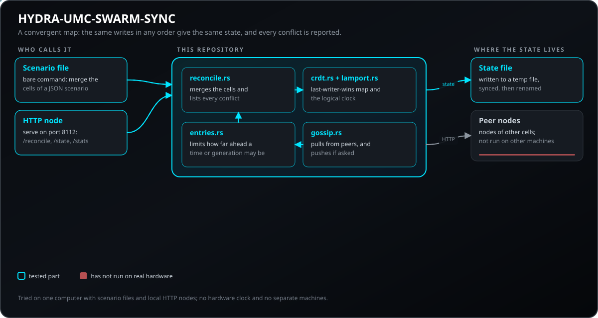
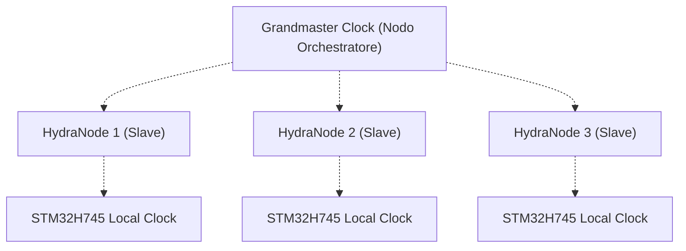
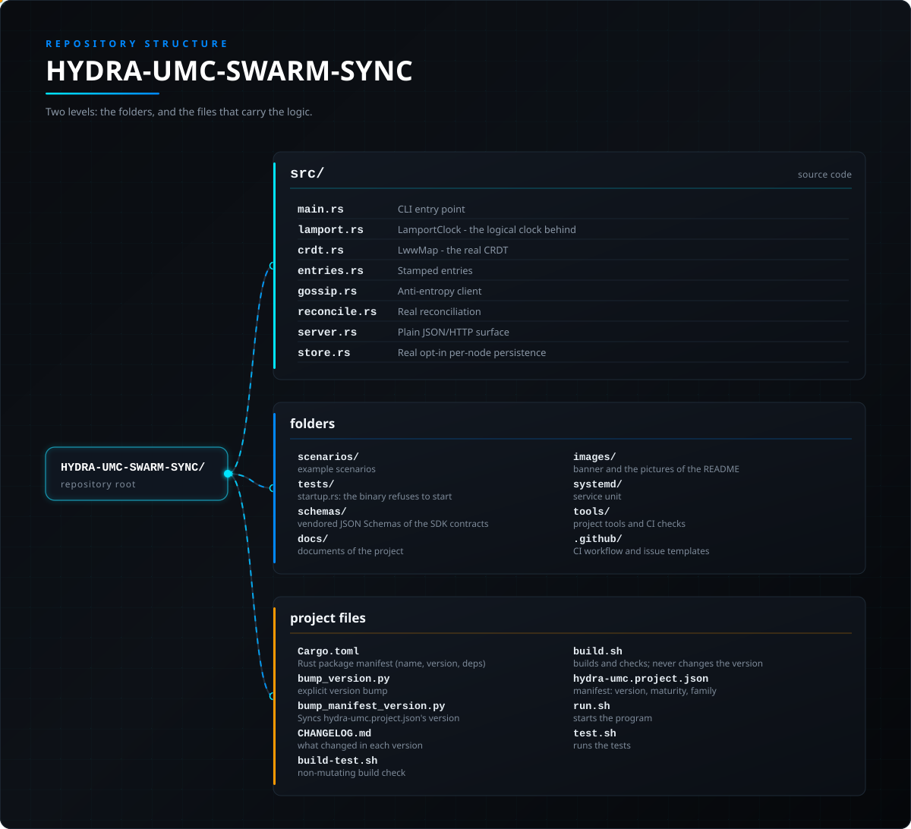

<!-- =============================================================================
HYDRA-UMC-SWARM-SYNC - CRDT state reconciliation for the swarm
Copyright (C) JuanenRac (Electro Hobby 3D) <electrohobby3d@gmail.com>
GPL-3.0-or-later - see LICENSE
============================================================================= -->

<p align="center">
  
</p>

# 🐝 HYDRA-UMC-SWARM-SYNC

<p align="center"><a href="README.md">🇺🇸 English</a> | <a href="README_spa.md">🇪🇸 Español</a> | <a href="README_fra.md">🇫🇷 Français</a> | 🇮🇹 <b>Italiano</b> | <a href="README_deu.md">🇩🇪 Deutsch</a> | <a href="README_zho.md">🇨🇳 简体中文</a> | <a href="README_jpn.md">🇯🇵 日本語</a> | <a href="README_por.md">🇵🇹 Português</a></p>

### 📡 Riconciliazione dello stato con CRDT e sincronizzazione multi-nodo

<p align="center">
  
  
  
  
  
</p>

---

> **Stato di sicurezza (safety e security):** questo ecosistema non è un sistema di sicurezza certificato. Non esiste ancora un percorso E-STOP hardware, né limiti o interblocchi imposti dal firmware, né un comando di movimento verificato; le immagini firmware sono controllate con CRC-32 e una firma Ed25519, e una compilazione di rilascio rifiuta le chiavi di sviluppo pubblicate (le teste utensile e le schede di espansione dietro il relè usano ancora i bootloader di URTC, che accettano un HMAC-SHA256 a chiave condivisa invece di una firma); TLS e TLS reciproco sono opzionali e disattivati per impostazione predefinita; nessuna scheda propria è stata ancora assemblata o provata. Leggi la [base di sicurezza](https://github.com/JuanenRac/HYDRA-UMC-DOCS/blob/main/docs/SECURITY_BASELINE.md) e il [modello delle minacce](https://github.com/JuanenRac/HYDRA-UMC-DOCS/blob/main/docs/THREAT_MODEL.md) prima di fidarti di qualsiasi affermazione qui per la sicurezza di una persona.

---

## 📋 In breve

| | |
|---|---|
| Versione | `0.1.5` |
| Maturità | Funzionale |
| Test | 105 (`cargo test`) |
| Tecnologia | Rust / CRDT (LWW-Element-Map) / Lamport logical clock / JSON/HTTP |
| Destinazione | Il Raspberry Pi CM5 di una cella HYDRA-UMC |
| Su hardware reale | Non ancora: per questa versione non risulta alcuna esecuzione su hardware reale |

**Vai a:** [Panoramica](#-panoramica) · [Architettura](#-architettura) · [Sicurezza e protezione](#-sicurezza-e-protezione) · [Configurazione](#-configurazione) · [Avvio rapido](#-avvio-rapido) · [Test](#-test) · [Risoluzione dei problemi](#-risoluzione-dei-problemi) · [Struttura del repository](#-struttura-del-repository) · [Progetti correlati](#-progetti-correlati)

## 🚦 Stato del progetto

Ogni riga è una parte di questo repository e il semaforo dice a che punto è oggi. È scritta in base a ciò che il repository può mostrare (test, compilazioni, esecuzioni), non a ciò che è previsto.

🟢 Fatto e verificato · 🟡 Funziona, con limiti noti · 🟠 Fatto a metà o non ancora verificato · 🔴 Non fatto o non funzionante

| Area | Stato | Cosa significa qui |
|---|---|---|
| Software | 🟡 | Funziona per il suo scopo principale; la verifica di onestà qui sopra elenca ciò che manca ancora |
| Test | 🟢 | 105 test automatici, eseguiti a ogni modifica |
| Hardware reale | 🔴 | Non ancora: per questa versione non risulta alcuna esecuzione su hardware reale |
| Documentazione | 🟢 | README in otto lingue, verificato rispetto al manifesto a ogni modifica |

## 🎯 Panoramica

**HYDRA-UMC-SWARM-SYNC** è il livello di riconciliazione dello stato della fabbrica distribuita: un CRDT (una mappa dove vince l'ultima scrittura, ordinata da un orologio logico di Lamport) che permette a ogni controller di fondere la propria vista dello sciame senza un arbitro centrale. Un orologio globale sincronizzato con precisione (PTP / IEEE 1588) è l'obiettivo a lungo termine e non è implementato: vedi la roadmap.

Avviare e terminare le traiettorie di più bracci nello stesso microsecondo, o eseguire un assemblaggio congiunto, richiede quell'orologio ed è lavoro futuro.

### Caratteristiche principali:
* ⏱️ **Orologio logico, non ancora sincronizzazione PTP hardware:** `src/lamport.rs` implementa un vero orologio logico di Lamport, testato - la primitiva di ordinamento di cui il merge del CRDT sotto ha davvero bisogno. Il jitter sub-100 ns e il timestamping hardware PTP (IEEE 1588) sono l'obiettivo finale (vedi ARCHITETTURA più sotto), non qualcosa che questo crate misura o implementa oggi - non c'è alcun codice NIC/timer hardware da nessuna parte in questo repository, e il commento di intestazione di `src/lamport.rs` lo dichiara esplicitamente.
* 🔄 **Riconciliazione dello stato CRDT (reale oggi):** l'LWW-Element-Map di `src/crdt.rs` unisce lo stato di più celle in modo deterministico - dimostrato commutativo, associativo e idempotente da property test, non un avvio/arresto sincronizzato di comandi di traiettoria robot (quell'orchestrazione vive in HYDRA-UMC-ORCHESTRATOR/HYDRA-UMC-JOB-DISPATCHER, non qui).
* 📡 **Ancora nessun timestamp hardware:** sfruttare veri timer hardware CM5/STM32 è lavoro futuro - questo crate è puro software (un binario Rust), senza alcun codice che tocchi l'hardware.
* 🛡️ **Merge CRDT resiliente alla riconnessione (reale oggi):** un vero test di simulazione a 4 celle (`cargo test`) dimostra che la convergenza regge attraverso più round di partizione e riconnessione parziale - questa è resilienza a una cella che va offline e si ricollega più tardi, non una resilienza misurata al jitter/ritardo reale dei pacchetti di rete, che questo crate non strumenta.
* 🔍 **Visibilità Reale dei Conflitti e Prova di Convergenza su Scala Sciame (v0):** `merge_report()` restituisce un registro reale, per chiave, di ogni conflitto di scrittura genuino risolto durante la riconciliazione - quale cella ha battuto quale altra, e con quale timestamp. Un test simulato a 4 celle dimostra che la convergenza regge attraverso più cicli di partizione e riconnessione parziale, non solo un singolo merge tra due celle.
* 💾 **Persistenza Reale per Nodo (`--state-file`):** Lo stato CRDT proprio della modalità `serve` ora sopravvive a un vero riavvio del processo (`src/store.rs`) - ogni `POST /reconcile` si fonde nello stato di questo nodo e lo aggiorna in modo duraturo invece di ripartire da zero a ogni chiamata - verificato contro un vero processo terminato e rilanciato, non solo test interni. Se non configurato, resta il comportamento originale solo in memoria. Vedi `docs/CLI_REFERENCE.md`.
* 🔁 **Scambio dello stato completo e client di gossip:** `GET /state?full=1` risponde con ogni voce, il suo tempo, scrittore e generazione, chiavi cancellate (tombstone) incluse, e `POST /merge` le accetta, così un nodo può essere aggiornato da un altro qualunque cosa ciascuno abbia scritto e cancellato nel frattempo; una `Write` di uno scenario può ora portare `"deleted": true`. Le voci sono controllate prima di toccare la mappa (dimensione, un tempo al massimo `--max-time-jump` avanti, una generazione al massimo `--max-generation-jump` avanti rispetto a quella della chiave). Con `--peer http://host:port` (ripetuto per ogni nodo) il nodo chiede ai pari il loro stato ogni `--gossip-interval-ms` (almeno 1000) e, con `--gossip-push`, invia il proprio; i pari condividono `SWARM_SYNC_SHARED_SECRET` e `GET /stats` riporta ciascuno. La generazione è confrontata prima del tempo (una replica che ha cancellato e ricreato una chiave più volte vince su una scrittura semplice successiva), e un conflitto riportato ora indica entrambe le generazioni. *(provato tra nodi sulla stessa macchina; mai attraverso una vera partizione)*
* 🔐 **Autenticazione con Segreto Condiviso Reale Opzionale (`SWARM_SYNC_SHARED_SECRET`):** non configurata, questo progetto mantiene la sua postura originale di fiducia LAN - qualsiasi chiamante può fare `POST /reconcile` o `GET /state`. Configurata (solo variabile d'ambiente, mai un flag CLI - un segreto condiviso appartiene all'ambiente/unità systemd, non a un elenco di processi), entrambe le rotte richiedono un `Authorization: Bearer <token>` corrispondente, verificato in tempo costante. `GET /stats` resta aperta in entrambi i casi.
* 🧱 **Rifiuta di essere un nodo aperto sulla rete, e corpi delimitati (v0):** `serve` su un indirizzo diverso da loopback richiede `SWARM_SYNC_SHARED_SECRET` (o un `--allow-anonymous` esplicito per il laboratorio), perché un nodo che unisce tutto ciò che gli invia qualsiasi macchina della rete permette a quella macchina di riscrivere la visione che lo sciame ha di sé; i corpi di richiesta oltre 1 MiB vengono rifiutati con `413` prima di essere letti; e il file di stato viene forzato su disco prima di sostituire il precedente, così un'interruzione di corrente non può lasciare uno stato troncato o vuoto. *(implementato)*
* 📜 **Storico dei conflitti:** `GET /conflicts` elenca i conflitti che questo nodo ha risolto (chiave, scrittore vincente, scrittore perdente e ora), dal più recente, fino agli ultimi 200 o `?limit=N`; `/stats` conservava solo l'ultimo. Richiede il segreto condiviso quando c'è, come `/state`.

## 🧩 Ruolo in HYDRA-UMC

**HYDRA-UMC-SWARM-SYNC** fonde le viste dello sciame che ogni cella possiede in un risultato che non dipende dall'ordine della fusione: una mappa «l'ultimo scrittore vince» con un orologio logico di Lamport. Funziona con un file di scenario o come un piccolo nodo HTTP che conserva lo stato su disco e può dialogare con i pari; non è una sorgente oraria hardware.

## 🏛️ Architettura

<p align="center">
  
</p>

<details>
<summary>Versione testuale del diagramma (Mermaid)</summary>



</details>

### GERARCHIA DI SINCRONIZZAZIONE

> Le frecce tratteggiate sono pianificate, non implementate: questo repository non contiene codice PTP.

### ARCHITETTURA E DECISIONI DI PROGETTAZIONE

* **Perché sincronizzazione basata su CRDT, non un'unica fonte di verità.** Più celle HYDRA-UMC possono operare in modo semi-autonomo e riconnettersi più tardi - una strategia di fusione CRDT converge senza un arbitro centrale che decida quale stato 'vince', cosa che un approccio ingenuo dell'ultima scrittura vincente non può garantire di fronte a una vera partizione di rete.
* **Perché è sorella, non un sottomodulo, di HYDRA-UMC-ORCHESTRATOR.** La riconciliazione dello stato è una preoccupazione continua di sfondo, indipendente da qualsiasi decisione di orchestrazione puntuale - tenerla come processo separato significa che un riavvio dell'orchestratore non interrompe una fusione in corso.
* **Perché la fusione CRDT è già reale oggi ma la sincronizzazione hardware PTP no.** `src/crdt.rs` implementa un vero LWW-Element-Map (mappa a ultima scrittura vincente), un CRDT basato su stato il cui `merge` è dimostrabilmente commutativo, associativo e idempotente - non solo "sembra convergere" su un esempio, vedi i test di proprietà di quello stesso modulo. `src/lamport.rs` lo sostiene con un vero orologio logico di Lamport. Il PTP (IEEE 1588, marcatura temporale hardware sub-100ns) è un problema fondamentalmente diverso e dipendente dall'hardware - ha bisogno di NIC/timer hardware reali per avere senso, e resta rimandato finché non ci sarà hardware reale contro cui validarlo. Un orologio logico è ciò di cui la fusione CRDT ha realmente bisogno per risolvere i conflitti in modo deterministico, e quella parte è reale e testata oggi.
* **Come si inserisce nel resto dell'ecosistema.** Un servizio fratello sotto HYDRA-UMC-ORCHESTRATOR, insieme a HYDRA-UMC-PATH-PLANNER-3D, HYDRA-UMC-JOB-DISPATCHER e HYDRA-UMC-NODE-HEALING - mantiene coerente la visione che ogni cella ha dello stato dello sciame, indipendentemente da quale detenga il ruolo di orchestratore in un dato momento. (Per ora nulla lo chiama: l'integrazione è pianificata.)
* **Perché `merge_report()` è un nuovo metodo invece di cambiare cosa restituisce `merge()`.** `merge()` resta una scatola nera pura, economica e ovviamente corretta - questa semplicità è ciò che la rende facile da fidarsi. `merge_report()` aggiunge sopra una reale visibilità dei conflitti per un chiamante (un operatore, uno strumento di debug) che vuole specificamente sapere cosa ha sovrascritto una riconciliazione, senza costringere ogni chiamante del percorso critico `merge()` a pagare per quella contabilità o a gestirla.
* **Perché i report di conflitto mostrano l'ordine dei timestamp, non un "happened-before" causale.** Un orologio di Lamport garantisce che un vero happens-before causale implichi un timestamp precedente - ma il contrario non è vero: un timestamp precedente NON dimostra che due eventi fossero causalmente correlati anziché semplicemente concorrenti. `MergeConflict` è deliberatamente onesto e riporta solo ciò che un orologio di Lamport può realmente dimostrare (un ordine totale coerente), non un'affermazione di causalità che richiederebbe un orologio vettoriale.

**Stato del robot tipizzato.** Ciò che un nodo replica sotto la chiave `robot_state/<robot_id>` è un `RobotState` dell'SDK e non una stringa libera: prima di toccare la mappa (`POST /reconcile` e `POST /merge`) il valore deve essere JSON, rispettare lo schema incluso (Draft 2020-12, formati verificati), portare il `robot_id` della chiave e un quaternione di posa di lunghezza unitaria; altrimenti la richiesta riceve un `422`. Una cancellazione è sempre accettata e ogni altra chiave resta non tipizzata. Le missioni non sono ancora tipizzate.

## 🔒 Sicurezza e protezione

| Minaccia | Difesa | Dove |
|---|---|---|
| Una macchina della rete riscrive la visione che lo sciame ha di sé | `serve` rifiuta di ascoltare su un indirizzo non loopback senza `SWARM_SYNC_SHARED_SECRET` (codice di uscita 2); `--allow-anonymous` è una scelta esplicita di laboratorio | `src/main.rs` |
| Una scrittura con un tempo vicino al massimo vince ogni conflitto per sempre | Una richiesta può spostare un tempo al massimo di `--max-time-jump` oltre il più recente mantenuto, e una generazione al massimo di `--max-generation-jump` (1000 per impostazione predefinita) oltre quella della chiave | `src/entries.rs` |
| Una richiesta enorme o lenta blocca il nodo | Un corpo oltre 1 MiB è rifiutato con 413 prima di essere letto, e quattro thread servono le richieste, così un upload lento ne trattiene uno solo | `src/server.rs` |
| Un'interruzione di corrente lascia un file di stato troncato | Lo stato viene scritto in un file temporaneo, forzato su disco e rinominato sopra quello reale | `src/store.rs` |

## ⚙️ Configurazione

| Variabile | Predefinito | Cosa imposta |
|---|---|---|
| `--addr` | `127.0.0.1` | indirizzo del nodo HTTP |
| `--port` | `8112` | porta del nodo HTTP |
| `--state-file` / `SWARM_SYNC_STATE_FILE` | nessuno | file che conserva lo stato tra le esecuzioni |
| `SWARM_SYNC_SHARED_SECRET` | nessuno | segreto condiviso che un nodo di rete richiede ai chiamanti e invia ai pari |
| `--max-time-jump` | `1000000` | fino a dove una richiesta può scrivere oltre il tempo più recente |
| `--max-generation-jump` | `1000` | fino a dove una voce può superare la generazione della chiave |
| `--presence` | `delete-wins` | come si risolvono una cancellazione e un'aggiunta concorrente della stessa chiave: `delete-wins` o `add-wins` (tutti i nodi dello sciame devono usare lo stesso) |
| `--peer URL`, `--gossip-interval-ms`, `--gossip-push` | disattivato; almeno 1000 ms tra i giri, 10000 per impostazione predefinita | pari a cui chiedere lo stato, la pausa tra i giri e se rimandare il proprio |

## 🚀 Avvio rapido

Richiede la toolchain Rust stabile (edizione 2021) con `cargo`.

```bash
./build.sh  # Linux, macOS (build.bat on Windows)
./run.sh scenarios/example.json
./run.sh serve --port 8112 --state-file data/state.json
```

## 🧪 Test

105 test automatici si eseguono con `cargo test`. Non richiedono hardware né nulla al di fuori di questa macchina.

La CI esegue `HYDRA_UMC_CI=1 python tools/ci_validate.py`, che controlla il manifesto, i documenti, gli otto README e le immagini.

## 🏗️ Compilazione e rilascio

Una vera fusione CRDT testata, non solo uno scheletro che compila:
riconcilia uno scenario JSON multi-cella e stampa lo stato convergente.

```bash
# Windows
build.bat
run.bat scenarios/example.json

# Linux / macOS
./build.sh
./run.sh scenarios/example.json
```

`build.sh`/`build.bat` non cambiano mai la versione (solo `python tools/hydra_project_tool.py bump` la alza) e poi eseguono
`cargo build --release`. `run.sh`/`run.bat` eseguono direttamente il binario
risultante, inoltrando qualsiasi argomento (il percorso dello scenario).

Uno scenario è un file JSON con un array `cells` - ogni cella ha un `id`
(per leggibilità), un `writer` (ID scrittore), e una lista di `writes`
(`{key, value, time}`, con `time` come timestamp Lamport esplicito,
riprodotto anziché generato dal vivo - lo stesso schema di "input
esplicito e deterministico" che usa il `seed` di
HYDRA-UMC-PATH-PLANNER-3D). Le scritture di ogni cella vengono ripiegate nella propria mappa, poi la mappa di ogni cella viene fusa da sinistra a destra con `merge_report()`, così ogni conflitto reale viene registrato nel risultato. Che la fusione dia lo stesso stato in qualsiasi ordine è una proprietà del CRDT stesso, fissata dai test di proprietà di `src/crdt.rs`, e non viene ricontrollata a ogni chiamata.

Eseguendolo contro `scenarios/example.json` (dove `cell-a` e `cell-b`
hanno entrambe scritto su `cell-a-node-2`) si vede la vera risoluzione
del conflitto, non solo il risultato finale opaco:

```bash
./run.sh scenarios/example.json
```
```json
{
  "cells_merged": 2,
  "merged_state": { "...": "..." },
  "conflicts_resolved": 1,
  "conflicts": [
    { "key": "cell-a-node-2",
      "local_time": 2, "local_writer": 1, "local_value": "ok",
      "remote_time": 3, "remote_writer": 2, "remote_value": "unhealthy",
      "kept_remote": true }
  ],
  "next_local_time": 6
}
```

```bash
cargo test   # l'orologio di Lamport, e il CRDT stesso - incluse verifiche
             # dirette che merge sia commutativo, associativo e
             # idempotente (non solo "sembra corretto" su un esempio), un
             # test di spareggio deterministico per scritture veramente
             # concorrenti, il comportamento proprio di rilevamento
             # conflitti di merge_report(), e una simulazione a 4 celle
             # che dimostra la convergenza attraverso più cicli di
             # partizione e riconnessione parziale - 105 test in totale
```

La stessa chiamata a `reconcile()` è raggiungibile anche tramite una vera
API JSON/HTTP (`src/server.rs`, `tiny_http`, bloccante, senza runtime
asincrono) invece di un file di scenario locale - `run.sh serve [--addr ADDR] [--port PORT]`
la avvia (default `127.0.0.1:8112`), esponendo `POST /reconcile` (lo
scenario nel corpo della richiesta, stessa forma JSON) e `GET /stats`.
Questo è ciò che `systemd/hydra-umc-swarm-sync.service` esegue senza
supervisione sulla CM5. L'uso completo, i codici di uscita e il
riferimento completo delle rotte sono in
[`docs/CLI_REFERENCE.md`](docs/CLI_REFERENCE.md).

## 🩺 Risoluzione dei problemi

| Vedi | Perché | Fai |
|---|---|---|
| `[swarm-sync] fatal: ...` + exit code 2 | La porta è occupata, l'indirizzo non è loopback e manca il segreto, oppure il file di stato esiste ma non è leggibile | Leggi il messaggio dopo `fatal:`; imposta `SWARM_SYNC_SHARED_SECRET`, cambia porta o ripara il file |
| HTTP 413 | Il corpo della richiesta supera 1 MiB | Invia uno scenario più piccolo o dividilo |

## 📂 Struttura del repository

<p align="center">
  
</p>

<details>
<summary>Versione testuale dell'albero</summary>

```text
HYDRA-UMC-SWARM-SYNC/
├── src/                       codice sorgente
│   ├── main.rs                Punto di ingresso CLI: carica uno scenario, riconcilia, stampa JSON
│   ├── lamport.rs             LamportClock - l'orologio logico dietro l'ordine del CRDT
│   ├── crdt.rs                LwwMap - il vero CRDT: set/get/merge/snapshot
│   ├── entries.rs             Stamped entries: GET /state?full=1, POST /merge and their checks
│   ├── gossip.rs              Anti-entropy client: asks the peers for their state
│   ├── reconcile.rs           Riconciliazione reale, separata così server.rs può usarla anch'esso
│   ├── server.rs              Superficie JSON/HTTP semplice (tiny_http) - POST /reconcile in rete
│   └── store.rs               Persistenza reale e opzionale per nodo (--state-file): un file di stato JSON a prova di crash
├── scenarios/                 scenari di esempio
├── tests/                     startup.rs: il binario rifiuta di avviarsi con un file di stato illeggibile, un salto di tempo massimo errato o impostazioni gossip inutilizzabili
├── schemas/                   schemi JSON dei contratti dell'SDK inclusi
├── docs/                      documenti del progetto
├── images/                    banner e immagini del README
├── systemd/                   unità di servizio
├── tools/                     strumenti del progetto e controlli della CI
├── .github/                   workflow di CI e modelli di segnalazione
├── Cargo.toml                 Manifesto del pacchetto Rust (nome, versione, dep)
├── bump_version.py            Incremento di versione stile contachilometri (eseguito solo dal comando `bump` esplicito)
├── bump_manifest_version.py   Sincronizza la versione di hydra-umc.project.json con quella nativa (--sync)
├── CHANGELOG.md               cosa è cambiato in ogni versione
├── build-test.sh              controllo di build senza modifiche
├── build.sh                   compila e controlla; non cambia mai la versione
├── hydra-umc.project.json     manifesto: versione, maturità, famiglia
├── run.sh                     avvia il programma
└── test.sh                    esegue i test
```

</details>

## 🗺️ Roadmap e limiti noti

**Limiti noti oggi**

* **Fase 1:** Sincronizzazione deterministica dello sciame su TSN e riduzione del jitter sub-ms.
* **Fase 2:** Pianificazione dei percorsi 3D con evitamento dinamico degli ostacoli in celle multi-robot.
* **Fase 3:** Ottimizzazione del dispacciamento dei lavori multi-robot utilizzando la disponibilità delle risorse in tempo reale.
* **Fase 4:** Supporto per la sincronizzazione PTP wireless su Wi-Fi 6 (modalità ad alta affidabilità) e convalida della precisione sub-100ns.

## 🌍 Lingue

Questo README e i documenti del repository esistono in otto lingue: inglese, spagnolo, tedesco, francese, italiano, giapponese, cinese e portoghese (Portogallo). Sono scritti insieme e la CI verifica che gli otto file abbiano le stesse sezioni e gli stessi link. Questo repository non ha uno schermo né un catalogo di messaggi propri, quindi non ci sono stringhe di interfaccia da tradurre.

## 🔗 Progetti correlati

Questo progetto fa parte dell'ecosistema robotico HYDRA-UMC dello stesso autore (JuanenRac / Electro Hobby 3D). Vale la pena conoscerlo, poiché una richiesta potrebbe in realtà riguardare uno di questi invece di questo repository.

**Progetto Padre**
- **[HYDRA-UMC-ORCHESTRATOR](https://github.com/JuanenRac/HYDRA-UMC-ORCHESTRATOR)** — hub di integrazione con un vero contratto di health-report gRPC/Protobuf e una macchina a stati di missione; il genitore di cui questo repository è un servizio di orchestrazione specifico, all'interno del proprio livello di coordinamento dello sciame.

**Progetti Fratelli** — gli altri servizi di orchestrazione del livello di coordinamento dello sciame proprio di HYDRA-UMC-ORCHESTRATOR
- **[HYDRA-UMC-PATH-PLANNER-3D](https://github.com/JuanenRac/HYDRA-UMC-PATH-PLANNER-3D)** — vero pianificatore di percorsi 3D basato su RRT, con vera validazione delle collisioni ostacolo/spazio di lavoro.
- **[HYDRA-UMC-JOB-DISPATCHER](https://github.com/JuanenRac/HYDRA-UMC-JOB-DISPATCHER)** — vera coda di lavori basata su priorità con deduplicazione, su una vera API HTTP.
- **[HYDRA-UMC-NODE-HEALING](https://github.com/JuanenRac/HYDRA-UMC-NODE-HEALING)** — vero watchdog di salute della flotta basato su gRPC, con retry/backoff e rilevamento di discrepanza d'identità.

**Fa Anche Parte dell'Ecosistema**

*Hardware e Piattaforma di Base*
- **[HYDRA-UMC](https://github.com/JuanenRac/HYDRA-UMC)** — il progetto della scheda madre del braccio robotico: host CM5 + coprocessore STM32H745 dual-core, pensato per coordinare fino a 8 bracci utensile via CAN-OTA/SPI-OTA (firmware in fase iniziale; nessuna scheda assemblata per ora).
- **[HYDRA-UMC-OS](https://github.com/JuanenRac/HYDRA-UMC-OS)** — livello prodotto riproducibile su Raspberry Pi OS per il CM5: agente in sola lettura, config/profili validati, provisioning WiFi al primo contatto.
- **[HYDRA-UMC-SDK](https://github.com/JuanenRac/HYDRA-UMC-SDK)** — il contratto JSON-Schema condiviso e la barriera software di controllo dei job contro cui ogni bridge valida i propri comandi (non è una funzione di sicurezza certificata).
- **[HYDRA-UMC-CONNECTOR-HUB](https://github.com/JuanenRac/HYDRA-UMC-CONNECTOR-HUB)** — registro dichiarativo e validatore di manifesti adattatore per connettori di macchine esterne; estende la propria idea di contratto dell'SDK alle macchine esterne senza sostituire i progetti di gateway industriale.

*Backend Centrale e Client*
- **[HYDRA-UMC-SERVER](https://github.com/JuanenRac/HYDRA-UMC-SERVER)** — il vero backend headless (REST/WebSocket) con cui parla davvero ogni client di controllo.
- **[HYDRA-UMC-STUDIO](https://github.com/JuanenRac/HYDRA-UMC-STUDIO)** — dashboard di controllo web con visualizzazione 3D multi-robot in tempo reale.
- **[HYDRA-UMC-SUITE](https://github.com/JuanenRac/HYDRA-UMC-SUITE)** — centro di comando sciame desktop (PySide6) per più server contemporaneamente, pacchettizzato come eseguibile standalone.
- **[HYDRA-UMC-ANDROID-CONTROL](https://github.com/JuanenRac/HYDRA-UMC-ANDROID-CONTROL)** — app di controllo nativa per Android con login biometrico e un companion Wear OS abbinato.
- **[HYDRA-UMC-IOS-CONTROL](https://github.com/JuanenRac/HYDRA-UMC-IOS-CONTROL)** — app di controllo per iOS/iPadOS (Flutter) con sincronizzazione WebSocket in tempo reale.
- **[HYDRA-UMC-DSI](https://github.com/JuanenRac/HYDRA-UMC-DSI)** — interfaccia touch nativa per il touchscreen DSI da 7" a bordo, incorporata direttamente nel CM5.
- **[HYDRA-UMC-EDITOR-URDF](https://github.com/JuanenRac/HYDRA-UMC-EDITOR-URDF)** — creatore/editor grafico desktop di URDF che invia i modelli finiti al catalogo di STUDIO.
- **[HYDRA-UMC-EDITOR-STL](https://github.com/JuanenRac/HYDRA-UMC-EDITOR-STL)** — editor desktop di modelli STL, che trasforma/sostituisce/rimuove/aggiunge veri pezzi nello stesso catalogo di modelli modificato anche da HYDRA-UMC-EDITOR-URDF.
- **[HYDRA-UMC-BRIDGE-AMR](https://github.com/JuanenRac/HYDRA-UMC-BRIDGE-AMR)** — barriera di coordinamento per flotte AGV/AMR tramite un publisher MQTT VDA 5050 (testato solo contro una flotta emulata).
- **[HYDRA-UMC-BRIDGE-CNC](https://github.com/JuanenRac/HYDRA-UMC-BRIDGE-CNC)** — coordinatore ad alto livello per celle CNC con accesso a stato/byte di controllo GRBL (testato solo contro un emulatore).
- **[HYDRA-UMC-BRIDGE-DROIDS](https://github.com/JuanenRac/HYDRA-UMC-BRIDGE-DROIDS)** — barriera di coordinamento per droidi con zampe/umanoidi, con un mittente di comandi per Boston Dynamics Spot (testato solo contro un emulatore).
- **[HYDRA-UMC-BRIDGE-LASER](https://github.com/JuanenRac/HYDRA-UMC-BRIDGE-LASER)** — coordinatore per celle laser che legge 3 segnali GPIO di chiave/involucro/interblocco (testato solo contro un chip simulato; non può armare né far partire un laser).
- **[HYDRA-UMC-BRIDGE-OPENPNP](https://github.com/JuanenRac/HYDRA-UMC-BRIDGE-OPENPNP)** — coordinatore ad alto livello sicuro per il flusso schede del pick-and-place OpenPnP.
- **[HYDRA-UMC-BRIDGE-PRINTER3D](https://github.com/JuanenRac/HYDRA-UMC-BRIDGE-PRINTER3D)** — barriera di coordinamento sicura per stampanti 3D Moonraker/Klipper, con comandi di lavoro reali e controllati.
- **[HYDRA-UMC-BRIDGE-ROS2](https://github.com/JuanenRac/HYDRA-UMC-BRIDGE-ROS2)** — coordinatore con un trasporto ROS 2 rclpy importato in modo lazy (non ancora eseguito contro un'installazione ROS 2).
- **[HYDRA-UMC-BRIDGE-UAV](https://github.com/JuanenRac/HYDRA-UMC-BRIDGE-UAV)** — barriera di coordinamento per UAV dotati di fotocamera, con un mittente di comandi MAVLink (testato solo contro un emulatore).

*Piattaforma Strumenti URTC*
- **[URTC](https://github.com/JuanenRac/URTC)** — firmware per la scheda fisica dell'Universal Robot Tool Controller, oltre 25 profili utensile su bus CAN.
- **[URTC-FLASHER](https://github.com/JuanenRac/URTC-FLASHER)** — strumento desktop con GUI per il flashing delle schede URTC, CAN-OTA più SWD/JTAG a chip intero.
- **[URTC-TESTER](https://github.com/JuanenRac/URTC-TESTER)** — strumento desktop di diagnostica CAN-bus dal vivo per schede URTC, un pannello per profilo utensile.
- **[URTC-WEB-STUDIO](https://github.com/JuanenRac/URTC-WEB-STUDIO)** — alternativa basata su browser a URTC-TESTER tramite la Web Serial API, senza installazione locale.
- **[URTC-GATEWAY](https://github.com/JuanenRac/URTC-GATEWAY)** — gateway davanti al bus CAN di URTC: elenco di identificatori consentiti, limite di frequenza e chiave di sessione; software provato su computer, non ancora su un bus reale.

*Nodo IA Visione (Hailo-8)*
- **[HYDRA-UMC-VISION-NODE](https://github.com/JuanenRac/HYDRA-UMC-VISION-NODE)** — hub di integrazione per la pipeline di visione Hailo-8, con un vero controllo di prontezza hardware per fase.
- **[HYDRA-UMC-DETECTION-HEF](https://github.com/JuanenRac/HYDRA-UMC-DETECTION-HEF)** — registro reale di modelli compilati con verifica di caricamento sicuro per architettura Hailo/checksum.
- **[HYDRA-UMC-VISION-STREAMER](https://github.com/JuanenRac/HYDRA-UMC-VISION-STREAMER)** — generatore reale di pipeline GStreamer + config MediaMTX, con una vera barriera di integrazione HailoRT.
- **[HYDRA-UMC-VISUAL-SERVOING-API](https://github.com/JuanenRac/HYDRA-UMC-VISUAL-SERVOING-API)** — legge di correzione Position-Based Visual Servoing con autorizzazione condizionata allo stato di zona; ancora nessuna stima di posa da telecamera.
- **[HYDRA-UMC-SAFETY-ZONES](https://github.com/JuanenRac/HYDRA-UMC-SAFETY-ZONES)** — logica v0 di violazione zona, freschezza di calibrazione e richiesta E-STOP che legge le posizioni degli oggetti da un file; nessun rilevatore la alimenta e nessun E-STOP fisico è ancora collegato.

*Nodo IA Cognitivo (Hailo-10)*
- **[HYDRA-UMC-COGNITIVE-NODE](https://github.com/JuanenRac/HYDRA-UMC-COGNITIVE-NODE)** — hub di integrazione per la pipeline cognitiva Hailo-10 (orchestrazione LLM/VLA/voce).
- **[HYDRA-UMC-VLA-ENGINE](https://github.com/JuanenRac/HYDRA-UMC-VLA-ENGINE)** — vera codifica/decodifica di token d'azione e generazione di traiettoria per un modello Vision-Language-Action.
- **[HYDRA-UMC-VOICE-UI](https://github.com/JuanenRac/HYDRA-UMC-VOICE-UI)** — vero front-end vocale (VAD + parser di intenti) con un relay verso Watch limitato e soggetto a conferma.
- **[HYDRA-UMC-SEMANTIC-PLANNER](https://github.com/JuanenRac/HYDRA-UMC-SEMANTIC-PLANNER)** — vera scomposizione dei task basata su regole e recupero semantico degli errori sui codici errore MCU.
- **[HYDRA-UMC-DOCS-QA](https://github.com/JuanenRac/HYDRA-UMC-DOCS-QA)** — vera ricerca documentale TF-IDF (solo libreria standard) sui documenti Markdown di questo ecosistema.
- **[HYDRA-UMC-LOCAL-TECHNICIAN](https://github.com/JuanenRac/HYDRA-UMC-LOCAL-TECHNICIAN)** — tecnico di manutenzione IA locale e con cancelli di policy per l'ecosistema stesso - osserva, diagnostica e propone correzioni; i due livelli di rischio più alti non sono deliberatamente ancora implementati.

*Gemello Digitale e Simulazione*
- **[HYDRA-UMC-TWIN](https://github.com/JuanenRac/HYDRA-UMC-TWIN)** — hub di integrazione per il motore di gemello digitale, con un vero contratto di sincronizzazione per compatibilità di versione.
- **[HYDRA-UMC-HIL-BRIDGE](https://github.com/JuanenRac/HYDRA-UMC-HIL-BRIDGE)** — router hardware-in-the-loop con un interblocco software di collisione tra simulazione e hardware reale (testato senza hardware reale).
- **[HYDRA-UMC-PHYSICS-REPLICA](https://github.com/JuanenRac/HYDRA-UMC-PHYSICS-REPLICA)** — vera cinematica diretta e validazione dei limiti articolari su un vero sottoinsieme URDF.
- **[HYDRA-UMC-SYNTHETIC-DATA-GEN](https://github.com/JuanenRac/HYDRA-UMC-SYNTHETIC-DATA-GEN)** — vero generatore procedurale di scene 2D con esportazione di annotazioni YOLO/COCO.

*Dati e Analisi*
- **[HYDRA-UMC-DATALAKE](https://github.com/JuanenRac/HYDRA-UMC-DATALAKE)** — vero archivio di serie temporali basato su sqlite3, con una vera API HTTP di ingestione/query.
- **[HYDRA-UMC-ANOMALY-DETECTOR](https://github.com/JuanenRac/HYDRA-UMC-ANOMALY-DETECTOR)** — vero rilevatore di anomalie FFT + baseline statistica, con monitoraggio della deriva.
- **[HYDRA-UMC-PRODUCTION-REPORTS](https://github.com/JuanenRac/HYDRA-UMC-PRODUCTION-REPORTS)** — vero calcolo OEE/disponibilità sullo storico di DATALAKE, con esportazione CSV riproducibile.
- **[HYDRA-UMC-TELEMETRY-COLLECTOR](https://github.com/JuanenRac/HYDRA-UMC-TELEMETRY-COLLECTOR)** — vera pipeline di ingestione CAN/WebSocket verso DATALAKE, con deduplicazione per sequenza.

*Gateway Industriale*
- **[HYDRA-UMC-GATEWAY-INDUSTRIAL](https://github.com/JuanenRac/HYDRA-UMC-GATEWAY-INDUSTRIAL)** — hub di integrazione che inoltra ai protocolli industriali, con un vero livello di allowlist dei comandi/backpressure.
- **[HYDRA-UMC-OPCUA-SERVER](https://github.com/JuanenRac/HYDRA-UMC-OPCUA-SERVER)** — vero spazio di indirizzi OPC-UA, verificato con una vera sessione client del protocollo binario.
- **[HYDRA-UMC-MQTT-BROKER](https://github.com/JuanenRac/HYDRA-UMC-MQTT-BROKER)** — vero broker MQTT con autenticazione opzionale per client e ACL sui topic.
- **[HYDRA-UMC-MTCONNECT-ADAPTER](https://github.com/JuanenRac/HYDRA-UMC-MTCONNECT-ADAPTER)** — veri endpoint XML `/probe` e `/current` di MTConnect, con output in modalità degradata.

*Strumenti Complementari e Operazioni dell'Ecosistema*
- **[HYDRA-UMC-DASHBOARD-AI](https://github.com/JuanenRac/HYDRA-UMC-DASHBOARD-AI)** — pannelli Smart Summaries e Anomaly Highlighting su DATALAKE/ANOMALY-DETECTOR, con un fallback statistico onesto.
- **[HYDRA-UMC-TOOL-CLI](https://github.com/JuanenRac/HYDRA-UMC-TOOL-CLI)** — CLI di flotta con un vero e stabile contratto di exit-code, un client live reale della stessa API di HYDRA-UMC-SERVER.
- **[HYDRA-UMC-WATCH](https://github.com/JuanenRac/HYDRA-UMC-WATCH)** — app companion WearOS con schemi di avviso aptico e un relay vocale verso il telefono abbinato (non ancora eseguita su un orologio fisico).
- **[URTC-SMART-RACK](https://github.com/JuanenRac/URTC-SMART-RACK)** — firmware per un rack di montaggio schede con decodifica reale dell'ID utensile e logica di preriscaldamento Smart Idle.
- **[URTC-VISION-TOOL](https://github.com/JuanenRac/URTC-VISION-TOOL)** — firmware più un vero companion di visione Python per una testa utensile di ispezione termica/RGB.
- **[HYDRA-UMC-UPDATER](https://github.com/JuanenRac/HYDRA-UMC-UPDATER)** — strumento amministrativo desktop che scopre, clona e aggiorna ogni repository di questo ecosistema.
- **[HYDRA-UMC-OS-REBUILDER](https://github.com/JuanenRac/HYDRA-UMC-OS-REBUILDER)** — strumento desktop Windows/Linux che costruisce un'immagine della CM5 pronta da scrivere, precaricata con le versioni più aggiornate dell'ecosistema, con configurazione di primo avvio Wi-Fi/utente/SSH in stile Raspberry Pi Imager.
- **[HYDRA-UMC-OPS-AGENT](https://github.com/JuanenRac/HYDRA-UMC-OPS-AGENT)** — coordinatore di incidenti di manutenzione: un ruolo edge a basso privilegio raccoglie uno snapshot di inventario/salute sanificato, un ruolo control-plane lo rende in sola lettura e chiede a un provider di IA di suggerire una diagnosi - non applica mai una patch né distribuisce nulla.
- **[HYDRA-UMC-DEV-SERVER](https://github.com/JuanenRac/HYDRA-UMC-DEV-SERVER)** — host di sviluppo riproducibile (Raspberry Pi 5 / CM5) che conserva il codice sorgente dell'ecosistema ed esegue attività delimitate di build/test tramite una coda durevole; un ruolo di sviluppo dedicato, esplicitamente distinto da un CM5 operativo.

## 📚 Documentazione

Dove leggere di più:

* [Base di sicurezza dell'ecosistema](https://github.com/JuanenRac/HYDRA-UMC-DOCS/blob/main/docs/SECURITY_BASELINE.md)
* [Modello delle minacce dell'ecosistema](https://github.com/JuanenRac/HYDRA-UMC-DOCS/blob/main/docs/THREAT_MODEL.md)
* [Registro delle modifiche di questo repository](CHANGELOG.md)
* [Licenza di questo repository](LICENSE.md)

## 🤝 Contribuire e comunità

* Prima di una pull request esegui `HYDRA_UMC_CI=1 py -3 tools/ci_validate.py` (oppure `HYDRA_UMC_CI=1 python3 tools/ci_validate.py`): deve stampare `CI_VALIDATION=PASS`. Non eseguire `build.sh` né `build.bat` per questa verifica; compilare non è verificare.
* I otto README sono scritti da un'unica fonte in HYDRA-UMC-DOCS; non modificarli a mano. Cambia la fonte e riscrivili con `tools/make_readmes.py`.
* Non affermare in un README ciò che non è stato eseguito: scrivi «simulato» o «non provato su hardware» quando è la verità.
* Vedi [CONTRIBUTING.md](CONTRIBUTING.md), il [codice di condotta](CODE_OF_CONDUCT.md), [SECURITY.md](SECURITY.md) e [SUPPORT.md](SUPPORT.md).

## 👤 AUTORE

**JuanenRac (Electro Hobby 3D)** · electrohobby3d@gmail.com

## 📜 LICENZA

GPL-3.0-or-later - [LICENSE](LICENSE).
