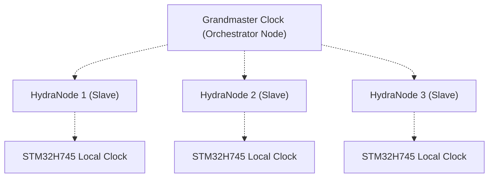

<!-- =============================================================================
HYDRA-UMC-SWARM-SYNC - CRDT state reconciliation for the swarm
Copyright (C) JuanenRac (Electro Hobby 3D) <electrohobby3d@gmail.com>
GPL-3.0-or-later - see LICENSE
============================================================================= -->

<p align="center">
  
</p>

# 🐝 HYDRA-UMC-SWARM-SYNC

<p align="center"><a href="README.md">🇺🇸 English</a> | <a href="README_spa.md">🇪🇸 Español</a> | <a href="README_fra.md">🇫🇷 Français</a> | <a href="README_ita.md">🇮🇹 Italiano</a> | <a href="README_deu.md">🇩🇪 Deutsch</a> | <a href="README_zho.md">🇨🇳 简体中文</a> | 🇯🇵 <b>日本語</b> | <a href="README_por.md">🇵🇹 Português</a></p>

### 📡 CRDT による状態の調停とマルチノード同期

<p align="center">
  
  
  
  
  
</p>

---

> **安全性とセキュリティの現状:** このエコシステムは認証された安全システムではありません。ハードウェアの E-STOP 経路、ファームウェアが強制する制限やインターロック、検証済みの動作コマンドはまだありません。ファームウェアイメージは CRC-32 と Ed25519 署名で検査し、リリースビルドは公開済みの開発用鍵を拒否します(リレーの先のツールヘッドと拡張ボードは引き続き URTC のブートローダーを使い、署名ではなく共有鍵の HMAC-SHA256 を使います)。TLS と相互 TLS は任意で、既定では無効です。独自基板はまだ実装も試験もされていません。ここに書かれた内容を人の安全のために頼る前に、[セキュリティベースライン](https://github.com/JuanenRac/HYDRA-UMC-DOCS/blob/main/docs/SECURITY_BASELINE.md)と[脅威モデル](https://github.com/JuanenRac/HYDRA-UMC-DOCS/blob/main/docs/THREAT_MODEL.md)をお読みください。

---

## 📋 ひと目で

| | |
|---|---|
| バージョン | `0.1.5` |
| 成熟度 | 機能する |
| テスト | 105 (`cargo test`) |
| 技術 | Rust / CRDT (LWW-Element-Map) / Lamport logical clock / JSON/HTTP |
| 対象 | HYDRA-UMC セルの Raspberry Pi CM5 |
| 実機での確認 | まだです：このバージョンについて実機での動作記録はありません |

**移動：** [概要](#-概要) · [アーキテクチャ](#-アーキテクチャ) · [セキュリティと安全](#-セキュリティと安全) · [設定](#-設定) · [クイックスタート](#-クイックスタート) · [テスト](#-テスト) · [トラブルシューティング](#-トラブルシューティング) · [リポジトリの構成](#-リポジトリの構成) · [関連プロジェクト](#-関連プロジェクト)

## 🚦 プロジェクトの状況

各行はこのリポジトリの一部分で、信号は今日どこまで進んでいるかを示します。計画ではなく、リポジトリが示せるもの（テスト、ビルド、実行）に基づいて書かれています。

🟢 完了・検証済み · 🟡 動作する（既知の制限あり） · 🟠 一部のみ、または未検証 · 🔴 未実装または動作しない

| 領域 | 状態 | ここでの意味 |
|---|---|---|
| ソフトウェア | 🟡 | 主な目的では動作します。足りない点は上の正直さの確認に書かれています |
| テスト | 🟢 | 自動テスト 105 件。変更のたびに実行されます |
| 実機 | 🔴 | まだです：このバージョンについて実機での動作記録はありません |
| ドキュメント | 🟢 | 8 言語の README。変更のたびにマニフェストと照合されます |

## 🎯 概要

**HYDRA-UMC-SWARM-SYNC** は分散工場の状態調停レイヤーです。Lamport 論理クロックで順序付けられた CRDT（最後の書き込みが勝つマップ）により、各コントローラーは中央の調停者なしにスウォームの見え方をマージできます。高精度に同期されたグローバルクロック（PTP / IEEE 1588）は長期目標であり、実装されていません。ロードマップを参照してください。

複数のアームが同じマイクロ秒で軌道を開始・終了すること、あるいは共同組立を行うには、そのクロックが必要であり、今後の作業です。

### 主な機能：
* ⏱️ **論理クロック、まだハードウェアPTP同期ではない：** `src/lamport.rs`は本物のテスト済みLamport論理クロックを実装しています - 下記のCRDTマージが実際に必要とする順序付けのプリミティブです。サブ100nsのジッタとPTP（IEEE 1588）ハードウェアタイムスタンプは最終目標であり（下記のARCHITECTUREを参照）、このクレートが今日測定・実装しているものではありません - このリポジトリにはNIC/ハードウェアタイマーのコードはどこにもなく、`src/lamport.rs`自身のヘッダーコメントにもそう明記されています。
* 🔄 **CRDT状態のリコンサイル（今日実際に動く）：** `src/crdt.rs`のLWW-Element-Mapは複数セルの状態を決定的にマージします - プロパティテストにより可換性・結合性・冪等性が証明されており、ロボット軌道コマンドの同期された開始/停止ではありません（そのオーケストレーションはここではなくHYDRA-UMC-ORCHESTRATOR/HYDRA-UMC-JOB-DISPATCHERにあります）。
* 📡 **まだハードウェアタイムスタンプはない：** 実際のCM5/STM32ハードウェアタイマーの活用は将来の作業です - このクレートは純粋なソフトウェア（Rustバイナリ）で、ハードウェア関連のコードは一切ありません。
* 🛡️ **再接続に強いCRDTマージ（今日実際に動く）：** 本物の4セルシミュレーションテスト（`cargo test`）が、複数ラウンドのパーティション分割と部分的な再接続にわたって収束が保たれることを証明します - これはオフラインになって後で再参加するセルに対する耐性であり、このクレートが計測していないライブなネットワークのパケットジッタ/遅延に対する耐性ではありません。
* 🔍 **実際の競合可視化とスウォーム規模での収束の証明（v0）：** `merge_report()` は、調整中に解決された実際の書き込み競合それぞれについて、どのセルがどの別のセルに勝ったか、どのタイムスタンプでかを示す、キーごとの実際の記録を返します。4 セルのシミュレーションテストは、単一の 2 セル間マージだけでなく、複数回のパーティション化と部分的な再接続を通じて収束が保たれることを証明します。
* 💾 **実際のノードごとの永続化（`--state-file`）：** `serve` モード自身の CRDT 状態は、実際のプロセス再起動を経ても生き残るようになりました（`src/store.rs`）- 各 `POST /reconcile` は毎回まっさらな状態から始めるのではなく、このノード自身の状態にマージされ、永続的に更新されます - インプロセステストだけでなく、実際に終了・再起動させたバイナリに対して検証済みです。未設定の場合は、元のメモリのみの動作のままです。詳細は `docs/CLI_REFERENCE.md` を参照。
* 🔁 **完全な状態の交換とゴシップクライアント:** `GET /state?full=1` は各エントリを時刻・書き手・世代とともに(削除されたキー=墓標も含めて)返し、`POST /merge` がそれを受け取るので、その間に双方が何を書き何を削除していても、あるノードを別のノードから最新にできます。シナリオの `Write` は `"deleted": true` を持てるようになりました。エントリはマップに触れる前に検査されます(大きさ、`--max-time-jump` を超えて先の時刻、そのキーの世代より `--max-generation-jump` を超えて先の世代は拒否)。`--peer http://host:port`(ノードごとに繰り返す)を付けると、ノードは `--gossip-interval-ms`(1000 以上)ごとにピアへ状態を尋ね、`--gossip-push` を付けると自分の状態も送ります。ピアは `SWARM_SYNC_SHARED_SECRET` を共有し、`GET /stats` が各ピアを報告します。世代は時刻より先に比較され(キーを多く削除・再作成したレプリカは後からの単純な書き込みに勝つ)、報告される衝突は両方の世代を示します。*(同一マシン上のノード間で試験済み、実際の分断では未検証)*
* 🔐 **実際のオプトイン共有シークレット認証（`SWARM_SYNC_SHARED_SECRET`）：** 未設定の場合、このプロジェクトは元のLAN信頼姿勢を維持します - どの呼び出し元でも `POST /reconcile` や `GET /state` を実行できます。設定した場合（環境変数のみ、CLIフラグは使いません - 共有シークレットはプロセス一覧ではなく環境変数/systemdユニットに属するべきです）、両方のルートで一致する `Authorization: Bearer <token>` が必要になり、定数時間で比較されます。`GET /stats` はどちらの場合も開いたままです。
* 🧱 **ネットワーク上のオープンなノードになることを拒否し、ボディにも上限があります（v0）：** ループバック以外のアドレスでの `serve` には `SWARM_SYNC_SHARED_SECRET`（ラボ用途なら明示的な `--allow-anonymous`）が必要です。ネットワーク上のどのマシンから送られても統合してしまうノードは、そのマシンにスウォームの自己認識を書き換えさせてしまうからです。1 MiB を超えるリクエストボディは読み込む前に `413` で拒否され、状態ファイルは前のファイルを置き換える前にディスクへ強制書き込みされるため、停電で切り詰められた状態や空の状態が残ることはありません。*（実装済み）*
* 📜 **競合の履歴:** `GET /conflicts` は、このノードが解決した競合(キー、勝った書き手、負けた書き手、時刻)を新しい順に、直近 200 件まで(または `?limit=N` で)一覧します。`/stats` は最後の一件しか持っていませんでした。共有シークレットが設定されている場合は、`/state` と同じくそれを求めます。

## 🧩 HYDRA-UMC での役割

**HYDRA-UMC-SWARM-SYNC** は、各セルが持つスウォームの見え方を、マージの順序に依存しない 1 つの結果に統合します。Lamport 論理時計を使った last-writer-wins マップです。シナリオファイルから、または状態をディスクに保持してピアとゴシップできる小さな HTTP ノードとして動作します。ハードウェアの時刻源ではありません。

## 🏛️ アーキテクチャ

<p align="center">
  
</p>

<details>
<summary>図のテキスト版（Mermaid）</summary>



</details>

### 同期階層

> 点線の矢印は計画中で、未実装です。このリポジトリに PTP のコードはありません。

### アーキテクチャと設計上の決定

* **単一の信頼できる情報源ではなく、CRDT ベースの同期を採用した理由。** 複数の HYDRA-UMC セルは半自律的に動作し、後で再接続することがあります——CRDT マージ戦略は、中央の仲裁者が「どの状態が勝つか」を決定することなく収束します。これは、素朴な「最後に書き込んだ者が勝つ」方式では実際のネットワーク分断において保証できないことです。
* **HYDRA-UMC-ORCHESTRATOR のサブモジュールではなく兄弟プロジェクトである理由。** 状態の調整は、いかなる単一のオーケストレーション決定からも独立した継続的なバックグラウンド上の関心事です——独立したプロセスとして保つことで、オーケストレーターの再起動が進行中のマージを中断することはありません。
* **CRDT マージは今日すでに本物だが、PTP ハードウェア同期はまだ本物ではない理由。** `src/crdt.rs` は実際の LWW-Element-Map（最終書き込み優先マップ）を実装しています——状態ベースの CRDT であり、その `merge` は可換・結合的・冪等であることが証明されています(単に「ある例で収束するように見える」だけではなく、そのモジュール自身のプロパティテストを参照)。`src/lamport.rs` は実際の Lamport 論理クロックでこれを支えています。PTP(IEEE 1588、サブ 100ns のハードウェアタイムスタンプ)は根本的に異なる、ハードウェア依存の問題です——意味を持つには実際の NIC/ハードウェアタイマーが必要であり、検証できる実機が手に入るまでは先送りされたままです。論理クロックこそ、CRDT マージが競合を決定論的に解決するために実際に必要とするものであり、その部分は今日すでに本物でテスト済みです。
* **エコシステムの他の部分との関係。** HYDRA-UMC-ORCHESTRATOR の下の兄弟サービスであり、HYDRA-UMC-PATH-PLANNER-3D、HYDRA-UMC-JOB-DISPATCHER、HYDRA-UMC-NODE-HEALING と並んでいます——現在どのセルがオーケストレーターの役割を担っているかにかかわらず、各セル自身のスウォーム状態のビューを一貫させます。（まだ何も呼び出していません。この統合は計画中です。）
* **`merge_report()` が `merge()` の戻り値を変更するのではなく新しいメソッドである理由。** `merge()` は純粋で、コストが低く、明らかに正しいブラックボックスのままです——その単純さが信頼しやすさの理由です。`merge_report()` は、調整が実際に何を上書きしたかを具体的に知りたい呼び出し側(オペレーター、デバッグツール)のために、その上に実際の競合可視化を積み重ねます。ホットパスである `merge()` のすべての呼び出し側にその記帳のコストを負わせたり処理させたりすることはありません。
* **競合レポートが因果的な「happened-before」ではなくタイムスタンプの順序を示す理由。** Lamport クロックは、真の因果的 happens-before が成り立てばより早いタイムスタンプになることを保証します——しかし逆は成り立ちません。より早いタイムスタンプは、2 つのイベントが単に並行していたのではなく因果的に関連していたことを証明するものではありません。`MergeConflict` は意図的に正直であり、Lamport クロックが実際に証明できること(一貫した全順序)のみを報告し、ベクタークロックが必要になるような因果性の主張はしません。

## 🔒 セキュリティと安全

| 脅威 | 防御 | 場所 |
|---|---|---|
| ネットワーク上のマシンがスウォーム自身の見え方を書き換える | `serve` は `SWARM_SYNC_SHARED_SECRET` が無いとループバック以外のアドレスで待ち受けません（終了コード 2）。`--allow-anonymous` は実験用の明示的な選択です | `src/main.rs` |
| 最大値に近い時刻の書き込みが、永久にすべての競合に勝ってしまう | リクエストは、保持している最新の時刻より `--max-time-jump` まで、世代はキー自身の世代より `--max-generation-jump`（既定 1000）までしか進められません | `src/entries.rs` |
| 巨大または遅いリクエストがノードを占有してしまう | 1 MiB を超える本文は読み込む前に 413 で拒否され、4 本のワーカースレッドが処理するため、遅いアップロードが止めるのは 1 本だけです | `src/server.rs` |
| 停電で状態ファイルが途中で切れる | 状態は一時ファイルに書き込まれ、ディスクに強制反映されてから本物の上に名前変更されます | `src/store.rs` |

## ⚙️ 設定

| 変数 | 既定値 | 設定する内容 |
|---|---|---|
| `--addr` | `127.0.0.1` | HTTP ノードのアドレス |
| `--port` | `8112` | HTTP ノードのポート |
| `--state-file` / `SWARM_SYNC_STATE_FILE` | なし | 実行間で状態を保持するファイル |
| `SWARM_SYNC_SHARED_SECRET` | なし | ネットワークノードが呼び出し側に要求し、ピアへ送る共有シークレット |
| `--max-time-jump` | `1000000` | リクエストが最新時刻をどこまで超えて書き込めるか |
| `--max-generation-jump` | `1000` | エントリがキーの世代をどこまで超えてよいか |
| `--peer URL`, `--gossip-interval-ms`, `--gossip-push` | オフ。ラウンド間隔は 1000 ms 以上、既定は 10000 | 状態を尋ねるピア、ラウンド間の待ち時間、こちらの状態を送り返すか |

## 🚀 クイックスタート

安定版の Rust ツールチェーン（エディション 2021）と `cargo` が必要です。

```bash
./build.sh  # Linux, macOS (build.bat on Windows)
./run.sh scenarios/example.json
./run.sh serve --port 8112 --state-file data/state.json
```

## 🧪 テスト

`cargo test` で自動テスト 105 件を実行します。 ハードウェアも、このマシンの外にあるものも必要ありません。

CI は `HYDRA_UMC_CI=1 python tools/ci_validate.py` を実行し、マニフェスト、文書、8 つの README、図を検査します。

## 🏗️ ビルドとリリース

コンパイルできるだけの骨組みではなく、本物の、テスト済みの CRDT
マージです：複数セルの JSON シナリオを調整し、収束した状態を
出力します。

```bash
# Windows
build.bat
run.bat scenarios/example.json

# Linux / macOS
./build.sh
./run.sh scenarios/example.json
```

`build.sh`/`build.bat` はバージョンを変更せず（上げるのは `python tools/hydra_project_tool.py bump` だけです）、
その後 `cargo build --release` を実行します。`run.sh`/`run.bat` は
生成されたバイナリを直接実行し、引数（シナリオのパス）をそのまま
渡します。

シナリオは `cells` 配列を持つ JSON ファイルです——各セルには `id`
(可読性のため)、`writer`(書き込み者 ID)、そして `writes` のリスト
(`{key, value, time}`、`time` はライブ生成ではなく再生される明示的な
Lamport タイムスタンプ - HYDRA-UMC-PATH-PLANNER-3D の `seed` が使う
のと同じ「明示的で決定論的な入力」パターン)があります。各セルの書き込みはそれぞれのマップに畳み込まれ、その後すべてのセルのマップが `merge_report()` で左から右へマージされるため、途中で起きた実際の競合はすべて結果に記録されます。どの順序でマージしても同じ状態になることは CRDT 自体の性質であり、`src/crdt.rs` のプロパティテストで固定されています。呼び出しごとに再確認はしません。

`scenarios/example.json`(`cell-a` と `cell-b` の両方が `cell-a-node-2`
に書き込んだシナリオ)に対して実行すると、単なる不透明な最終結果では
なく、実際の競合解決が見えます:

```bash
./run.sh scenarios/example.json
```
```json
{
  "cells_merged": 2,
  "merged_state": { "...": "..." },
  "conflicts_resolved": 1,
  "conflicts": [
    { "key": "cell-a-node-2",
      "local_time": 2, "local_writer": 1, "local_value": "ok",
      "remote_time": 3, "remote_writer": 2, "remote_value": "unhealthy",
      "kept_remote": true }
  ],
  "next_local_time": 6
}
```

```bash
cargo test   # Lamport クロックと CRDT 自体 - merge が可換・結合的・
             # 冪等であることの直接的な検証(単に「ある例で正しく見える」
             # だけではない)、真に並行する書き込みに対する決定論的な
             # タイブレークのテスト、merge_report() 自体の競合検出の
             # 振る舞い、そして複数回のパーティション化と部分的な
             # 再接続を経ても収束することを証明する 4 セルのシミュレー
             # ション - 合計 102 個のテスト
```

同じ `reconcile()` 呼び出しは、ローカルのシナリオファイルの代わりに
本物の JSON/HTTP API(`src/server.rs`、`tiny_http`、ブロッキング、
非同期ランタイムなし)経由でも到達できます - `run.sh serve [--addr ADDR] [--port PORT]`
で起動し(デフォルト `127.0.0.1:8112`)、`POST /reconcile`(リクエスト
ボディに同じ JSON 形式のシナリオ)と `GET /stats` を公開します。これは
`systemd/hydra-umc-swarm-sync.service` が CM5 上で無人実行している
のと同じものです。完全な使用方法、終了コード、ルートの完全な
リファレンスは [`docs/CLI_REFERENCE.md`](docs/CLI_REFERENCE.md) に
あります。

## 🩺 トラブルシューティング

| 表示 | 原因 | 対処 |
|---|---|---|
| `[swarm-sync] fatal: ...` + exit code 2 | ポートが使用中、ループバック以外のアドレスでシークレットが無い、または状態ファイルが読めない | `fatal:` の後のメッセージを読み、`SWARM_SYNC_SHARED_SECRET` を設定するか、ポートを変えるか、ファイルを直します |
| HTTP 413 | リクエスト本文が 1 MiB を超えている | より小さいシナリオを送るか分割します |

## 📂 リポジトリの構成

<p align="center">
  
</p>

<details>
<summary>ツリーのテキスト版</summary>

```text
HYDRA-UMC-SWARM-SYNC/
├── src/                       ソースコード
│   ├── main.rs                CLI エントリポイント：シナリオを読み込み、調整し、JSON を出力
│   ├── lamport.rs             LamportClock - CRDT の順序付けを支える論理クロック
│   ├── crdt.rs                LwwMap - 本物の CRDT：set/get/merge/snapshot
│   ├── entries.rs             Stamped entries: GET /state?full=1, POST /merge and their checks
│   ├── gossip.rs              Anti-entropy client: asks the peers for their state
│   ├── reconcile.rs           実際の調整ロジック。server.rs からも使えるよう分離
│   ├── server.rs              シンプルなJSON/HTTPサーフェス(tiny_http) - ネットワーク経由のPOST /reconcile
│   └── store.rs               実際の任意のノードごとの永続化(--state-file):クラッシュ耐性のあるJSON状態ファイル
├── scenarios/                 シナリオの例
├── tests/                     startup.rs: 状態ファイルが読めない、最大時間ジャンプが不正、gossip 設定が使えない場合に起動を拒否する
├── docs/                      プロジェクトの文書
├── images/                    バナーと README の図
├── systemd/                   サービスユニット
├── tools/                     プロジェクトのツールと CI の検査
├── .github/                   CI ワークフローと Issue テンプレート
├── Cargo.toml                 Rust パッケージマニフェスト（名前、バージョン、依存関係）
├── bump_version.py            明示的なバージョン更新
├── bump_manifest_version.py   hydra-umc.project.json のバージョンをネイティブ版と同期(--sync)
├── CHANGELOG.md               各バージョンの変更点
├── build-test.sh              変更を伴わないビルド確認
├── build.sh                   ビルドと検査。バージョンは変更しない
├── hydra-umc.project.json     マニフェスト：バージョン、成熟度、ファミリー
├── run.sh                     プログラムを起動
└── test.sh                    テストを実行
```

</details>

## 🗺️ ロードマップと既知の制限

**現時点の既知の制限**

* **フェーズ 1：** TSN による決定論的スウォーム同期とサブミリ秒ジッタの低減。
* **フェーズ 2：** マルチロボットセルにおける動的障害物回避を伴う 3D パスプランニング。
* **フェーズ 3：** リアルタイムのリソース可用性を用いたマルチロボットジョブディスパッチの最適化。
* **フェーズ 4：** Wi-Fi 6（高信頼性モード）経由の無線 PTP 同期のサポートと、サブ 100ns 精度の検証。

## 🌍 言語

この README とリポジトリの文書は、英語・スペイン語・ドイツ語・フランス語・イタリア語・日本語・中国語・ポルトガル語（ポルトガル）の 8 言語で提供されています。8 つのファイルは同時に書かれ、同じ節と同じリンクを持つことを CI が確認します。 このリポジトリには独自の画面もメッセージカタログもないため、翻訳すべきインターフェース文字列はありません。

## 🔗 関連プロジェクト

本プロジェクトは、同じ作者(JuanenRac / Electro Hobby 3D)による HYDRA-UMC ロボティクスエコシステムの一部です。リクエストが実はこの中のどれかについてのものである可能性があるため、知っておく価値があります。

**親プロジェクト**
- **[HYDRA-UMC-ORCHESTRATOR](https://github.com/JuanenRac/HYDRA-UMC-ORCHESTRATOR)** — 実際の gRPC/Protobuf ヘルスレポート契約とミッションステートマシンを持つ統合ハブ。本リポジトリは、その自身のスウォーム調整レイヤー内における特定のオーケストレーションサービスとして、この親の一部を成す。

**兄弟プロジェクト** —— HYDRA-UMC-ORCHESTRATOR 自身のスウォーム調整レイヤーにおける他のオーケストレーションサービス
- **[HYDRA-UMC-PATH-PLANNER-3D](https://github.com/JuanenRac/HYDRA-UMC-PATH-PLANNER-3D)** — 実際の障害物/ワークスペース衝突検証を備えた、実際の RRT ベースの 3D 経路プランナー。
- **[HYDRA-UMC-JOB-DISPATCHER](https://github.com/JuanenRac/HYDRA-UMC-JOB-DISPATCHER)** — 実際の HTTP API 上に構築された、優先度ベースの実際のジョブキュー(重複排除付き)。
- **[HYDRA-UMC-NODE-HEALING](https://github.com/JuanenRac/HYDRA-UMC-NODE-HEALING)** — リトライ/バックオフとアイデンティティ不一致検出を備えた、実際の gRPC ベースのフリートヘルスウォッチドッグ。

**エコシステムの他のプロジェクト**

*コアハードウェア&プラットフォーム*
- **[HYDRA-UMC](https://github.com/JuanenRac/HYDRA-UMC)** — ロボットアームのマザーボードの設計——CM5 ホスト + デュアルコア STM32H745、CAN-OTA/SPI-OTA 経由で最大 8 本のツールアームを統括することを目指す(ファームウェアは初期段階で、実装済みの基板はまだない)。
- **[HYDRA-UMC-OS](https://github.com/JuanenRac/HYDRA-UMC-OS)** — CM5 向けの再現可能な Raspberry Pi OS プロダクト層——読み取り専用エージェント、検証済み設定/プロファイル、WiFi 初回接続プロビジョニング。
- **[HYDRA-UMC-SDK](https://github.com/JuanenRac/HYDRA-UMC-SDK)** — すべてのブリッジが自身のコマンドを検証する共有 JSON-Schema 契約とソフトウェアのジョブゲート境界(認証済みの安全機能ではない)。
- **[HYDRA-UMC-CONNECTOR-HUB](https://github.com/JuanenRac/HYDRA-UMC-CONNECTOR-HUB)** — 外部マシン用コネクタのための宣言的アダプターマニフェストのレジストリとバリデーター。SDK 自身の契約という発想を外部マシンにまで拡張し、産業用ゲートウェイ系のプロジェクトを置き換えることはありません。

*コアバックエンド&クライアント*
- **[HYDRA-UMC-SERVER](https://github.com/JuanenRac/HYDRA-UMC-SERVER)** — すべての制御クライアントが実際に通信する、本物のヘッドレスバックエンド(REST/WebSocket)。
- **[HYDRA-UMC-STUDIO](https://github.com/JuanenRac/HYDRA-UMC-STUDIO)** — リアルタイムのマルチロボット 3D 可視化を備えたウェブ制御ダッシュボード。
- **[HYDRA-UMC-SUITE](https://github.com/JuanenRac/HYDRA-UMC-SUITE)** — 複数のサーバーを同時に扱えるデスクトップ(PySide6)スウォームコマンドセンター、スタンドアロン実行ファイルとしてパッケージ化。
- **[HYDRA-UMC-ANDROID-CONTROL](https://github.com/JuanenRac/HYDRA-UMC-ANDROID-CONTROL)** — 生体認証ログインとペアリングされた Wear OS コンパニオンを備えたネイティブ Android 制御アプリ。
- **[HYDRA-UMC-IOS-CONTROL](https://github.com/JuanenRac/HYDRA-UMC-IOS-CONTROL)** — リアルタイム WebSocket 同期を備えた iOS/iPadOS 制御アプリ(Flutter)。
- **[HYDRA-UMC-DSI](https://github.com/JuanenRac/HYDRA-UMC-DSI)** — 本体搭載の 7 インチ DSI タッチスクリーン向けネイティブタッチ UI、CM5 自体に組み込み。
- **[HYDRA-UMC-EDITOR-URDF](https://github.com/JuanenRac/HYDRA-UMC-EDITOR-URDF)** — 完成したモデルを STUDIO 自身のカタログへ送信するデスクトップ用グラフィカル URDF 作成/編集ツール。
- **[HYDRA-UMC-EDITOR-STL](https://github.com/JuanenRac/HYDRA-UMC-EDITOR-STL)** — HYDRA-UMC-EDITOR-URDF も編集する同じモデルカタログ内で、実在するパーツを変換/置換/削除/追加するデスクトップ STL モデルエディタ。
- **[HYDRA-UMC-BRIDGE-AMR](https://github.com/JuanenRac/HYDRA-UMC-BRIDGE-AMR)** — VDA 5050 MQTT パブリッシャーによる AGV/AMR フリートの調整境界(エミュレートしたフリートに対してのみテスト済み)。
- **[HYDRA-UMC-BRIDGE-CNC](https://github.com/JuanenRac/HYDRA-UMC-BRIDGE-CNC)** — GRBL ステータス/制御バイトへのアクセスを持つ、CNC セルの高レベルコーディネーター(エミュレーターに対してのみテスト済み)。
- **[HYDRA-UMC-BRIDGE-DROIDS](https://github.com/JuanenRac/HYDRA-UMC-BRIDGE-DROIDS)** — Boston Dynamics Spot コマンド送信機能を持つ、脚型/ヒューマノイドドロイドの調整境界(エミュレーターに対してのみテスト済み)。
- **[HYDRA-UMC-BRIDGE-LASER](https://github.com/JuanenRac/HYDRA-UMC-BRIDGE-LASER)** — キー/筐体/インターロックの GPIO 信号 3 系統を読み取るレーザーセルのコーディネーター(模擬チップに対してのみテスト済み。レーザーの武装や発射はできない)。
- **[HYDRA-UMC-BRIDGE-OPENPNP](https://github.com/JuanenRac/HYDRA-UMC-BRIDGE-OPENPNP)** — OpenPnP ピックアンドプレースの基板フローを安全に統括する高レベルコーディネーター。
- **[HYDRA-UMC-BRIDGE-PRINTER3D](https://github.com/JuanenRac/HYDRA-UMC-BRIDGE-PRINTER3D)** — 実際にゲート制御されたジョブコマンドを持つ、Moonraker/Klipper 3D プリンター向けの安全な調整境界。
- **[HYDRA-UMC-BRIDGE-ROS2](https://github.com/JuanenRac/HYDRA-UMC-BRIDGE-ROS2)** — 遅延インポートの rclpy ROS 2 トランスポートを持つコーディネーター(ROS 2 環境ではまだ実行していない)。
- **[HYDRA-UMC-BRIDGE-UAV](https://github.com/JuanenRac/HYDRA-UMC-BRIDGE-UAV)** — MAVLink コマンド送信機能を持つ、カメラ搭載 UAV の調整境界(エミュレーターに対してのみテスト済み)。

*URTC ツールプラットフォーム*
- **[URTC](https://github.com/JuanenRac/URTC)** — 物理的な Universal Robot Tool Controller 基板向けファームウェア、CAN バス経由の 25 以上のツールプロファイル。
- **[URTC-FLASHER](https://github.com/JuanenRac/URTC-FLASHER)** — URTC 基板用のデスクトップ GUI 書き込みツール、CAN-OTA およびフルチップ SWD/JTAG。
- **[URTC-TESTER](https://github.com/JuanenRac/URTC-TESTER)** — URTC 基板向けのデスクトップ CAN バスライブ診断ツール、ツールプロファイルごとに 1 パネル。
- **[URTC-WEB-STUDIO](https://github.com/JuanenRac/URTC-WEB-STUDIO)** — Web Serial API を使ったブラウザベースの URTC-TESTER の代替、ローカルインストール不要。
- **[URTC-GATEWAY](https://github.com/JuanenRac/URTC-GATEWAY)** — URTC の CAN バスの前に置くゲートウェイ：許可する識別子のリスト、レート制限、セッション鍵。コンピューター上でテスト済みで、実際のバスではまだ試していません。

*ビジョン AI ノード(Hailo-8)*
- **[HYDRA-UMC-VISION-NODE](https://github.com/JuanenRac/HYDRA-UMC-VISION-NODE)** — Hailo-8 ビジョンパイプラインの統合ハブ、段階ごとの実際のハードウェア準備状況チェック付き。
- **[HYDRA-UMC-DETECTION-HEF](https://github.com/JuanenRac/HYDRA-UMC-DETECTION-HEF)** — Hailo アーキテクチャ/チェックサムによる安全読み込み検証を備えた、実際のコンパイル済みモデルレジストリ。
- **[HYDRA-UMC-VISION-STREAMER](https://github.com/JuanenRac/HYDRA-UMC-VISION-STREAMER)** — 実際の HailoRT 統合境界を持つ、実際の GStreamer パイプライン + MediaMTX 設定生成器。
- **[HYDRA-UMC-VISUAL-SERVOING-API](https://github.com/JuanenRac/HYDRA-UMC-VISUAL-SERVOING-API)** — ゾーン状態を条件に承認する Position-Based Visual Servoing 補正則。カメラによる姿勢推定はまだない。
- **[HYDRA-UMC-SAFETY-ZONES](https://github.com/JuanenRac/HYDRA-UMC-SAFETY-ZONES)** — ファイルから物体位置を受け取る、ゾーン侵入・キャリブレーション鮮度・E-STOP 要求の v0 ロジック。検出器は接続されておらず、物理 E-STOP もまだ配線されていない。

*コグニティブ AI ノード(Hailo-10)*
- **[HYDRA-UMC-COGNITIVE-NODE](https://github.com/JuanenRac/HYDRA-UMC-COGNITIVE-NODE)** — Hailo-10 コグニティブパイプライン(LLM/VLA/音声オーケストレーション)の統合ハブ。
- **[HYDRA-UMC-VLA-ENGINE](https://github.com/JuanenRac/HYDRA-UMC-VLA-ENGINE)** — Vision-Language-Action モデル向けの、実際のアクショントークンのエンコード/デコードと軌道生成。
- **[HYDRA-UMC-VOICE-UI](https://github.com/JuanenRac/HYDRA-UMC-VOICE-UI)** — 確認ゲート付きの限定的な Watch リレーを備えた、実際の音声フロントエンド(VAD + 意図解析)。
- **[HYDRA-UMC-SEMANTIC-PLANNER](https://github.com/JuanenRac/HYDRA-UMC-SEMANTIC-PLANNER)** — MCU エラーコードに対する、実際のルールベースのタスク分解と意味的エラー復旧。
- **[HYDRA-UMC-DOCS-QA](https://github.com/JuanenRac/HYDRA-UMC-DOCS-QA)** — このエコシステム自身の Markdown ドキュメントに対する、標準ライブラリのみの実際の TF-IDF 文書検索。
- **[HYDRA-UMC-LOCAL-TECHNICIAN](https://github.com/JuanenRac/HYDRA-UMC-LOCAL-TECHNICIAN)** — エコシステム自身のための、ローカルでポリシーゲート付きのAIメンテナンス技術者 — 観察、診断し、修正を提案する;最上位の2つのリスクレベルは意図的にまだ実装されていない。

*デジタルツイン&シミュレーション*
- **[HYDRA-UMC-TWIN](https://github.com/JuanenRac/HYDRA-UMC-TWIN)** — 実際のバージョン互換性同期契約を持つ、デジタルツインエンジンの統合ハブ。
- **[HYDRA-UMC-HIL-BRIDGE](https://github.com/JuanenRac/HYDRA-UMC-HIL-BRIDGE)** — シミュレーションと実機の間にソフトウェアの衝突インターロックを備えたハードウェア・イン・ザ・ループのルーター(実機なしでテスト済み)。
- **[HYDRA-UMC-PHYSICS-REPLICA](https://github.com/JuanenRac/HYDRA-UMC-PHYSICS-REPLICA)** — 実際の URDF サブセットに対する、実際の順運動学と関節限界検証。
- **[HYDRA-UMC-SYNTHETIC-DATA-GEN](https://github.com/JuanenRac/HYDRA-UMC-SYNTHETIC-DATA-GEN)** — YOLO/COCO アノテーションのエクスポート機能を持つ、実際のプロシージャル 2D シーンジェネレーター。

*データ&分析*
- **[HYDRA-UMC-DATALAKE](https://github.com/JuanenRac/HYDRA-UMC-DATALAKE)** — 実際の取り込み/クエリ HTTP API を備えた、実際の sqlite3 ベースの時系列ストア。
- **[HYDRA-UMC-ANOMALY-DETECTOR](https://github.com/JuanenRac/HYDRA-UMC-ANOMALY-DETECTOR)** — ドリフト監視を備えた、実際の FFT + 統計ベースラインによる異常検知器。
- **[HYDRA-UMC-PRODUCTION-REPORTS](https://github.com/JuanenRac/HYDRA-UMC-PRODUCTION-REPORTS)** — DATALAKE の履歴に対する実際の OEE/稼働率計算、再現可能な CSV エクスポート付き。
- **[HYDRA-UMC-TELEMETRY-COLLECTOR](https://github.com/JuanenRac/HYDRA-UMC-TELEMETRY-COLLECTOR)** — シーケンス重複排除機能を備えた、DATALAKE への実際の CAN/WebSocket 取り込みパイプライン。

*産業用ゲートウェイ*
- **[HYDRA-UMC-GATEWAY-INDUSTRIAL](https://github.com/JuanenRac/HYDRA-UMC-GATEWAY-INDUSTRIAL)** — 実際のコマンド許可リスト/バックプレッシャー層を持つ、産業用プロトコルへ中継する統合ハブ。
- **[HYDRA-UMC-OPCUA-SERVER](https://github.com/JuanenRac/HYDRA-UMC-OPCUA-SERVER)** — 実際のバイナリプロトコルクライアントセッションで検証された、実際の OPC-UA アドレス空間。
- **[HYDRA-UMC-MQTT-BROKER](https://github.com/JuanenRac/HYDRA-UMC-MQTT-BROKER)** — クライアント単位のオプション認証とトピック ACL を備えた、実際の MQTT ブローカー。
- **[HYDRA-UMC-MTCONNECT-ADAPTER](https://github.com/JuanenRac/HYDRA-UMC-MTCONNECT-ADAPTER)** — 縮退モード出力を備えた、実際の MTConnect `/probe` および `/current` XML エンドポイント。

*補完ツール&エコシステム運用*
- **[HYDRA-UMC-DASHBOARD-AI](https://github.com/JuanenRac/HYDRA-UMC-DASHBOARD-AI)** — 誠実な統計フォールバックを備えた、DATALAKE/ANOMALY-DETECTOR 上のスマートサマリーと異常ハイライトパネル。
- **[HYDRA-UMC-TOOL-CLI](https://github.com/JuanenRac/HYDRA-UMC-TOOL-CLI)** — 実際の安定した終了コード契約を持つフリート CLI、HYDRA-UMC-SERVER 自身の API の本物のライブクライアント。
- **[HYDRA-UMC-WATCH](https://github.com/JuanenRac/HYDRA-UMC-WATCH)** — 触覚アラートのパターンとペアリング済みスマートフォンへの音声リレーを備えた WearOS コンパニオンアプリ(物理的なウォッチではまだ実行していない)。
- **[URTC-SMART-RACK](https://github.com/JuanenRac/URTC-SMART-RACK)** — 実際の工具 ID デコードと Smart Idle 予熱ロジックを備えた、基板搭載ラック用ファームウェア。
- **[URTC-VISION-TOOL](https://github.com/JuanenRac/URTC-VISION-TOOL)** — サーマル/RGB 検査ツールヘッド向けの、ファームウェアと実際の Python ビジョンコンパニオン。
- **[HYDRA-UMC-UPDATER](https://github.com/JuanenRac/HYDRA-UMC-UPDATER)** — このエコシステム内のすべてのリポジトリを検出・クローン・更新する、管理用デスクトップツール。
- **[HYDRA-UMC-OS-REBUILDER](https://github.com/JuanenRac/HYDRA-UMC-OS-REBUILDER)** — エコシステムの最新バージョンをプリロードした、書き込み可能なCM5イメージを構築するWindows/Linuxデスクトップツール。Raspberry Pi Imager方式の初回起動Wi-Fi/ユーザー/SSH設定を備える。
- **[HYDRA-UMC-OPS-AGENT](https://github.com/JuanenRac/HYDRA-UMC-OPS-AGENT)** — 保守インシデントコーディネーター: 低権限のエッジ役割がサニタイズされたインベントリ/ヘルスのスナップショットを収集し、コントロールプレーン役割がそれを読み取り専用でレンダリングして AI プロバイダーに診断の提案を依頼します - パッチを適用することも、何かをデプロイすることも決してありません。
- **[HYDRA-UMC-DEV-SERVER](https://github.com/JuanenRac/HYDRA-UMC-DEV-SERVER)** — 再現可能な開発ホスト（Raspberry Pi 5 / CM5）。エコシステムのソースコードを保管し、永続キューのもとで境界の明確なビルド/テストタスクを実行する。運用中の CM5 とは明確に異なる、開発専用の役割。

## 📚 ドキュメント

さらに読むには：

* [エコシステムのセキュリティ基準](https://github.com/JuanenRac/HYDRA-UMC-DOCS/blob/main/docs/SECURITY_BASELINE.md)
* [エコシステムの脅威モデル](https://github.com/JuanenRac/HYDRA-UMC-DOCS/blob/main/docs/THREAT_MODEL.md)
* [このリポジトリの変更履歴](CHANGELOG.md)
* [このリポジトリのライセンス](LICENSE.md)

## 🤝 コントリビュートとコミュニティ

* プルリクエストの前に `HYDRA_UMC_CI=1 py -3 tools/ci_validate.py`（または `HYDRA_UMC_CI=1 python3 tools/ci_validate.py`）を実行してください。`CI_VALIDATION=PASS` と表示される必要があります。この確認に `build.sh` や `build.bat` は使わないでください。ビルドは検査ではありません。
* 8 つの README は HYDRA-UMC-DOCS の 1 つのソースから書かれます。手で編集しないでください。ソースを変更し、`tools/make_readmes.py` で書き直します。
* 実行していないことを README に書かないでください。事実であれば「シミュレーションのみ」「実機では未確認」と書きます。
* [CONTRIBUTING.md](CONTRIBUTING.md)、[行動規範](CODE_OF_CONDUCT.md)、[SECURITY.md](SECURITY.md)、[SUPPORT.md](SUPPORT.md) を参照してください。

## 👤 作者

**JuanenRac (Electro Hobby 3D)** · electrohobby3d@gmail.com

## 📜 ライセンス

GPL-3.0-or-later - [LICENSE](LICENSE).
