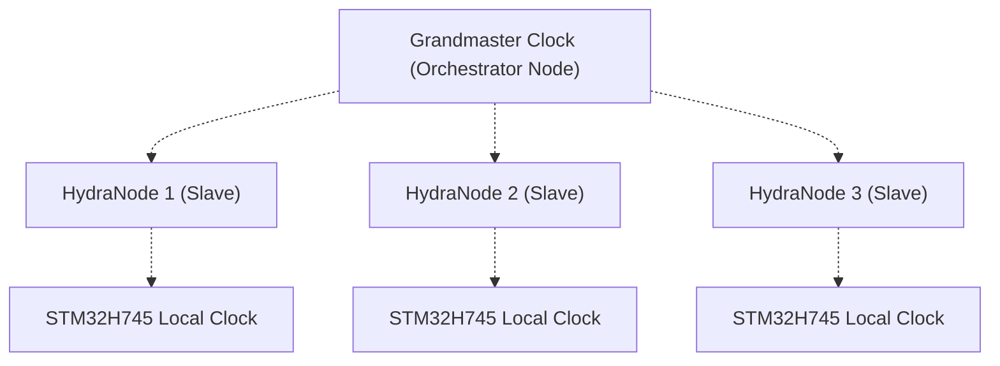

<!-- =============================================================================
HYDRA-UMC-SWARM-SYNC - CRDT state reconciliation for the swarm
Copyright (C) JuanenRac (Electro Hobby 3D) <electrohobby3d@gmail.com>
GPL-3.0-or-later - see LICENSE
============================================================================= -->

<p align="center">
  
</p>

# 🐝 HYDRA-UMC-SWARM-SYNC

<p align="center"><a href="README.md">🇺🇸 English</a> | <a href="README_spa.md">🇪🇸 Español</a> | <a href="README_fra.md">🇫🇷 Français</a> | <a href="README_ita.md">🇮🇹 Italiano</a> | <a href="README_deu.md">🇩🇪 Deutsch</a> | <a href="README_zho.md">🇨🇳 简体中文</a> | <a href="README_jpn.md">🇯🇵 日本語</a> | 🇵🇹 <b>Português</b></p>

### 📡 Reconciliação de estado por CRDT e sincronização multinó

<p align="center">
  
  
  
  
  
</p>

---

**Verificação de honestidade - o que realmente funciona hoje:** o relógio lógico de Lamport (`src/lamport.rs`), o CRDT LWW-Element-Map com uma fusão demonstrada comutativa/associativa/idempotente por testes de propriedades, e não apenas observada num exemplo (`src/crdt.rs`), a lógica de reconciliação partilhada entre a CLI e o servidor (`src/reconcile.rs`), a persistência real por nó à prova de falhas (`src/store.rs`, `--state-file`, verificada contra um binário realmente terminado e relançado), o servidor JSON/HTTP que expõe tudo isso (`src/server.rs`, `tiny_http`, `POST /reconcile`, `GET /stats`, `GET /state`) e a sua Autenticação por segredo partilhado opcional (`SWARM_SYNC_SHARED_SECRET`) são reais e testados (102 testes, `cargo test`), incluindo uma simulação de 4 células que prova a convergência ao longo de várias rondas de partição e religação parcial. O que NÃO é real: a marcação temporal por hardware PTP (IEEE 1588), a precisão abaixo de 100 ns que o distintivo e os pontos «Sincronização ultraprecisa»/«Marcação temporal por hardware» deste README descrevem - não há código PTP em lado nenhum deste crate, e fica adiado até existir hardware real de NIC/temporizador onde o validar (ver ARQUITETURA abaixo). O que existe e está testado hoje é o relógio lógico (de Lamport) de que a fusão do CRDT realmente precisa, não a sincronização de hardware por relógio de parede. Consulte o `CHANGELOG.md` para saber exatamente o que já foi entregue e o ROTEIRO abaixo para o que fica em aberto.

---

> **Estado de segurança (safety e security):** este ecossistema não é um sistema de segurança certificado. Ainda não existe um caminho de E-STOP por hardware, nem limites ou interlocks impostos pelo firmware, nem um comando de movimento verificado; as imagens de firmware são verificadas com CRC-32 e uma assinatura Ed25519, e uma compilação de versão recusa as chaves de desenvolvimento publicadas (as cabeças de ferramenta e as placas de expansão atrás do relé ainda usam os bootloaders do URTC, que aceitam um HMAC-SHA256 de chave partilhada em vez de uma assinatura); TLS e TLS mútuo são opcionais e estão desativados por defeito; nenhuma placa própria foi ainda montada ou testada. Leia a [base de segurança](https://github.com/JuanenRac/HYDRA-UMC-DOCS/blob/main/docs/SECURITY_BASELINE.md) e o [modelo de ameaças](https://github.com/JuanenRac/HYDRA-UMC-DOCS/blob/main/docs/THREAT_MODEL.md) antes de confiar em qualquer afirmação aqui para a segurança de uma pessoa.

---

## 📋 Num relance

| | |
|---|---|
| Versão | `0.1.5` |
| Maturidade | Funcional |
| Testes | 105 (`cargo test`) |
| Tecnologia | Rust / CRDT (LWW-Element-Map) / Lamport logical clock / JSON/HTTP |
| Destino | O Raspberry Pi CM5 de uma célula HYDRA-UMC |
| Em hardware real | Ainda não: não há registo de execução em hardware real para esta versão |

**Ir para:** [Visão geral](#-visão-geral) · [Arquitetura](#-arquitetura) · [Segurança e proteção](#-segurança-e-proteção) · [Configuração](#-configuração) · [Início rápido](#-início-rápido) · [Testes](#-testes) · [Resolução de problemas](#-resolução-de-problemas) · [Estrutura do repositório](#-estrutura-do-repositório) · [Projetos relacionados](#-projetos-relacionados)

## 🚦 Estado do projeto

Cada linha é uma parte deste repositório e a luz diz até onde chega hoje. É escrita com o que o repositório consegue demonstrar (testes, compilações, execuções), não com o que está previsto.

🟢 Feito e verificado · 🟡 Funciona, com limites conhecidos · 🟠 Feito a meio ou ainda por verificar · 🔴 Por fazer ou a não funcionar

| Área | Estado | O que significa aqui |
|---|---|---|
| Software | 🟡 | Funciona para o seu propósito principal; a verificação de honestidade acima lista o que ainda falta |
| Testes | 🟢 | 105 testes automáticos, executados a cada alteração |
| Hardware real | 🔴 | Ainda não: não há registo de execução em hardware real para esta versão |
| Documentação | 🟢 | README em oito idiomas, verificado contra o manifesto a cada alteração |

## 🎯 Visão geral

O **HYDRA-UMC-SWARM-SYNC** é a camada de reconciliação de estado da fábrica distribuída: um CRDT (um mapa em que ganha a última escrita, ordenado por um relógio lógico de Lamport) que permite a cada controlador fundir a sua visão do enxame sem um árbitro central. Um relógio global sincronizado com precisão (PTP / IEEE 1588) é o objetivo a longo prazo e não está implementado: consulte o roteiro.

Iniciar e terminar as trajetórias de vários braços no mesmo microssegundo, ou fazer montagem conjunta, precisa desse relógio e é trabalho futuro.

### Funcionalidades principais:
* ⏱️ **Relógio lógico, ainda não sincronização PTP por hardware:** o `src/lamport.rs` implementa um relógio lógico de Lamport real e testado - a primitiva de ordenação de que a fusão do CRDT abaixo realmente precisa. O jitter abaixo de 100 ns e a marcação temporal por hardware PTP (IEEE 1588) são o objetivo final (ver ARQUITETURA abaixo), não algo que este crate meça ou implemente hoje - não há código de NIC/temporizador de hardware em lado nenhum deste repositório, e o próprio comentário de cabeçalho do `src/lamport.rs` di-lo explicitamente.
* 🔄 **Reconciliação de estado por CRDT (real hoje):** o LWW-Element-Map do `src/crdt.rs` funde de forma determinista o estado de várias células - demonstrado comutativo, associativo e idempotente por testes de propriedades, e não um arranque/paragem sincronizado dos comandos de trajetória dos robôs (essa orquestração vive no HYDRA-UMC-ORCHESTRATOR/HYDRA-UMC-JOB-DISPATCHER, não aqui).
* 📡 **Ainda sem marcação temporal por hardware:** aproveitar os temporizadores de hardware reais da CM5/STM32 é trabalho futuro - este crate é software puro (binário Rust), sem qualquer código virado para o hardware.
* 🛡️ **Fusão de CRDT resiliente à religação (real hoje):** um teste simulado real de 4 células (`cargo test`) prova que a convergência se mantém ao longo de várias rondas de partição e religação parcial - é resiliência a uma célula que fica offline e volta a juntar-se mais tarde, não resiliência medida ao jitter/atraso de pacotes de rede em direto, que este crate não instrumenta.
* 🔍 **Visibilidade real dos conflitos e prova de convergência à escala do enxame (v0):** o `merge_report()` devolve um registo real, por chave, de cada conflito de escrita genuíno resolvido durante a reconciliação - que célula venceu que outra célula e com que carimbo. Um teste simulado de 4 células prova que a convergência se mantém ao longo de várias rondas de partição e religação parcial, e não apenas numa fusão simples de duas células.
* 💾 **Persistência real por nó (`--state-file`):** o estado CRDT do próprio modo `serve` sobrevive agora a um reinício real do processo (`src/store.rs`) - cada `POST /reconcile` funde-se com o estado próprio deste nó e atualiza-o de forma durável, em vez de começar de uma folha em branco a cada chamada, verificado contra um binário realmente terminado e relançado, e não apenas com testes em processo. Sem o definir, mantém o comportamento original só em memória. Consulte o `docs/CLI_REFERENCE.md`.
* 🔁 **Troca do estado completo e cliente de gossip:** `GET /state?full=1` responde com cada entrada, o seu tempo, escritor e geração, chaves apagadas (lápides) incluídas, e `POST /merge` aceita-as, de modo que um nó pode ser posto em dia a partir de outro, seja o que for que cada um tenha escrito e apagado entretanto; uma `Write` de um cenário pode agora levar `"deleted": true`. As entradas são verificadas antes de tocarem o mapa (tamanho, um tempo no máximo `--max-time-jump` adiante, uma geração no máximo `--max-generation-jump` adiante da da chave). Com `--peer http://host:port` (repetido para cada nó) o nó pede o estado aos pares a cada `--gossip-interval-ms` (no mínimo 1000) e, com `--gossip-push`, envia o seu; os pares partilham `SWARM_SYNC_SHARED_SECRET` e `GET /stats` indica cada um. A geração é comparada antes do tempo (uma réplica que apagou e recriou uma chave mais vezes ganha a uma escrita simples posterior), e um conflito comunicado diz agora as duas gerações. *(experimentado entre nós da mesma máquina; nunca através de uma partição real)*
* 🔐 **Autenticação por segredo partilhado real e opcional (`SWARM_SYNC_SHARED_SECRET`):** sem o definir, este projeto mantém a sua postura original de confiança na LAN - qualquer chamador pode fazer `POST /reconcile` ou `GET /state`. Definido (apenas por variável de ambiente, nunca por flag da CLI - um segredo partilhado pertence ao ambiente/unidade systemd, não à lista de processos), ambas as rotas exigem um `Authorization: Bearer <token>` correspondente, verificado em tempo constante. O `GET /stats` fica aberto em qualquer dos casos.
* 🧱 **Recusa ser um nó aberto na rede, e corpos limitados (v0):** o `serve` num endereço que não seja loopback precisa de `SWARM_SYNC_SHARED_SECRET` (ou de um `--allow-anonymous` explícito para laboratório), porque um nó que funde tudo o que lhe enviar qualquer máquina da rede deixa essa máquina reescrever a visão que o enxame tem de si mesmo; os corpos de pedido com mais de 1 MiB são recusados com `413` antes de serem lidos; e o ficheiro de estado é forçado para o disco antes de substituir o anterior, para que um corte de energia não possa deixar um estado truncado ou vazio. *(implementado)*
* 📜 **Histórico de conflitos:** `GET /conflicts` lista os conflitos que este nó resolveu (chave, escritor vencedor, escritor vencido e hora), do mais recente para o mais antigo, até aos últimos 200 ou `?limit=N`; o `/stats` só guardava o último. Pede o segredo partilhado quando há um, como o `/state`.

## 🧩 Papel no HYDRA-UMC

O **HYDRA-UMC-SWARM-SYNC** funde as vistas do enxame que cada célula tem num resultado que não depende da ordem da fusão: um mapa em que o último escritor ganha, com um relógio lógico de Lamport. Funciona com um ficheiro de cenário ou como um pequeno nó HTTP que guarda o seu estado em disco e pode trocar informação com pares; não é uma fonte de tempo por hardware.

## 🏛️ Arquitetura

<p align="center">
  
</p>

<details>
<summary>Versão em texto do diagrama (Mermaid)</summary>



</details>

### HIERARQUIA DE SINCRONIZAÇÃO

> As setas a tracejado estão planeadas, não implementadas: este repositório não tem código PTP.

### ARQUITETURA E DECISÕES DE DESIGN

* **Porque uma sincronização baseada em CRDT e não uma única fonte de verdade.** Várias células HYDRA-UMC podem funcionar de forma semiautónoma e voltar a ligar-se mais tarde - uma estratégia de fusão por CRDT converge sem um árbitro central a decidir de quem é o estado que «ganha», o que uma abordagem ingénua de «último a escrever ganha» não consegue garantir numa partição de rede real.
* **Porque é que este é um irmão, e não um submódulo, do HYDRA-UMC-ORCHESTRATOR.** A reconciliação de estado é uma preocupação contínua de segundo plano, independente de qualquer decisão de orquestração isolada - mantê-la como processo separado significa que o reinício do orquestrador não interrompe uma fusão em curso.
* **Porque é que a fusão do CRDT é real hoje mas a sincronização por hardware PTP não.** O `src/crdt.rs` implementa um LWW-Element-Map (Last-Writer-Wins Map) real, um CRDT baseado em estado cuja `merge` é comprovadamente comutativa, associativa e idempotente - não apenas «parece convergir num exemplo», ver os testes de propriedades desse módulo. O `src/lamport.rs` apoia-o com um relógio lógico de Lamport real. O PTP (IEEE 1588, marcação temporal por hardware abaixo de 100 ns) é um problema fundamentalmente diferente e dependente de hardware - precisa de NICs/temporizadores de hardware reais para fazer sentido, e fica adiado até haver hardware real onde o validar. Um relógio lógico é o que a fusão do CRDT realmente precisa para resolver conflitos de forma determinista, e essa parte é real e testada hoje.
* **Como isto se encaixa no resto do ecossistema.** Um serviço irmão sob o HYDRA-UMC-ORCHESTRATOR, ao lado do HYDRA-UMC-PATH-PLANNER-3D, do HYDRA-UMC-JOB-DISPATCHER e do HYDRA-UMC-NODE-HEALING - mantém consistente a visão que cada célula tem do estado do enxame, independentemente de qual delas detém agora o papel de orquestrador. (Ainda nada o chama: essa integração está planeada.)
* **Porque é que o `merge_report()` é um método novo em vez de mudar o que o `merge()` devolve.** O `merge()` continua a ser uma caixa negra pura, barata e obviamente correta - essa simplicidade é o que a torna fácil de confiar. O `merge_report()` acrescenta por cima visibilidade real dos conflitos para um chamador (um operador, uma ferramenta de depuração) que quer especificamente saber o que uma reconciliação sobrescreveu, sem obrigar todos os chamadores do `merge()` do caminho crítico a pagar ou tratar essa contabilidade.
* **Porque é que os relatórios de conflito mostram a ordem dos carimbos e não o «aconteceu-antes» causal.** Um relógio de Lamport garante que um verdadeiro aconteceu-antes causal implica um carimbo anterior - mas o inverso não se verifica: um carimbo anterior NÃO prova que dois eventos estavam causalmente relacionados em vez de meramente concorrentes. O `MergeConflict` é deliberadamente honesto ao reportar apenas o que um relógio de Lamport consegue realmente provar (uma ordem total consistente), e não uma afirmação de causalidade que exigiria um relógio vetorial.

## 🔒 Segurança e proteção

| Ameaça | Defesa | Onde |
|---|---|---|
| Uma máquina da rede reescreve a visão que o enxame tem de si | `serve` recusa escutar num endereço que não seja de loopback sem `SWARM_SYNC_SHARED_SECRET` (código de saída 2); `--allow-anonymous` é uma escolha explícita de laboratório | `src/main.rs` |
| Uma escrita com um tempo perto do máximo ganha todos os conflitos para sempre | Um pedido só pode avançar um tempo, no máximo, `--max-time-jump` para além do mais recente guardado, e uma geração, no máximo, `--max-generation-jump` (1000 por predefinição) para além da própria da chave | `src/entries.rs` |
| Um pedido enorme ou lento deixa o nó sem serviço | Um corpo acima de 1 MiB é recusado com 413 antes de ser lido, e quatro threads atendem os pedidos, de modo que um envio lento prende apenas uma | `src/server.rs` |
| Um corte de energia deixa um ficheiro de estado truncado | O estado é escrito num ficheiro temporário, forçado para o disco e renomeado por cima do real | `src/store.rs` |

## ⚙️ Configuração

| Variável | Predefinição | O que define |
|---|---|---|
| `--addr` | `127.0.0.1` | endereço do nó HTTP |
| `--port` | `8112` | porta do nó HTTP |
| `--state-file` / `SWARM_SYNC_STATE_FILE` | nenhum | ficheiro que guarda o estado entre execuções |
| `SWARM_SYNC_SHARED_SECRET` | nenhum | segredo partilhado que um nó de rede exige a quem chama e envia aos pares |
| `--max-time-jump` | `1000000` | até onde um pedido pode escrever para além do tempo mais recente |
| `--max-generation-jump` | `1000` | até onde uma entrada pode estar acima da geração da chave |
| `--peer URL`, `--gossip-interval-ms`, `--gossip-push` | desligado; pelo menos 1000 ms entre rondas, 10000 por predefinição | pares a quem pedir o estado, a pausa entre rondas e se se devolve o próprio |

## 🚀 Início rápido

Requer a cadeia de ferramentas Rust estável (edição 2021) com `cargo`.

```bash
./build.sh  # Linux, macOS (build.bat on Windows)
./run.sh scenarios/example.json
./run.sh serve --port 8112 --state-file data/state.json
```

## 🧪 Testes

105 testes automáticos correm com `cargo test`. Não precisam de hardware nem de nada fora desta máquina.

A CI executa `HYDRA_UMC_CI=1 python tools/ci_validate.py`, que verifica o manifesto, os documentos, os oito README e as imagens.

## 🏗️ Compilação e publicação

Uma fusão de CRDT real e testada - não apenas um esqueleto que compila: reconcilia um cenário JSON multicélula e imprime o estado convergido.

```bash
# Windows
build.bat
run.bat scenarios/example.json

# Linux / macOS
./build.sh
./run.sh scenarios/example.json
```

`build.sh`/`build.bat` nunca altera a versão (só `python tools/hydra_project_tool.py bump` a sobe) e depois executa `cargo build --release`. O `run.sh`/`run.bat` executa diretamente o binário resultante, reencaminhando para ele quaisquer argumentos (o caminho do cenário).

Um cenário é um ficheiro JSON com um array `cells` - cada célula tem um `id` (para legibilidade), um ID de `writer` e uma lista de `writes` (`{key, value, time}`, sendo `time` um carimbo de Lamport explícito, reproduzido em vez de gerado em direto - o mesmo padrão de «entrada explícita e determinista» que o `seed` do HYDRA-UMC-PATH-PLANNER-3D usa). As escritas de cada célula são dobradas no seu próprio mapa, e depois o mapa de cada célula é fundido da esquerda para a direita com `merge_report()`, pelo que cada conflito real fica registado no resultado. Que a fusão dê o mesmo estado em qualquer ordem é uma propriedade do próprio CRDT, fixada pelos testes de propriedades de `src/crdt.rs`, e não é verificada de novo em cada chamada.

Executá-lo sobre `scenarios/example.json` (onde `cell-a` e `cell-b` escreveram ambas em `cell-a-node-2`) mostra a resolução real de conflitos, e não apenas o resultado final opaco:

```bash
./run.sh scenarios/example.json
```
```json
{
  "cells_merged": 2,
  "merged_state": { "...": "..." },
  "conflicts_resolved": 1,
  "conflicts": [
    { "key": "cell-a-node-2",
      "local_time": 2, "local_writer": 1, "local_value": "ok",
      "remote_time": 3, "remote_writer": 2, "remote_value": "unhealthy",
      "kept_remote": true }
  ],
  "next_local_time": 6
}
```

```bash
cargo test   # o relógio de Lamport e o próprio CRDT - incluindo
             # verificações diretas de que a fusão é comutativa, associativa
             # e idempotente (não apenas «parece certo» num exemplo), um
             # teste de desempate determinista para escritas realmente
             # concorrentes, o comportamento de deteção de conflitos do
             # próprio merge_report() e uma simulação de 4 células que prova
             # a convergência ao longo de várias rondas de partição e
             # reconexão parcial - 105 testes no total
```

A mesma chamada `reconcile()` também é acessível através de uma API JSON/HTTP real (`src/server.rs`, `tiny_http`, bloqueante, sem runtime assíncrono) em vez de um ficheiro de cenário local - o `run.sh serve [--addr ADDR] [--port PORT]` arranca-a (por defeito `127.0.0.1:8112`), expondo `POST /reconcile` (cenário no corpo do pedido, com a mesma forma JSON) e `GET /stats`. É isto que o `systemd/hydra-umc-swarm-sync.service` executa sem supervisão na CM5. A utilização completa, os códigos de saída e a referência completa das rotas estão em [`docs/CLI_REFERENCE.md`](docs/CLI_REFERENCE.md).

## 🩺 Resolução de problemas

| Vê | Porque | Faça |
|---|---|---|
| `[swarm-sync] fatal: ...` + exit code 2 | A porta está ocupada, o endereço não é de loopback e não há segredo, ou o ficheiro de estado existe mas não se consegue ler | Leia a mensagem a seguir a `fatal:`; defina `SWARM_SYNC_SHARED_SECRET`, mude a porta ou corrija o ficheiro |
| HTTP 413 | O corpo do pedido excede 1 MiB | Envie um cenário mais pequeno ou divida-o |

## 📂 Estrutura do repositório

<p align="center">
  
</p>

<details>
<summary>Versão em texto da árvore</summary>

```text
HYDRA-UMC-SWARM-SYNC/
├── src/                       código-fonte
│   ├── main.rs                Ponto de entrada da CLI: carrega um cenário, reconcilia, imprime JSON
│   ├── lamport.rs             LamportClock - o relógio lógico por trás da ordenação do CRDT
│   ├── crdt.rs                LwwMap - o CRDT real: set/get/merge/snapshot
│   ├── entries.rs             Stamped entries: GET /state?full=1, POST /merge and their checks
│   ├── gossip.rs              Anti-entropy client: asks the peers for their state
│   ├── reconcile.rs           Reconciliação real, separada para que o server.rs também lhe aceda
│   ├── server.rs              Superfície JSON/HTTP simples (tiny_http) - POST /reconcile pela rede
│   └── store.rs               Persistência real opcional por nó (--state-file): um ficheiro de estado JSON à prova de falhas
├── scenarios/                 cenários de exemplo
├── tests/                     startup.rs: o binário recusa arrancar com um ficheiro de estado ilegível, um salto máximo de tempo errado ou definições de gossip inutilizáveis
├── docs/                      documentos do projeto
├── images/                    faixa e imagens do README
├── systemd/                   unidade de serviço
├── tools/                     ferramentas do projeto e verificações da CI
├── .github/                   fluxo de CI e modelos de problemas
├── Cargo.toml                 Manifesto do pacote Rust (nome, versão, dependências)
├── bump_version.py            Subida de versão ao estilo conta-quilómetros (executada só pelo comando `bump` explícito)
├── bump_manifest_version.py   Sincroniza a versão do hydra-umc.project.json com a nativa (--sync)
├── CHANGELOG.md               o que mudou em cada versão
├── build-test.sh              verificação de compilação sem alterações
├── build.sh                   compila e verifica; nunca muda a versão
├── hydra-umc.project.json     manifesto: versão, maturidade, família
├── run.sh                     arranca o programa
└── test.sh                    executa os testes
```

</details>

## 🗺️ Roteiro e limites conhecidos

**Limites conhecidos hoje**

* **Fase 1:** Sincronização determinista do enxame sobre TSN e redução de jitter abaixo do milissegundo.
* **Fase 2:** Planeamento de caminhos 3D com evitação dinâmica de obstáculos em células multirrobô.
* **Fase 3:** Otimização do despacho de trabalhos multirrobô com a disponibilidade de recursos em tempo real.
* **Fase 4:** Suporte para sincronização PTP sem fios sobre Wi-Fi 6 (modo de alta fiabilidade) e validação de precisão abaixo de 100 ns.

## 🌍 Idiomas

Este README e os documentos do repositório existem em oito idiomas: inglês, espanhol, alemão, francês, italiano, japonês, chinês e português (Portugal). São escritos em conjunto e a CI verifica que os oito ficheiros têm as mesmas secções e as mesmas ligações. Este repositório não tem ecrã nem catálogo de mensagens próprios, por isso não há textos de interface para traduzir.

## 🔗 Projetos relacionados

Este projeto faz parte do ecossistema de robótica HYDRA-UMC do mesmo autor (JuanenRac / Electro Hobby 3D). Vale a pena conhecê-los, porque um pedido pode ser, na verdade, sobre um destes e não sobre este repositório.

**Projeto-mãe**
- **[HYDRA-UMC-ORCHESTRATOR](https://github.com/JuanenRac/HYDRA-UMC-ORCHESTRATOR)** — hub de integração com um contrato real gRPC/Protobuf de relatórios de saúde e uma máquina de estados de missões; o pai de que este repositório é um serviço de orquestração específico, dentro da sua própria camada de coordenação de enxame.

**Projetos irmãos** — os outros serviços de orquestração da própria camada de coordenação de enxame do HYDRA-UMC-ORCHESTRATOR
- **[HYDRA-UMC-PATH-PLANNER-3D](https://github.com/JuanenRac/HYDRA-UMC-PATH-PLANNER-3D)** — planeador real de trajetórias 3D baseado em RRT com validação real de colisões com obstáculos e espaço de trabalho.
- **[HYDRA-UMC-JOB-DISPATCHER](https://github.com/JuanenRac/HYDRA-UMC-JOB-DISPATCHER)** — fila real de trabalhos por prioridade com deduplicação, sobre uma API HTTP real.
- **[HYDRA-UMC-NODE-HEALING](https://github.com/JuanenRac/HYDRA-UMC-NODE-HEALING)** — vigilante real de saúde da frota por gRPC com repetição/recuo e deteção de identidade incoerente.

**Também fazem parte do ecossistema**

*Hardware e plataforma centrais*
- **[HYDRA-UMC](https://github.com/JuanenRac/HYDRA-UMC)** — o desenho da placa-mãe do braço robótico: anfitrião CM5 + STM32H745 de dois núcleos, pensado para orquestrar até 8 braços de ferramenta por CAN-OTA/SPI-OTA (firmware numa fase inicial; ainda sem placa montada).
- **[HYDRA-UMC-OS](https://github.com/JuanenRac/HYDRA-UMC-OS)** — camada de produto reproduzível do Raspberry Pi OS para o CM5: agente só de leitura, configuração/perfis validados, aprovisionamento Wi-Fi de primeiro contacto.
- **[HYDRA-UMC-SDK](https://github.com/JuanenRac/HYDRA-UMC-SDK)** — o contrato JSON-Schema partilhado e a fronteira de software de controlo de trabalhos contra a qual cada bridge valida os seus comandos (não é uma função de segurança certificada).
- **[HYDRA-UMC-CONNECTOR-HUB](https://github.com/JuanenRac/HYDRA-UMC-CONNECTOR-HUB)** — registo declarativo de manifestos de adaptador e validador para conectores de máquinas externas; estende a ideia de contrato do SDK a máquinas externas sem substituir os projetos de gateway industrial.

*Backend central e clientes*
- **[HYDRA-UMC-SERVER](https://github.com/JuanenRac/HYDRA-UMC-SERVER)** — o back-end headless real (REST/WebSocket) com que todos os clientes de controlo realmente comunicam.
- **[HYDRA-UMC-STUDIO](https://github.com/JuanenRac/HYDRA-UMC-STUDIO)** — painel web de controlo com visualização 3D em tempo real de vários robôs.
- **[HYDRA-UMC-SUITE](https://github.com/JuanenRac/HYDRA-UMC-SUITE)** — centro de comando de enxame para desktop (PySide6) para vários servidores ao mesmo tempo, empacotado como executável independente.
- **[HYDRA-UMC-ANDROID-CONTROL](https://github.com/JuanenRac/HYDRA-UMC-ANDROID-CONTROL)** — aplicação Android nativa de controlo, com início de sessão biométrico e um companheiro Wear OS emparelhado.
- **[HYDRA-UMC-IOS-CONTROL](https://github.com/JuanenRac/HYDRA-UMC-IOS-CONTROL)** — aplicação de controlo para iOS/iPadOS (Flutter) com sincronização WebSocket em tempo real.
- **[HYDRA-UMC-DSI](https://github.com/JuanenRac/HYDRA-UMC-DSI)** — interface tátil nativa para o ecrã tátil DSI de 7" integrado, executada no próprio CM5.
- **[HYDRA-UMC-EDITOR-URDF](https://github.com/JuanenRac/HYDRA-UMC-EDITOR-URDF)** — criador/editor gráfico de URDF para desktop que envia os modelos concluídos para o catálogo do STUDIO.
- **[HYDRA-UMC-EDITOR-STL](https://github.com/JuanenRac/HYDRA-UMC-EDITOR-STL)** — editor de modelos STL para desktop que transforma/substitui/remove/adiciona peças reais no mesmo catálogo de modelos que o HYDRA-UMC-EDITOR-URDF também edita.
- **[HYDRA-UMC-BRIDGE-AMR](https://github.com/JuanenRac/HYDRA-UMC-BRIDGE-AMR)** — fronteira de coordenação para frotas AGV/AMR através de um publicador MQTT VDA 5050 (testado apenas contra uma frota emulada).
- **[HYDRA-UMC-BRIDGE-CNC](https://github.com/JuanenRac/HYDRA-UMC-BRIDGE-CNC)** — coordenador de células CNC de alto nível com acesso ao estado GRBL e aos bytes de controlo (testado apenas contra um emulador).
- **[HYDRA-UMC-BRIDGE-DROIDS](https://github.com/JuanenRac/HYDRA-UMC-BRIDGE-DROIDS)** — fronteira de coordenação para droides com patas/humanoides, com um emissor de comandos para o Boston Dynamics Spot (testado apenas contra um emulador).
- **[HYDRA-UMC-BRIDGE-LASER](https://github.com/JuanenRac/HYDRA-UMC-BRIDGE-LASER)** — coordenador de células laser que lê 3 sinais GPIO (chave, caixa e interlock) (testado apenas contra um chip simulado; não pode armar nem disparar um laser).
- **[HYDRA-UMC-BRIDGE-OPENPNP](https://github.com/JuanenRac/HYDRA-UMC-BRIDGE-OPENPNP)** — coordenador seguro de fluxo de placa de alto nível para pick-and-place com OpenPnP.
- **[HYDRA-UMC-BRIDGE-PRINTER3D](https://github.com/JuanenRac/HYDRA-UMC-BRIDGE-PRINTER3D)** — fronteira de coordenação segura para impressoras 3D Moonraker/Klipper, com comandos de trabalho reais protegidos por portas.
- **[HYDRA-UMC-BRIDGE-ROS2](https://github.com/JuanenRac/HYDRA-UMC-BRIDGE-ROS2)** — coordenador com um transporte ROS 2 baseado em rclpy importado sob demanda (ainda não executado contra uma instalação ROS 2).
- **[HYDRA-UMC-BRIDGE-UAV](https://github.com/JuanenRac/HYDRA-UMC-BRIDGE-UAV)** — fronteira de coordenação para UAV com câmara, com um emissor de comandos MAVLink (testado apenas contra um emulador).

*Plataforma de ferramentas URTC*
- **[URTC](https://github.com/JuanenRac/URTC)** — firmware da placa física Universal Robot Tool Controller, mais de 25 perfis de ferramenta por barramento CAN.
- **[URTC-FLASHER](https://github.com/JuanenRac/URTC-FLASHER)** — ferramenta gráfica de gravação para desktop das placas URTC, por CAN-OTA e também SWD/JTAG de chip completo.
- **[URTC-TESTER](https://github.com/JuanenRac/URTC-TESTER)** — ferramenta de diagnóstico CAN em tempo real para desktop das placas URTC, com um painel por perfil de ferramenta.
- **[URTC-WEB-STUDIO](https://github.com/JuanenRac/URTC-WEB-STUDIO)** — alternativa no navegador ao URTC-TESTER através da Web Serial API, sem instalação local.
- **[URTC-GATEWAY](https://github.com/JuanenRac/URTC-GATEWAY)** — gateway à frente do barramento CAN do URTC: lista de identificadores permitidos, limite de taxa e chave de sessão; software testado num computador, ainda não num barramento real.

*Nó de IA de visão (Hailo-8)*
- **[HYDRA-UMC-VISION-NODE](https://github.com/JuanenRac/HYDRA-UMC-VISION-NODE)** — centro de integração do pipeline de visão Hailo-8, com uma verificação real de prontidão de hardware por fase.
- **[HYDRA-UMC-DETECTION-HEF](https://github.com/JuanenRac/HYDRA-UMC-DETECTION-HEF)** — registo real de modelos compilados com verificação segura de carga por arquitetura Hailo e soma de verificação.
- **[HYDRA-UMC-VISION-STREAMER](https://github.com/JuanenRac/HYDRA-UMC-VISION-STREAMER)** — pipeline GStreamer real e gerador de configuração MediaMTX com uma fronteira de integração HailoRT real.
- **[HYDRA-UMC-VISUAL-SERVOING-API](https://github.com/JuanenRac/HYDRA-UMC-VISUAL-SERVOING-API)** — lei de correção de servovisão baseada em posição com autorização condicionada ao estado da zona; ainda sem estimativa de pose por câmara.
- **[HYDRA-UMC-SAFETY-ZONES](https://github.com/JuanenRac/HYDRA-UMC-SAFETY-ZONES)** — lógica v0 de violação de zonas, atualidade da calibração e pedido de E-STOP que lê as posições dos objetos de um ficheiro; nenhum detetor a alimenta e ainda não há E-STOP físico ligado.

*Nó de IA cognitiva (Hailo-10)*
- **[HYDRA-UMC-COGNITIVE-NODE](https://github.com/JuanenRac/HYDRA-UMC-COGNITIVE-NODE)** — centro de integração do pipeline cognitivo do Hailo-10 (orquestração de LLM/VLA/voz).
- **[HYDRA-UMC-VLA-ENGINE](https://github.com/JuanenRac/HYDRA-UMC-VLA-ENGINE)** — codificação/descodificação real de tokens de ação e geração de trajetórias para um modelo Visão-Linguagem-Ação.
- **[HYDRA-UMC-VOICE-UI](https://github.com/JuanenRac/HYDRA-UMC-VOICE-UI)** — front-end de voz real (VAD + analisador de intenções) com um relé para o relógio limitado e protegido por confirmação.
- **[HYDRA-UMC-SEMANTIC-PLANNER](https://github.com/JuanenRac/HYDRA-UMC-SEMANTIC-PLANNER)** — decomposição real de tarefas baseada em regras e recuperação semântica de erros sobre os códigos de erro do MCU.
- **[HYDRA-UMC-DOCS-QA](https://github.com/JuanenRac/HYDRA-UMC-DOCS-QA)** — pesquisa real de documentos TF-IDF só com a biblioteca padrão sobre a documentação Markdown deste ecossistema.
- **[HYDRA-UMC-LOCAL-TECHNICIAN](https://github.com/JuanenRac/HYDRA-UMC-LOCAL-TECHNICIAN)** — técnico de manutenção de IA local, protegido por políticas, para o próprio ecossistema: observa, diagnostica e propõe correções; os dois níveis de maior risco não estão implementados de propósito.

*Gémeo digital e simulação*
- **[HYDRA-UMC-TWIN](https://github.com/JuanenRac/HYDRA-UMC-TWIN)** — centro de integração do motor de gémeo digital, com um contrato real de sincronização de compatibilidade de versões.
- **[HYDRA-UMC-HIL-BRIDGE](https://github.com/JuanenRac/HYDRA-UMC-HIL-BRIDGE)** — encaminhador hardware-in-the-loop com um interlock de software de colisão entre a simulação e o hardware real (testado sem hardware real).
- **[HYDRA-UMC-PHYSICS-REPLICA](https://github.com/JuanenRac/HYDRA-UMC-PHYSICS-REPLICA)** — cinemática direta real e validação de limites de juntas sobre um subconjunto real de URDF.
- **[HYDRA-UMC-SYNTHETIC-DATA-GEN](https://github.com/JuanenRac/HYDRA-UMC-SYNTHETIC-DATA-GEN)** — gerador procedural real de cenas 2D com exportação de anotações YOLO/COCO.

*Dados e análise*
- **[HYDRA-UMC-DATALAKE](https://github.com/JuanenRac/HYDRA-UMC-DATALAKE)** — armazém real de séries temporais sobre sqlite3 com uma API HTTP real de ingestão/consulta.
- **[HYDRA-UMC-ANOMALY-DETECTOR](https://github.com/JuanenRac/HYDRA-UMC-ANOMALY-DETECTOR)** — detetor real de anomalias por FFT e linha de base estatística, com monitorização de deriva.
- **[HYDRA-UMC-PRODUCTION-REPORTS](https://github.com/JuanenRac/HYDRA-UMC-PRODUCTION-REPORTS)** — cálculo real de OEE/disponibilidade sobre o histórico do DATALAKE, com exportação CSV reprodutível.
- **[HYDRA-UMC-TELEMETRY-COLLECTOR](https://github.com/JuanenRac/HYDRA-UMC-TELEMETRY-COLLECTOR)** — pipeline real de ingestão CAN/WebSocket para o DATALAKE, com deduplicação por sequência.

*Gateway industrial*
- **[HYDRA-UMC-GATEWAY-INDUSTRIAL](https://github.com/JuanenRac/HYDRA-UMC-GATEWAY-INDUSTRIAL)** — centro de integração que retransmite para protocolos industriais, com uma camada real de lista de comandos permitidos e contrapressão.
- **[HYDRA-UMC-OPCUA-SERVER](https://github.com/JuanenRac/HYDRA-UMC-OPCUA-SERVER)** — espaço de endereços OPC-UA real, verificado com uma sessão de cliente real do protocolo binário.
- **[HYDRA-UMC-MQTT-BROKER](https://github.com/JuanenRac/HYDRA-UMC-MQTT-BROKER)** — broker MQTT real com autenticação opcional por cliente e ACL de tópicos.
- **[HYDRA-UMC-MTCONNECT-ADAPTER](https://github.com/JuanenRac/HYDRA-UMC-MTCONNECT-ADAPTER)** — endpoints XML MTConnect `/probe` e `/current` reais com saída em modo degradado.

*Ferramentas complementares e operações do ecossistema*
- **[HYDRA-UMC-DASHBOARD-AI](https://github.com/JuanenRac/HYDRA-UMC-DASHBOARD-AI)** — painéis de Resumos Inteligentes e Realce de Anomalias sobre o DATALAKE/ANOMALY-DETECTOR, com um recurso estatístico honesto.
- **[HYDRA-UMC-TOOL-CLI](https://github.com/JuanenRac/HYDRA-UMC-TOOL-CLI)** — CLI da frota com um contrato de códigos de saída real e estável, um cliente vivo genuíno da API do HYDRA-UMC-SERVER.
- **[HYDRA-UMC-WATCH](https://github.com/JuanenRac/HYDRA-UMC-WATCH)** — aplicação companheira WearOS com padrões de alerta tátil e um relé de voz para o telemóvel emparelhado (ainda não executada num relógio físico).
- **[URTC-SMART-RACK](https://github.com/JuanenRac/URTC-SMART-RACK)** — firmware de um rack de montagem de placas com descodificação real do ID da ferramenta e lógica de pré-aquecimento Smart Idle.
- **[URTC-VISION-TOOL](https://github.com/JuanenRac/URTC-VISION-TOOL)** — firmware mais um companheiro de visão em Python real para uma cabeça de ferramenta de inspeção térmica/RGB.
- **[HYDRA-UMC-UPDATER](https://github.com/JuanenRac/HYDRA-UMC-UPDATER)** — ferramenta administrativa de desktop que descobre, clona e atualiza todos os repositórios deste ecossistema.
- **[HYDRA-UMC-OS-REBUILDER](https://github.com/JuanenRac/HYDRA-UMC-OS-REBUILDER)** — ferramenta de desktop para Windows/Linux que constrói uma imagem do CM5 pronta a gravar com as versões mais recentes do ecossistema, com configuração de primeiro arranque de Wi-Fi/utilizador/SSH ao estilo do Raspberry Pi Imager.
- **[HYDRA-UMC-OPS-AGENT](https://github.com/JuanenRac/HYDRA-UMC-OPS-AGENT)** — coordenador de incidentes de manutenção: um papel de borda de poucos privilégios recolhe um inventário/estado higienizado, um papel de plano de controlo mostra-o só de leitura e pede a um fornecedor de IA que sugira um diagnóstico; nunca aplica um patch nem implanta nada.
- **[HYDRA-UMC-DEV-SERVER](https://github.com/JuanenRac/HYDRA-UMC-DEV-SERVER)** — anfitrião de desenvolvimento reproduzível (Raspberry Pi 5 / CM5) que guarda o código-fonte do ecossistema e executa tarefas limitadas de compilação/teste numa fila durável; um papel de desenvolvimento dedicado, explicitamente não um CM5 operacional.

## 📚 Documentação

Onde ler mais:

* [Base de segurança do ecossistema](https://github.com/JuanenRac/HYDRA-UMC-DOCS/blob/main/docs/SECURITY_BASELINE.md)
* [Modelo de ameaças do ecossistema](https://github.com/JuanenRac/HYDRA-UMC-DOCS/blob/main/docs/THREAT_MODEL.md)
* [Registo de alterações deste repositório](CHANGELOG.md)
* [Licença deste repositório](LICENSE.md)

## 🤝 Contribuir e comunidade

* Antes de um pull request execute `HYDRA_UMC_CI=1 py -3 tools/ci_validate.py` (ou `HYDRA_UMC_CI=1 python3 tools/ci_validate.py`): tem de imprimir `CI_VALIDATION=PASS`. Não execute `build.sh` nem `build.bat` para esta verificação; compilar não é verificar.
* Os oito README são escritos a partir de uma única fonte em HYDRA-UMC-DOCS; não os edite à mão. Altere a fonte e escreva-os de novo com `tools/make_readmes.py`.
* Não afirme num README o que não foi executado: diga «simulado» ou «não testado em hardware» quando for a verdade.
* Consulte [CONTRIBUTING.md](CONTRIBUTING.md), o [código de conduta](CODE_OF_CONDUCT.md), [SECURITY.md](SECURITY.md) e [SUPPORT.md](SUPPORT.md).

## 👤 AUTOR

**JuanenRac (Electro Hobby 3D)** · electrohobby3d@gmail.com

## 📜 LICENÇA

GPL-3.0-or-later - [LICENSE](LICENSE).
