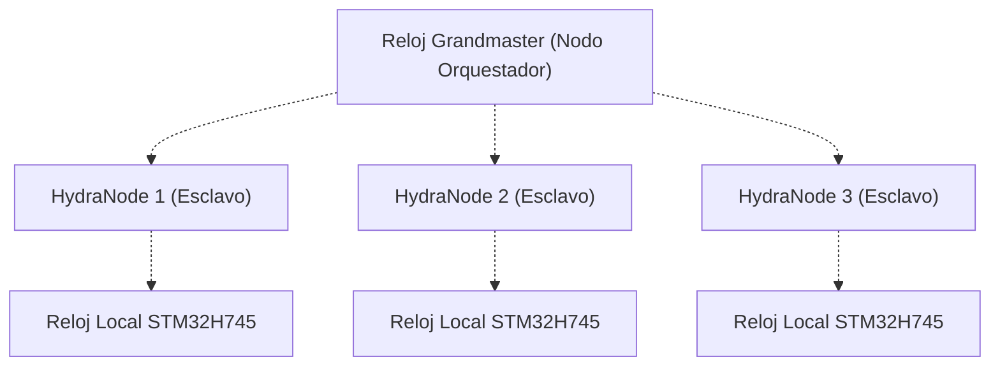

<!-- =============================================================================
HYDRA-UMC-SWARM-SYNC - CRDT state reconciliation for the swarm
Copyright (C) JuanenRac (Electro Hobby 3D) <electrohobby3d@gmail.com>
GPL-3.0-or-later - see LICENSE
============================================================================= -->

<p align="center">
  
</p>

# 🐝 HYDRA-UMC-SWARM-SYNC

<p align="center"><a href="README.md">🇺🇸 English</a> | 🇪🇸 <b>Español</b> | <a href="README_fra.md">🇫🇷 Français</a> | <a href="README_ita.md">🇮🇹 Italiano</a> | <a href="README_deu.md">🇩🇪 Deutsch</a> | <a href="README_zho.md">🇨🇳 简体中文</a> | <a href="README_jpn.md">🇯🇵 日本語</a> | <a href="README_por.md">🇵🇹 Português</a></p>

### 📡 Reconciliación de Estado con CRDT y Sincronización Multi-Nodo

<p align="center">
  
  
  
  
  
</p>

---

> **Estado de seguridad física y de ciberseguridad:** este ecosistema no es un sistema de seguridad certificado. Todavía no existe una ruta de E-STOP por hardware, ni límites ni enclavamientos aplicados por el firmware, ni un comando de movimiento verificado; las imágenes de firmware se comprueban con CRC-32 y una firma Ed25519, y una compilación de versión rechaza las claves de desarrollo publicadas (los cabezales de herramienta y las placas de expansión detrás del relé siguen con cargadores de URTC, que usan un HMAC-SHA256 de clave compartida en lugar de una firma); TLS y TLS mutuo son opcionales y están desactivados por defecto; aún no se ha poblado ni probado ninguna placa propia. Lee la [línea base de seguridad](https://github.com/JuanenRac/HYDRA-UMC-DOCS/blob/main/docs/SECURITY_BASELINE.md) y el [modelo de amenazas](https://github.com/JuanenRac/HYDRA-UMC-DOCS/blob/main/docs/THREAT_MODEL.md) antes de fiarte de cualquier afirmación de aquí para la seguridad de una persona.

---

## 📋 De un vistazo

| | |
|---|---|
| Versión | `0.1.5` |
| Madurez | Funcional |
| Tests | 105 (`cargo test`) |
| Tecnología | Rust / CRDT (LWW-Element-Map) / Lamport logical clock / JSON/HTTP |
| Destino | La Raspberry Pi CM5 de una celda HYDRA-UMC |
| En hardware real | Todavía no: no consta ninguna ejecución en hardware real para esta versión |

**Ir a:** [Resumen](#-resumen) · [Arquitectura](#-arquitectura) · [Seguridad y protección](#-seguridad-y-protección) · [Configuración](#-configuración) · [Inicio rápido](#-inicio-rápido) · [Pruebas](#-pruebas) · [Resolución de problemas](#-resolución-de-problemas) · [Estructura del repositorio](#-estructura-del-repositorio) · [Proyectos relacionados](#-proyectos-relacionados)

## 🚦 Estado del proyecto

Cada línea es una parte de este repositorio y la luz dice hasta dónde llega hoy. Se escribe con lo que el repositorio puede demostrar (pruebas, compilaciones, ejecuciones), no con lo previsto.

🟢 Hecho y verificado · 🟡 Funciona, con límites conocidos · 🟠 Hecho a medias o sin verificar · 🔴 Sin hacer o sin funcionar

| Área | Estado | Qué significa aquí |
|---|---|---|
| Software | 🟡 | Funciona para su propósito principal; la comprobación de honestidad de arriba lista lo que aún falta |
| Pruebas | 🟢 | 105 pruebas automáticas, ejecutadas en cada cambio |
| Hardware real | 🔴 | Todavía no: no consta ninguna ejecución en hardware real para esta versión |
| Documentación | 🟢 | README en ocho idiomas, comprobado contra el manifiesto en cada cambio |

## 🎯 Resumen

**HYDRA-UMC-SWARM-SYNC** es la capa de reconciliación de estado de la fábrica distribuida: un CRDT (un mapa de última escritura gana ordenado por un reloj lógico de Lamport) que permite a cada controlador fusionar su visión del enjambre sin un árbitro central. Un reloj global sincronizado con precisión (PTP / IEEE 1588) es el objetivo a largo plazo y no está implementado: consulta la hoja de ruta.

Iniciar y terminar las trayectorias de varios brazos en el mismo microsegundo, o realizar ensamblaje conjunto, necesita ese reloj y es trabajo futuro.

### Características Clave:
* ⏱️ **Reloj Lógico, Todavía No Sincronización PTP por Hardware:** `src/lamport.rs` implementa un reloj lógico de Lamport real y probado - la primitiva de ordenación que realmente necesita el merge del CRDT de más abajo. El jitter inferior a 100ns y el timestamping por hardware PTP (IEEE 1588) son el objetivo final (ver ARQUITECTURA más abajo), no algo que este crate mida o implemente hoy - no hay código de NIC/temporizador de hardware en ningún lugar de este repositorio, y el propio comentario de cabecera de `src/lamport.rs` lo dice explícitamente.
* 🔄 **Reconciliación de Estado CRDT (real hoy):** el LWW-Element-Map de `src/crdt.rs` fusiona el estado de múltiples celdas de forma determinista - demostrado conmutativo, asociativo e idempotente mediante property tests, no el inicio/parada sincronizados de comandos de trayectoria de robots (esa orquestación vive en HYDRA-UMC-ORCHESTRATOR/HYDRA-UMC-JOB-DISPATCHER, no aquí).
* 📡 **Todavía Sin Marcado de Tiempo por Hardware:** aprovechar temporizadores de hardware reales de CM5/STM32 es trabajo futuro - este crate es software puro (un binario Rust), sin ningún código que toque hardware.
* 🛡️ **Merge CRDT Resiliente a la Reconexión (real hoy):** un test de simulación real de 4 celdas (`cargo test`) demuestra que la convergencia se mantiene a través de múltiples rondas de partición y reconexión parcial - esto es resiliencia a que una celda se desconecte y vuelva a unirse más tarde, no una resiliencia medida frente al jitter/retraso de paquetes de red en vivo, que este crate no instrumenta.
* 🔍 **Visibilidad Real de Conflictos y Prueba de Convergencia a Escala de Enjambre (v0):** `merge_report()` devuelve un registro real, por clave, de cada conflicto de escritura genuino resuelto durante la reconciliación - qué célula le ganó a cuál otra, y con qué timestamp. Un test simulado de 4 células demuestra que la convergencia se mantiene a través de múltiples rondas de partición y reconexión parcial, no solo un único merge entre dos células.
* 💾 **Persistencia Real por Nodo (`--state-file`):** El propio estado CRDT del modo `serve` ahora sobrevive a un reinicio real del proceso (`src/store.rs`) - cada `POST /reconcile` se fusiona con el estado de este nodo y lo actualiza de forma duradera en vez de partir de cero en cada llamada - verificado contra un proceso real terminado y relanzado, no solo pruebas internas. Sin configurar, se mantiene el comportamiento original solo en memoria. Ver `docs/CLI_REFERENCE.md`.
* 🔁 **Intercambio del estado completo y cliente de gossip:** `GET /state?full=1` responde cada entrada con su tiempo, escritor y generación, borrados (lápidas) incluidos, y `POST /merge` las recibe, de modo que un nodo se puede poner al día desde otro cualquiera que sea lo que cada uno escribió y borró entretanto; una `Write` de un escenario puede llevar ahora `"deleted": true`. Las entradas se comprueban antes de tocar el mapa (tamaño, un tiempo a lo sumo `--max-time-jump` por delante, una generación a lo sumo `--max-generation-jump` por delante de la de la clave). Con `--peer http://host:port` (repetido por cada nodo) el nodo pide su estado a los pares cada `--gossip-interval-ms` (mínimo 1000) y, con `--gossip-push`, envía el suyo; los pares comparten `SWARM_SYNC_SHARED_SECRET` y `GET /stats` informa de cada uno. La generación se compara antes que el tiempo (una réplica que borró y recreó una clave más veces gana a una escritura simple posterior), y un conflicto informado ahora dice las dos generaciones. *(probado entre nodos de una misma máquina; nunca a través de una partición real)*
* 🔐 **Autenticación por Secreto Compartido Real Opcional (`SWARM_SYNC_SHARED_SECRET`):** sin configurar, este proyecto mantiene su postura original de confianza en la LAN - cualquier llamador puede hacer `POST /reconcile` o `GET /state`. Configurada (solo por variable de entorno, nunca por flag de CLI - un secreto compartido pertenece al entorno/unidad systemd, no a un listado de procesos), ambas rutas requieren un `Authorization: Bearer <token>` que coincida, comprobado en tiempo constante. `GET /stats` sigue abierta en ambos casos.
* 🧱 **Se niega a ser un nodo abierto en la red, y cuerpos acotados (v0):** `serve` en una dirección que no sea loopback necesita `SWARM_SYNC_SHARED_SECRET` (o un `--allow-anonymous` explícito para laboratorio), porque un nodo que fusiona lo que le envíe cualquier equipo de la red deja que ese equipo reescriba la visión que el enjambre tiene de sí mismo; los cuerpos de petición de más de 1 MiB se rechazan con `413` antes de leerlos; y el fichero de estado se fuerza a disco antes de reemplazar al anterior, de modo que un corte de corriente no pueda dejar un estado truncado o vacío. *(implementado)*
* 📜 **Historial de conflictos:** `GET /conflicts` lista los conflictos que este nodo resolvió (clave, escritor ganador, escritor perdedor y hora), el más reciente primero, hasta los últimos 200 o `?limit=N`; `/stats` solo guardaba el último. Pide el secreto compartido cuando hay uno, como `/state`.

## 🧩 Papel en HYDRA-UMC

**HYDRA-UMC-SWARM-SYNC** fusiona las vistas del enjambre que tiene cada celda en un resultado que no depende del orden de la fusión: un mapa de último escritor gana con un reloj lógico de Lamport. Funciona con un fichero de escenario o como un pequeño nodo HTTP que guarda su estado en disco y puede conversar con pares; no es una fuente horaria de hardware.

## 🏛️ Arquitectura

<p align="center">
  
</p>

<details>
<summary>Versión en texto del diagrama (Mermaid)</summary>



</details>

### JERARQUÍA DE SINCRONIZACIÓN

> Las flechas punteadas están previstas, no implementadas: este repositorio no tiene código PTP.

### ARQUITECTURA Y DECISIONES DE DISEÑO

* **Por qué sincronización basada en CRDT, no una única fuente de verdad.** Varias células HYDRA-UMC pueden operar de forma semi-autónoma y reconectarse después - una estrategia de fusión CRDT converge sin un árbitro central que decida qué estado 'gana', algo que un enfoque ingenuo de 'gana la última escritura' no puede garantizar ante una partición de red real.
* **Por qué es hermana, no un submódulo, de HYDRA-UMC-ORCHESTRATOR.** La reconciliación de estado es una preocupación continua de fondo, independiente de cualquier decisión de orquestación puntual - mantenerla como proceso separado significa que un reinicio del orquestador no interrumpe una fusión en curso.
* **Por qué la fusión CRDT ya es real hoy pero la sincronización PTP por hardware no.** `src/crdt.rs` implementa un LWW-Element-Map (mapa de última escritura gana) real, un CRDT basado en estado cuya `merge` es demostrablemente conmutativa, asociativa e idempotente - no solo "parece converger" en un ejemplo, ver los tests de propiedades de ese propio módulo. `src/lamport.rs` lo respalda con un reloj lógico de Lamport real. PTP (IEEE 1588, marcado de tiempo por hardware sub-100ns) es un problema fundamentalmente distinto y dependiente de hardware - necesita NICs/temporizadores de hardware reales para tener sentido, y sigue diferido hasta que haya hardware real contra el que validarlo. Un reloj lógico es lo que la fusión CRDT realmente necesita para resolver conflictos de forma determinista, y esa parte es real y está probada hoy.
* **Cómo encaja en el resto del ecosistema.** Un servicio hermano bajo HYDRA-UMC-ORCHESTRATOR, junto a HYDRA-UMC-PATH-PLANNER-3D, HYDRA-UMC-JOB-DISPATCHER y HYDRA-UMC-NODE-HEALING - mantiene consistente la visión que cada célula tiene del estado del enjambre, sin importar cuál ostente el rol de orquestador en cada momento. (Nada lo llama todavía: esa integración está prevista.)
* **Por qué `merge_report()` es un método nuevo en vez de cambiar lo que devuelve `merge()`.** `merge()` sigue siendo una caja negra pura, barata y obviamente correcta - esa simplicidad es lo que la hace fácil de confiar. `merge_report()` añade encima visibilidad real de conflictos para un llamador (un operador, una herramienta de depuración) que específicamente quiere saber qué sobreescribió una reconciliación, sin obligar a cada llamador del camino crítico `merge()` a pagar por esa contabilidad o manejarla.
* **Por qué los reportes de conflicto muestran orden de timestamp, no "happened-before" causal.** Un reloj de Lamport garantiza que un happens-before causal real implica un timestamp anterior - pero lo contrario no es cierto: un timestamp anterior NO prueba que dos eventos estuvieran causalmente relacionados en vez de simplemente ser concurrentes. `MergeConflict` es deliberadamente honesto al reportar solo lo que un reloj de Lamport puede realmente probar (un orden total consistente), no una afirmación de causalidad que necesitaría un reloj vectorial.

**Estado de robot tipado.** Lo que un nodo replica bajo la clave `robot_state/<robot_id>` es un `RobotState` del SDK y no una cadena libre: antes de tocar el mapa (`POST /reconcile` y `POST /merge`) el valor debe ser JSON, cumplir el esquema incluido (Draft 2020-12, formatos comprobados), llevar el `robot_id` de la clave y un cuaternión de pose de longitud unidad; si no, la petición es un `422`. Un borrado siempre se acepta y cualquier otra clave sigue sin tipo. Las misiones aún no están tipadas.

## 🔒 Seguridad y protección

| Amenaza | Defensa | Dónde |
|---|---|---|
| Una máquina de la red reescribe la visión que el enjambre tiene de sí mismo | `serve` se niega a escuchar en una dirección que no sea de bucle local sin `SWARM_SYNC_SHARED_SECRET` (código de salida 2); `--allow-anonymous` es una decisión explícita de laboratorio | `src/main.rs` |
| Una escritura con un tiempo cercano al máximo gana todos los conflictos para siempre | Una petición puede adelantar un tiempo como mucho `--max-time-jump` sobre el más reciente guardado, y una generación como mucho `--max-generation-jump` (1000 por defecto) sobre la propia de la clave | `src/entries.rs` |
| Una petición enorme o lenta deja sin servicio al nodo | Un cuerpo de más de 1 MiB se rechaza con 413 antes de leerlo, y cuatro hilos atienden las peticiones, así que una subida lenta solo retiene uno | `src/server.rs` |
| Un corte de corriente deja un fichero de estado truncado | El estado se escribe en un fichero temporal, se fuerza a disco y se renombra sobre el real | `src/store.rs` |

## ⚙️ Configuración

| Variable | Por defecto | Qué fija |
|---|---|---|
| `--addr` | `127.0.0.1` | dirección del nodo HTTP |
| `--port` | `8112` | puerto del nodo HTTP |
| `--state-file` / `SWARM_SYNC_STATE_FILE` | ninguno | fichero que conserva el estado entre ejecuciones |
| `SWARM_SYNC_SHARED_SECRET` | ninguno | secreto compartido que un nodo de red exige a quien llama y envía a los pares |
| `--max-time-jump` | `1000000` | hasta dónde puede escribir una petición sobre el tiempo más reciente |
| `--max-generation-jump` | `1000` | hasta dónde puede estar una entrada sobre la generación de la clave |
| `--presence` | `delete-wins` | cómo se resuelven un borrado y un alta concurrente de la misma clave: `delete-wins` o `add-wins` (todos los nodos del enjambre deben usar lo mismo) |
| `--peer URL`, `--gossip-interval-ms`, `--gossip-push` | desactivado; al menos 1000 ms entre rondas, 10000 por defecto | pares a los que pedir su estado, la pausa entre rondas y si se devuelve el propio |

## 🚀 Inicio rápido

Requiere la cadena de herramientas estable de Rust (edición 2021) con `cargo`.

```bash
./build.sh  # Linux, macOS (build.bat on Windows)
./run.sh scenarios/example.json
./run.sh serve --port 8112 --state-file data/state.json
```

## 🧪 Pruebas

105 pruebas automáticas se ejecutan con `cargo test`. No necesitan hardware ni nada fuera de esta máquina.

El CI ejecuta `HYDRA_UMC_CI=1 python tools/ci_validate.py`, que comprueba el manifiesto, los documentos, los ocho README y las imágenes.

## 🏗️ Compilación y publicación

Una fusión CRDT real y probada, no solo un esqueleto que compila:
reconcilia un escenario JSON multi-célula e imprime el estado convergido.

```bash
# Windows
build.bat
run.bat scenarios/example.json

# Linux / macOS
./build.sh
./run.sh scenarios/example.json
```

`build.sh`/`build.bat` nunca cambian la versión (solo `python tools/hydra_project_tool.py bump` la sube) y luego ejecutan
`cargo build --release`. `run.sh`/`run.bat` ejecutan directamente el binario
resultante, reenviando cualquier argumento (la ruta del escenario).

Un escenario es un archivo JSON con un array `cells` - cada célula tiene
un `id` (por legibilidad), un `writer` (ID de escritor), y una lista de
`writes` (`{key, value, time}`, siendo `time` una marca de tiempo Lamport
explícita, reproducida en vez de generada en vivo - el mismo patrón de
"entrada explícita y determinista" que usa el `seed` de
HYDRA-UMC-PATH-PLANNER-3D). Los writes de cada célula se pliegan en su propio mapa, y luego el mapa de cada célula se fusiona de izquierda a derecha con `merge_report()`, así que cada conflicto real queda registrado en el resultado. Que la fusión dé el mismo estado en cualquier orden es una propiedad del propio CRDT, fijada por los tests de propiedades de `src/crdt.rs`, no se vuelve a comprobar en cada llamada.

Al correrlo contra `scenarios/example.json` (donde `cell-a` y `cell-b`
escribieron ambas a `cell-a-node-2`) se ve la resolución real del
conflicto, no solo el resultado final opaco:

```bash
./run.sh scenarios/example.json
```
```json
{
  "cells_merged": 2,
  "merged_state": { "...": "..." },
  "conflicts_resolved": 1,
  "conflicts": [
    { "key": "cell-a-node-2",
      "local_time": 2, "local_writer": 1, "local_value": "ok",
      "remote_time": 3, "remote_writer": 2, "remote_value": "unhealthy",
      "kept_remote": true }
  ],
  "next_local_time": 6
}
```

```bash
cargo test   # el reloj de Lamport, y el CRDT en si - incluyendo
             # comprobaciones directas de que merge es conmutativa,
             # asociativa e idempotente (no solo "parece correcto" en un
             # ejemplo), un test de desempate determinista para
             # escrituras verdaderamente concurrentes, el comportamiento
             # propio de deteccion de conflictos de merge_report(), y una
             # simulacion de 4 celulas que demuestra convergencia a
             # traves de multiples rondas de particion y reconexion
             # parcial - 105 tests en total
```

La misma llamada a `reconcile()` también es alcanzable a través de una
API JSON/HTTP real (`src/server.rs`, `tiny_http`, bloqueante, sin
runtime asíncrono) en lugar de un fichero de escenario local -
`run.sh serve [--addr ADDR] [--port PORT]` la arranca (por defecto
`127.0.0.1:8112`), exponiendo `POST /reconcile` (el escenario en el
cuerpo de la petición, con la misma forma JSON) y `GET /stats`. Esto es
lo que `systemd/hydra-umc-swarm-sync.service` ejecuta sin supervisión en
la CM5. El uso completo, los códigos de salida y la referencia completa
de rutas están en [`docs/CLI_REFERENCE.md`](docs/CLI_REFERENCE.md).

## 🩺 Resolución de problemas

| Ves | Porque | Haz |
|---|---|---|
| `[swarm-sync] fatal: ...` + exit code 2 | El puerto está ocupado, la dirección no es de bucle local y no hay secreto, o el fichero de estado existe pero no se puede leer | Lee el mensaje tras `fatal:`; define `SWARM_SYNC_SHARED_SECRET`, cambia el puerto o arregla el fichero |
| HTTP 413 | El cuerpo de la petición supera 1 MiB | Envía un escenario más pequeño o divídelo |

## 📂 Estructura del repositorio

<p align="center">
  
</p>

<details>
<summary>Versión en texto del árbol</summary>

```text
HYDRA-UMC-SWARM-SYNC/
├── src/                       código fuente
│   ├── main.rs                Punto de entrada CLI: carga un escenario, reconcilia, imprime JSON
│   ├── lamport.rs             LamportClock - el reloj lógico detrás del orden del CRDT
│   ├── crdt.rs                LwwMap - el CRDT real: set/get/merge/snapshot
│   ├── entries.rs             Stamped entries: GET /state?full=1, POST /merge and their checks
│   ├── gossip.rs              Anti-entropy client: asks the peers for their state
│   ├── reconcile.rs           Reconciliación real, separada para que server.rs también pueda usarla
│   ├── server.rs              Superficie JSON/HTTP plana (tiny_http) - POST /reconcile por red
│   └── store.rs               Persistencia real y opcional por nodo (--state-file): un fichero de estado JSON a prueba de fallos
├── scenarios/                 escenarios de ejemplo
├── tests/                     startup.rs: el binario se niega a arrancar con un fichero de estado ilegible, un salto máximo de tiempo erróneo o ajustes de gossip inservibles
├── schemas/                   esquemas JSON de los contratos del SDK incluidos
├── docs/                      documentos del proyecto
├── images/                    banner e imágenes del README
├── systemd/                   unidad de servicio
├── tools/                     herramientas del proyecto y comprobaciones del CI
├── .github/                   flujo de CI y plantillas de incidencias
├── Cargo.toml                 Manifiesto del paquete Rust (nombre, versión, deps)
├── bump_version.py            Incremento de versión tipo cuentakilómetros (solo lo ejecuta el comando `bump` explícito)
├── bump_manifest_version.py   Sincroniza la versión de hydra-umc.project.json con la nativa (--sync)
├── CHANGELOG.md               qué cambió en cada versión
├── build-test.sh              comprobación de compilación sin cambios
├── build.sh                   compila y comprueba; nunca cambia la versión
├── hydra-umc.project.json     manifiesto: versión, madurez, familia
├── run.sh                     arranca el programa
└── test.sh                    ejecuta las pruebas
```

</details>

## 🗺️ Hoja de ruta y límites conocidos

**Límites conocidos hoy**

* **Fase 1:** Sincronización determinista de enjambre sobre TSN y reducción de jitter sub-ms.
* **Fase 2:** Planificación de trayectorias 3D con evitación dinámica de obstáculos en celdas multi-robot.
* **Fase 3:** Optimización del despacho de trabajos multi-robot utilizando disponibilidad de recursos en tiempo real.
* **Fase 4:** Soporte para sincronización PTP inalámbrica sobre Wi-Fi 6 (Modo de Alta Fiabilidad) y validación de precisión sub-100ns.

## 🌍 Idiomas

Este README y los documentos del repositorio existen en ocho idiomas: inglés, español, alemán, francés, italiano, japonés, chino y portugués (Portugal). Se escriben a la vez y el CI comprueba que los ocho ficheros tengan las mismas secciones y los mismos enlaces. Este repositorio no tiene pantalla ni catálogo de mensajes propios, así que no hay cadenas de interfaz que traducir.

## 🔗 Proyectos relacionados

Este proyecto es parte del ecosistema de robótica HYDRA-UMC del mismo autor (JuanenRac / Electro Hobby 3D). Vale la pena conocerlo, ya que una petición podría en realidad ser sobre alguno de estos en vez de sobre este repositorio.

**Proyecto Padre**
- **[HYDRA-UMC-ORCHESTRATOR](https://github.com/JuanenRac/HYDRA-UMC-ORCHESTRATOR)** — nodo de integración con un contrato real de informe de salud gRPC/Protobuf y una máquina de estados de misión; el padre del que este repositorio es un servicio de orquestación específico, dentro de su propia capa de coordinación de enjambre.

**Proyectos Hermanos** — los demás servicios de orquestación de la propia capa de coordinación de enjambre de HYDRA-UMC-ORCHESTRATOR
- **[HYDRA-UMC-PATH-PLANNER-3D](https://github.com/JuanenRac/HYDRA-UMC-PATH-PLANNER-3D)** — planificador de rutas 3D real basado en RRT, con validación real de colisión de obstáculos/espacio de trabajo.
- **[HYDRA-UMC-JOB-DISPATCHER](https://github.com/JuanenRac/HYDRA-UMC-JOB-DISPATCHER)** — cola de trabajos real basada en prioridad con deduplicación, sobre una API HTTP real.
- **[HYDRA-UMC-NODE-HEALING](https://github.com/JuanenRac/HYDRA-UMC-NODE-HEALING)** — watchdog de salud de flota real basado en gRPC, con reintento/backoff y detección de discrepancia de identidad.

**También Forma Parte del Ecosistema**

*Hardware y Plataforma Base*
- **[HYDRA-UMC](https://github.com/JuanenRac/HYDRA-UMC)** — el diseño de la placa madre del brazo robótico: host CM5 + coprocesador STM32H745 de doble núcleo, pensado para coordinar hasta 8 brazos herramienta por CAN-OTA/SPI-OTA (firmware en fase temprana; todavía no hay ninguna placa poblada).
- **[HYDRA-UMC-OS](https://github.com/JuanenRac/HYDRA-UMC-OS)** — capa de producto reproducible sobre Raspberry Pi OS para el CM5: agente de solo lectura, config/perfiles validados, aprovisionamiento WiFi de primer contacto.
- **[HYDRA-UMC-SDK](https://github.com/JuanenRac/HYDRA-UMC-SDK)** — el contrato JSON-Schema compartido y la barrera de software de puerta de trabajos contra la que cada bridge valida sus comandos (no es una función de seguridad certificada).
- **[HYDRA-UMC-CONNECTOR-HUB](https://github.com/JuanenRac/HYDRA-UMC-CONNECTOR-HUB)** — registro declarativo y validador de manifiestos de adaptador para conectores de máquinas externas; extiende la propia idea de contrato del SDK a máquinas externas sin sustituir a los proyectos de pasarela industrial.

*Backend Central y Clientes*
- **[HYDRA-UMC-SERVER](https://github.com/JuanenRac/HYDRA-UMC-SERVER)** — el backend headless real (REST/WebSocket) con el que habla de verdad cada cliente de control.
- **[HYDRA-UMC-STUDIO](https://github.com/JuanenRac/HYDRA-UMC-STUDIO)** — panel de control web con visualización 3D multi-robot en tiempo real.
- **[HYDRA-UMC-SUITE](https://github.com/JuanenRac/HYDRA-UMC-SUITE)** — centro de mando de enjambre de escritorio (PySide6) para varios servidores a la vez, empaquetado como ejecutable independiente.
- **[HYDRA-UMC-ANDROID-CONTROL](https://github.com/JuanenRac/HYDRA-UMC-ANDROID-CONTROL)** — app nativa de control para Android con inicio de sesión biométrico y un compañero Wear OS emparejado.
- **[HYDRA-UMC-IOS-CONTROL](https://github.com/JuanenRac/HYDRA-UMC-IOS-CONTROL)** — app de control para iOS/iPadOS (Flutter) con sincronización en tiempo real por WebSocket.
- **[HYDRA-UMC-DSI](https://github.com/JuanenRac/HYDRA-UMC-DSI)** — interfaz táctil nativa para la pantalla táctil DSI de 7" a bordo, embebida en el propio CM5.
- **[HYDRA-UMC-EDITOR-URDF](https://github.com/JuanenRac/HYDRA-UMC-EDITOR-URDF)** — creador/editor gráfico de URDF de escritorio que envía los modelos terminados al propio catálogo de STUDIO.
- **[HYDRA-UMC-EDITOR-STL](https://github.com/JuanenRac/HYDRA-UMC-EDITOR-STL)** — editor de escritorio de modelos STL, que transforma/reemplaza/quita/añade piezas reales en el mismo catálogo de modelos que también edita HYDRA-UMC-EDITOR-URDF.
- **[HYDRA-UMC-BRIDGE-AMR](https://github.com/JuanenRac/HYDRA-UMC-BRIDGE-AMR)** — barrera de coordinación para flotas AGV/AMR mediante un publicador MQTT VDA 5050 (probado solo contra una flota emulada).
- **[HYDRA-UMC-BRIDGE-CNC](https://github.com/JuanenRac/HYDRA-UMC-BRIDGE-CNC)** — coordinador de alto nivel para celdas CNC con acceso a estado/bytes de control GRBL (probado solo contra un emulador).
- **[HYDRA-UMC-BRIDGE-DROIDS](https://github.com/JuanenRac/HYDRA-UMC-BRIDGE-DROIDS)** — barrera de coordinación para droides con patas/humanoides, con un emisor de comandos para Boston Dynamics Spot (probado solo contra un emulador).
- **[HYDRA-UMC-BRIDGE-LASER](https://github.com/JuanenRac/HYDRA-UMC-BRIDGE-LASER)** — coordinador de celdas láser que lee 3 señales GPIO de llave/carcasa/enclavamiento (probado solo contra un chip simulado; no puede armar ni disparar un láser).
- **[HYDRA-UMC-BRIDGE-OPENPNP](https://github.com/JuanenRac/HYDRA-UMC-BRIDGE-OPENPNP)** — coordinador de alto nivel seguro para el flujo de placas de pick-and-place OpenPnP.
- **[HYDRA-UMC-BRIDGE-PRINTER3D](https://github.com/JuanenRac/HYDRA-UMC-BRIDGE-PRINTER3D)** — barrera de coordinación segura para impresoras 3D Moonraker/Klipper, con comandos de trabajo reales y controlados.
- **[HYDRA-UMC-BRIDGE-ROS2](https://github.com/JuanenRac/HYDRA-UMC-BRIDGE-ROS2)** — coordinador con un transporte ROS 2 rclpy importado de forma perezosa (todavía no ejecutado contra una instalación de ROS 2).
- **[HYDRA-UMC-BRIDGE-UAV](https://github.com/JuanenRac/HYDRA-UMC-BRIDGE-UAV)** — barrera de coordinación para UAV equipados con cámara, con un emisor de comandos MAVLink (probado solo contra un emulador).

*Plataforma de Herramientas URTC*
- **[URTC](https://github.com/JuanenRac/URTC)** — firmware para la placa física del Universal Robot Tool Controller, más de 25 perfiles de herramienta por bus CAN.
- **[URTC-FLASHER](https://github.com/JuanenRac/URTC-FLASHER)** — herramienta de escritorio con GUI para flashear placas URTC, CAN-OTA más SWD/JTAG de chip completo.
- **[URTC-TESTER](https://github.com/JuanenRac/URTC-TESTER)** — herramienta de escritorio de diagnóstico CAN-bus en vivo para placas URTC, un panel por perfil de herramienta.
- **[URTC-WEB-STUDIO](https://github.com/JuanenRac/URTC-WEB-STUDIO)** — alternativa basada en navegador a URTC-TESTER mediante la Web Serial API, sin instalación local.
- **[URTC-GATEWAY](https://github.com/JuanenRac/URTC-GATEWAY)** — pasarela delante del bus CAN de URTC: lista de identificadores permitidos, límite de tasa y clave de sesión; software probado en ordenador, aún no en un bus real.

*Nodo IA de Visión (Hailo-8)*
- **[HYDRA-UMC-VISION-NODE](https://github.com/JuanenRac/HYDRA-UMC-VISION-NODE)** — nodo de integración para el pipeline de visión Hailo-8, con una comprobación real de disponibilidad de hardware por etapa.
- **[HYDRA-UMC-DETECTION-HEF](https://github.com/JuanenRac/HYDRA-UMC-DETECTION-HEF)** — registro real de modelos compilados con verificación de carga segura por arquitectura Hailo/checksum.
- **[HYDRA-UMC-VISION-STREAMER](https://github.com/JuanenRac/HYDRA-UMC-VISION-STREAMER)** — generador real de pipeline GStreamer + config MediaMTX, con una frontera de integración HailoRT real.
- **[HYDRA-UMC-VISUAL-SERVOING-API](https://github.com/JuanenRac/HYDRA-UMC-VISUAL-SERVOING-API)** — ley de corrección Position-Based Visual Servoing con autorización condicionada al estado de zona; todavía sin estimación de pose por cámara.
- **[HYDRA-UMC-SAFETY-ZONES](https://github.com/JuanenRac/HYDRA-UMC-SAFETY-ZONES)** — lógica v0 de invasión de zona, vigencia de calibración y solicitud de E-STOP que toma las posiciones de los objetos de un fichero; ningún detector la alimenta y todavía no hay un E-STOP físico conectado.

*Nodo IA Cognitivo (Hailo-10)*
- **[HYDRA-UMC-COGNITIVE-NODE](https://github.com/JuanenRac/HYDRA-UMC-COGNITIVE-NODE)** — nodo de integración para el pipeline cognitivo Hailo-10 (orquestación de LLM/VLA/voz).
- **[HYDRA-UMC-VLA-ENGINE](https://github.com/JuanenRac/HYDRA-UMC-VLA-ENGINE)** — codificación/decodificación real de tokens de acción y generación de trayectoria para un modelo Vision-Language-Action.
- **[HYDRA-UMC-VOICE-UI](https://github.com/JuanenRac/HYDRA-UMC-VOICE-UI)** — front-end de voz real (VAD + analizador de intención) con un relé a Watch acotado y con confirmación.
- **[HYDRA-UMC-SEMANTIC-PLANNER](https://github.com/JuanenRac/HYDRA-UMC-SEMANTIC-PLANNER)** — descomposición real de tareas basada en reglas y recuperación semántica de errores sobre códigos de error del MCU.
- **[HYDRA-UMC-DOCS-QA](https://github.com/JuanenRac/HYDRA-UMC-DOCS-QA)** — búsqueda real de documentos TF-IDF (solo librería estándar) sobre los propios documentos Markdown de este ecosistema.
- **[HYDRA-UMC-LOCAL-TECHNICIAN](https://github.com/JuanenRac/HYDRA-UMC-LOCAL-TECHNICIAN)** — técnico de mantenimiento con IA local y con puertas de política para el propio ecosistema - observa, diagnostica y propone arreglos; los dos niveles de riesgo más altos están deliberadamente sin implementar todavía.

*Gemelo Digital y Simulación*
- **[HYDRA-UMC-TWIN](https://github.com/JuanenRac/HYDRA-UMC-TWIN)** — nodo de integración para el motor de gemelo digital, con un contrato real de sincronización por compatibilidad de versión.
- **[HYDRA-UMC-HIL-BRIDGE](https://github.com/JuanenRac/HYDRA-UMC-HIL-BRIDGE)** — enrutador hardware-in-the-loop con un enclavamiento de software por colisión entre simulación y hardware real (probado sin hardware real).
- **[HYDRA-UMC-PHYSICS-REPLICA](https://github.com/JuanenRac/HYDRA-UMC-PHYSICS-REPLICA)** — cinemática directa real y validación de límites articulares sobre un subconjunto real de URDF.
- **[HYDRA-UMC-SYNTHETIC-DATA-GEN](https://github.com/JuanenRac/HYDRA-UMC-SYNTHETIC-DATA-GEN)** — generador real de escenas 2D procedurales con exportación de anotaciones YOLO/COCO.

*Datos y Analítica*
- **[HYDRA-UMC-DATALAKE](https://github.com/JuanenRac/HYDRA-UMC-DATALAKE)** — almacén de series temporales real respaldado por sqlite3, con una API HTTP real de ingesta/consulta.
- **[HYDRA-UMC-ANOMALY-DETECTOR](https://github.com/JuanenRac/HYDRA-UMC-ANOMALY-DETECTOR)** — detector de anomalías real basado en FFT + línea base estadística, con monitorización de deriva.
- **[HYDRA-UMC-PRODUCTION-REPORTS](https://github.com/JuanenRac/HYDRA-UMC-PRODUCTION-REPORTS)** — cálculo real de OEE/disponibilidad sobre el histórico de DATALAKE, con exportación CSV reproducible.
- **[HYDRA-UMC-TELEMETRY-COLLECTOR](https://github.com/JuanenRac/HYDRA-UMC-TELEMETRY-COLLECTOR)** — pipeline real de ingesta CAN/WebSocket hacia DATALAKE, con deduplicación por secuencia.

*Pasarela Industrial*
- **[HYDRA-UMC-GATEWAY-INDUSTRIAL](https://github.com/JuanenRac/HYDRA-UMC-GATEWAY-INDUSTRIAL)** — nodo de integración que retransmite a protocolos industriales, con una capa real de lista blanca de comandos/contrapresión.
- **[HYDRA-UMC-OPCUA-SERVER](https://github.com/JuanenRac/HYDRA-UMC-OPCUA-SERVER)** — espacio de direcciones OPC-UA real, verificado con una sesión de cliente real del protocolo binario.
- **[HYDRA-UMC-MQTT-BROKER](https://github.com/JuanenRac/HYDRA-UMC-MQTT-BROKER)** — broker MQTT real con autenticación por cliente opcional y ACL de tópicos.
- **[HYDRA-UMC-MTCONNECT-ADAPTER](https://github.com/JuanenRac/HYDRA-UMC-MTCONNECT-ADAPTER)** — endpoints XML reales `/probe` y `/current` de MTConnect, con salida en modo degradado.

*Herramientas Complementarias y Operaciones del Ecosistema*
- **[HYDRA-UMC-DASHBOARD-AI](https://github.com/JuanenRac/HYDRA-UMC-DASHBOARD-AI)** — paneles de Resúmenes Inteligentes y Resaltado de Anomalías sobre DATALAKE/ANOMALY-DETECTOR, con un respaldo estadístico honesto.
- **[HYDRA-UMC-TOOL-CLI](https://github.com/JuanenRac/HYDRA-UMC-TOOL-CLI)** — CLI de flota con un contrato real y estable de códigos de salida, cliente real y en vivo de la propia API de HYDRA-UMC-SERVER.
- **[HYDRA-UMC-WATCH](https://github.com/JuanenRac/HYDRA-UMC-WATCH)** — app compañera de WearOS con patrones de alerta háptica y un relé de voz al teléfono emparejado (todavía no ejecutada en un reloj físico).
- **[URTC-SMART-RACK](https://github.com/JuanenRac/URTC-SMART-RACK)** — firmware para un rack de montaje de placas con decodificación real de ID de herramienta y lógica de precalentamiento Smart Idle.
- **[URTC-VISION-TOOL](https://github.com/JuanenRac/URTC-VISION-TOOL)** — firmware más un compañero de visión real en Python para un cabezal de inspección térmica/RGB.
- **[HYDRA-UMC-UPDATER](https://github.com/JuanenRac/HYDRA-UMC-UPDATER)** — herramienta administrativa de escritorio que descubre, clona y actualiza cada repositorio de este ecosistema.
- **[HYDRA-UMC-OS-REBUILDER](https://github.com/JuanenRac/HYDRA-UMC-OS-REBUILDER)** — herramienta de escritorio Windows/Linux que construye una imagen de la CM5 lista para grabar, precargada con las versiones más actuales del ecosistema, con configuración de primer arranque de Wi-Fi/usuario/SSH al estilo de Raspberry Pi Imager.
- **[HYDRA-UMC-OPS-AGENT](https://github.com/JuanenRac/HYDRA-UMC-OPS-AGENT)** — coordinador de incidencias de mantenimiento: un rol edge de bajo privilegio recopila un snapshot de inventario/salud saneado, un rol control-plane lo renderiza de solo lectura y pide a un proveedor de IA que sugiera un diagnóstico - nunca aplica un parche ni despliega nada.
- **[HYDRA-UMC-DEV-SERVER](https://github.com/JuanenRac/HYDRA-UMC-DEV-SERVER)** — host de desarrollo reproducible (Raspberry Pi 5 / CM5) que almacena el código del ecosistema y ejecuta tareas acotadas de compilación/pruebas bajo una cola duradera; un rol de desarrollo dedicado, explícitamente distinto de un CM5 operativo.

## 📚 Documentación

Dónde leer más:

* [Base de seguridad del ecosistema](https://github.com/JuanenRac/HYDRA-UMC-DOCS/blob/main/docs/SECURITY_BASELINE.md)
* [Modelo de amenazas del ecosistema](https://github.com/JuanenRac/HYDRA-UMC-DOCS/blob/main/docs/THREAT_MODEL.md)
* [Historial de cambios de este repositorio](CHANGELOG.md)
* [Licencia de este repositorio](LICENSE.md)

## 🤝 Contribuir y comunidad

* Antes de un pull request ejecuta `HYDRA_UMC_CI=1 py -3 tools/ci_validate.py` (o `HYDRA_UMC_CI=1 python3 tools/ci_validate.py`): debe imprimir `CI_VALIDATION=PASS`. No ejecutes `build.sh` ni `build.bat` para esta comprobación; compilar no es comprobar.
* Los ocho README se escriben desde una sola fuente en HYDRA-UMC-DOCS; no los edites a mano. Cambia la fuente y vuelve a escribirlos con `tools/make_readmes.py`.
* No afirmes en un README lo que no se ha ejecutado: di «simulado» o «sin probar en hardware» cuando esa sea la verdad.
* Mira [CONTRIBUTING.md](CONTRIBUTING.md), el [código de conducta](CODE_OF_CONDUCT.md), [SECURITY.md](SECURITY.md) y [SUPPORT.md](SUPPORT.md).

## 👤 AUTOR

**JuanenRac (Electro Hobby 3D)** · electrohobby3d@gmail.com

## 📜 LICENCIA

GPL-3.0-or-later - [LICENSE](LICENSE).
