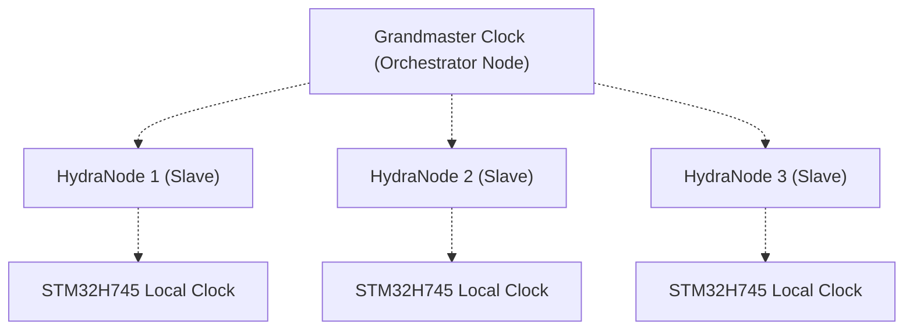

<!-- =============================================================================
HYDRA-UMC-SWARM-SYNC - CRDT state reconciliation for the swarm
Copyright (C) JuanenRac (Electro Hobby 3D) <electrohobby3d@gmail.com>
GPL-3.0-or-later - see LICENSE
============================================================================= -->

<p align="center">
  
</p>

# 🐝 HYDRA-UMC-SWARM-SYNC

<p align="center"><a href="README.md">🇺🇸 English</a> | <a href="README_spa.md">🇪🇸 Español</a> | <a href="README_fra.md">🇫🇷 Français</a> | <a href="README_ita.md">🇮🇹 Italiano</a> | <a href="README_deu.md">🇩🇪 Deutsch</a> | 🇨🇳 <b>简体中文</b> | <a href="README_jpn.md">🇯🇵 日本語</a> | <a href="README_por.md">🇵🇹 Português</a></p>

### 📡 CRDT 状态协调与多节点同步

<p align="center">
  
  
  
  
  
</p>

---

> **安全与安防现状:**本生态系统不是经认证的安全系统。目前尚无硬件 E-STOP 通路,没有由固件强制执行的限位或联锁,也没有经过验证的运动指令;固件映像使用 CRC-32 和 Ed25519 签名校验,发布构建会拒绝已公开的开发密钥(中继之后的工具头和扩展板仍运行 URTC 的引导程序,它们使用共享密钥的 HMAC-SHA256 而不是签名);TLS 与双向 TLS 均为可选项,默认关闭;自制电路板尚未组装或测试。在依赖此处任何说法来保障人身安全之前,请先阅读[安全基线](https://github.com/JuanenRac/HYDRA-UMC-DOCS/blob/main/docs/SECURITY_BASELINE.md)和[威胁模型](https://github.com/JuanenRac/HYDRA-UMC-DOCS/blob/main/docs/THREAT_MODEL.md)。

---

## 📋 速览

| | |
|---|---|
| 版本 | `0.1.5` |
| 成熟度 | 可用 |
| 测试 | 105 (`cargo test`) |
| 技术栈 | Rust / CRDT (LWW-Element-Map) / Lamport logical clock / JSON/HTTP |
| 目标 | HYDRA-UMC 工作单元的 Raspberry Pi CM5 |
| 真实硬件 | 尚未：此版本没有在真实硬件上运行的记录 |

**跳转：** [概述](#-概述) · [架构](#-架构) · [安全与防护](#-安全与防护) · [配置](#-配置) · [快速开始](#-快速开始) · [测试](#-测试) · [故障排除](#-故障排除) · [仓库结构](#-仓库结构) · [相关项目](#-相关项目)

## 🚦 项目状态

每一行是本仓库的一个部分，灯号表示它今天做到了哪一步。内容依据仓库能够展示的证据（测试、构建、运行），而不是计划。

🟢 已完成并验证 · 🟡 可用，有已知限制 · 🟠 部分完成或尚未验证 · 🔴 未完成或不可用

| 领域 | 状态 | 在这里的含义 |
|---|---|---|
| 软件 | 🟡 | 主要用途可用；上面的诚实性检查列出了仍然缺少的内容 |
| 测试 | 🟢 | 105 项自动测试，每次变更都会运行 |
| 真实硬件 | 🔴 | 尚未：此版本没有在真实硬件上运行的记录 |
| 文档 | 🟢 | 八种语言的 README，每次变更都会与清单核对 |

## 🎯 概述

**HYDRA-UMC-SWARM-SYNC** 是分布式工厂的状态协调层：一个由 Lamport 逻辑时钟排序的 CRDT（后写入者获胜的映射），使每个控制器无需中央仲裁者即可合并自己对集群的视图。精确同步的全局时钟（PTP / IEEE 1588）是长期目标，目前尚未实现：请见路线图。

让多台机械臂在同一微秒启动和结束轨迹，或进行联合装配，需要这个时钟，属于未来的工作。

### 关键特性：
* ⏱️ **逻辑时钟，尚非硬件 PTP 同步：** `src/lamport.rs` 实现了一个真实的、经过测试的 Lamport 逻辑时钟——这正是下方 CRDT 合并实际需要的排序原语。亚 100ns 抖动和 PTP(IEEE 1588)硬件时间戳是最终目标(见下方 ARCHITECTURE)，但不是本 crate 今天测量或实现的东西——本仓库中没有任何网卡/硬件定时器代码，`src/lamport.rs` 自身的文件头注释也明确说明了这一点。
* 🔄 **CRDT 状态协调(今天真实可用)：** `src/crdt.rs` 中的 LWW-Element-Map 以确定性方式合并多个单元的状态——经属性测试证明满足交换律、结合律和幂等性，而不是机器人轨迹指令的同步启停(那部分编排属于 HYDRA-UMC-ORCHESTRATOR/HYDRA-UMC-JOB-DISPATCHER，不在这里)。
* 📡 **尚无硬件时间戳：** 利用真实的 CM5/STM32 硬件定时器是未来的工作——本 crate 是纯软件(Rust 二进制程序)，完全没有面向硬件的代码。
* 🛡️ **抗重连的 CRDT 合并(今天真实可用)：** 一个真实的 4 单元模拟测试(`cargo test`)证明了收敛性在多轮分区和部分重连中依然成立——这是对某个单元离线后又重新加入的韧性，而不是本 crate 未曾测量的、针对真实网络数据包抖动/延迟的韧性。
* 🔍 **真实的冲突可见性与集群规模的收敛证明（v0）：** `merge_report()` 会返回一份真实的、按键分类的记录，列出协调过程中解决的每一个真实写入冲突——哪个单元战胜了哪个单元，用的是什么时间戳。一个 4 单元的模拟测试证明了收敛性在多轮分区和部分重连中依然成立，而不仅仅是两个单元之间的一次性合并。
* 💾 **真实的按节点持久化(`--state-file`):** `serve` 模式自身的 CRDT 状态现在能在真实的进程重启后存活(`src/store.rs`)——每次 `POST /reconcile` 都会合并进该节点自身的状态并持久化更新,而不是每次调用都从零开始——已针对真实的、被终止后重新启动的进程完成验证,而不仅仅是进程内测试。未配置时,保持原有的纯内存行为。详见 `docs/CLI_REFERENCE.md`。
* 🔁 **完整状态交换与 gossip 客户端:** `GET /state?full=1` 返回每个条目及其时间、写入者和世代(包括已删除的键,即墓碑),`POST /merge` 接收它们,因此无论双方在此期间写入或删除了什么,一个节点都能从另一个节点追平;场景中的 `Write` 现在可以带 `"deleted": true`。条目在触及映射之前会被检查(大小、时间最多领先 `--max-time-jump`、世代最多领先该键自身世代 `--max-generation-jump`)。使用 `--peer http://host:port`(每个节点重复一次)时,节点每隔 `--gossip-interval-ms`(至少 1000)向对等节点索取状态,并在加 `--gossip-push` 时发送自己的状态;对等节点共享 `SWARM_SYNC_SHARED_SECRET`,`GET /stats` 报告每个对等节点。世代先于时间比较(多次删除并重建某个键的副本会胜过之后的普通写入),报告的冲突现在会写出两边的世代。*(已在同一台机器上的节点之间试过,从未在真实分区中验证)*
* 🔐 **真实的可选共享密钥认证(`SWARM_SYNC_SHARED_SECRET`):** 未配置时,本项目保持原有的局域网信任姿态——任何调用方都可以执行 `POST /reconcile` 或 `GET /state`。配置后(仅通过环境变量,绝不通过命令行参数——共享密钥应属于环境变量/systemd 单元,而非进程列表),两个路由都要求携带匹配的 `Authorization: Bearer <token>`,并以恒定时间比较。`GET /stats` 在两种情况下都保持开放。
* 🧱 **拒绝成为网络上的开放节点，且请求体有上限（v0）：** 在非回环地址上运行 `serve` 需要 `SWARM_SYNC_SHARED_SECRET`（实验室环境可显式使用 `--allow-anonymous`），因为一个会合并网络上任意机器所发送内容的节点，会让该机器改写蜂群对自身的认知；超过 1 MiB 的请求体会在读取之前就被以 `413` 拒绝；状态文件在替换旧文件之前会被强制写入磁盘，因此断电不会留下被截断或为空的状态。*（已实现）*
* 📜 **冲突历史:** `GET /conflicts` 按从新到旧列出此节点解决过的冲突(键、胜出的写入方、落败的写入方和时间)，最多最近 200 条，或用 `?limit=N`；`/stats` 以前只保留最后一条。设置了共享密钥时，它和 `/state` 一样需要该密钥。

## 🧩 在 HYDRA-UMC 中的角色

**HYDRA-UMC-SWARM-SYNC** 把每个单元持有的群体视图合并成一个与合并顺序无关的结果：带 Lamport 逻辑时钟的“后写者获胜”映射。它可以用场景文件运行，也可以作为把状态保存在磁盘上、能与对等节点交换信息的小型 HTTP 节点运行；它不是硬件时间源。

## 🏛️ 架构

<p align="center">
  
</p>

<details>
<summary>图表的文本版本（Mermaid）</summary>



</details>

### 同步层级结构

> 虚线箭头仅为计划，尚未实现：本仓库中没有 PTP 代码。

### 架构与设计决策

* **为何采用基于 CRDT 的同步，而非单一真实来源。** 多个 HYDRA-UMC 单元可以半自主运行并在之后重新连接——CRDT 合并策略无需中央仲裁者决定"谁的状态获胜"即可收敛，这是朴素的"最后写入者获胜"方法在真实网络分区场景下无法保证的。
* **为何这是 HYDRA-UMC-ORCHESTRATOR 的兄弟项目，而非子模块。** 状态协调是一项持续的后台关注点，独立于任何单一的编排决策——将其保持为独立进程意味着编排器的重启不会中断正在进行中的合并。
* **为何 CRDT 合并今天已经真实存在，而 PTP 硬件同步尚未实现。** `src/crdt.rs` 实现了一个真实的 LWW-Element-Map（最后写入者获胜映射）——一种基于状态的 CRDT，其 `merge` 可证明是可交换、可结合且幂等的（不仅仅是在某个例子上“看起来收敛”，见该模块自身的属性测试）。`src/lamport.rs` 用一个真实的 Lamport 逻辑时钟为其提供支撑。PTP（IEEE 1588，亚 100ns 硬件时间戳）是一个根本不同、依赖硬件的问题——它需要真实的网卡/硬件计时器才有意义，在有真实硬件可供验证之前将继续推迟。逻辑时钟才是 CRDT 合并真正需要用来确定性地解决冲突的东西，而这部分今天已经是真实且经过测试的。
* **这如何融入生态系统的其余部分。** 作为 HYDRA-UMC-ORCHESTRATOR 下的同级服务，与 HYDRA-UMC-PATH-PLANNER-3D、HYDRA-UMC-JOB-DISPATCHER 和 HYDRA-UMC-NODE-HEALING 并列——无论当前由哪个单元持有编排器角色，都能保持每个单元自身对集群状态的视图一致。（目前还没有任何组件调用它，该集成仍在计划中。）
* **为何 `merge_report()` 是一个新方法，而不是修改 `merge()` 的返回值。** `merge()` 依然保持纯粹、廉价、明显正确的黑盒特性——正是这种简单性使它易于被信任。`merge_report()` 在其之上为调用方（一个运维人员、一个调试工具）叠加了真实的冲突可见性，供其明确想知道一次协调究竟覆盖了什么，而不必强迫热路径 `merge()` 的每一个调用方都为这份记账买单或去处理它。
* **为何冲突报告展示的是时间戳顺序，而不是因果上的“先于发生”。** Lamport 时钟保证真正的因果先于关系意味着更早的时间戳——但反过来并不成立：更早的时间戳并不能证明两个事件是因果相关的，而不仅仅是并发的。`MergeConflict` 刻意保持诚实，只报告 Lamport 时钟真正能够证明的东西（一个一致的全序关系），而不是需要向量时钟才能做出的因果性断言。

**带类型的机器人状态。** 节点在键 `robot_state/<robot_id>` 下复制的是 SDK 的 `RobotState`，而不是任意字符串：在触及映射之前（`POST /reconcile` 和 `POST /merge`），该值必须是 JSON，通过随附的模式（Draft 2020-12，校验格式），带有键中的 `robot_id` 和单位长度的位姿四元数；否则请求返回 `422`。删除始终被接受，其他键保持无类型。任务尚未加上类型。

## 🔒 安全与防护

| 威胁 | 防御 | 位置 |
|---|---|---|
| 网络上的某台机器改写群体对自身的视图 | 没有 `SWARM_SYNC_SHARED_SECRET` 时，`serve` 拒绝在非回环地址上监听（退出码 2）；`--allow-anonymous` 是明确的实验室选择 | `src/main.rs` |
| 时间戳接近最大值的写入将永远赢得所有冲突 | 一次请求最多只能把时间推进到已持有的最新时间之后 `--max-time-jump`，把代数推进到该键自身代数之后 `--max-generation-jump`（默认 1000） | `src/entries.rs` |
| 巨大或缓慢的请求拖垮节点 | 超过 1 MiB 的请求体在读取前即以 413 拒绝，四个工作线程处理请求，因此缓慢的上传只占用其中一个 | `src/server.rs` |
| 断电留下被截断的状态文件 | 状态先写入临时文件，强制落盘，再重命名覆盖真实文件 | `src/store.rs` |

## ⚙️ 配置

| 变量 | 默认值 | 设置内容 |
|---|---|---|
| `--addr` | `127.0.0.1` | HTTP 节点的地址 |
| `--port` | `8112` | HTTP 节点的端口 |
| `--state-file` / `SWARM_SYNC_STATE_FILE` | 无 | 在两次运行之间保存状态的文件 |
| `SWARM_SYNC_SHARED_SECRET` | 无 | 网络节点要求调用方提供并发送给对等节点的共享密钥 |
| `--max-time-jump` | `1000000` | 请求可写入到最新时间之后多远 |
| `--max-generation-jump` | `1000` | 条目可超出键的代数多远 |
| `--peer URL`, `--gossip-interval-ms`, `--gossip-push` | 关闭；每轮间隔至少 1000 毫秒，默认 10000 | 要询问其状态的对等节点、每轮之间的暂停，以及是否回推 |

## 🚀 快速开始

需要稳定版 Rust 工具链（2021 版）及 `cargo`。

```bash
./build.sh  # Linux, macOS (build.bat on Windows)
./run.sh scenarios/example.json
./run.sh serve --port 8112 --state-file data/state.json
```

## 🧪 测试

运行 `cargo test` 会执行 105 个自动测试。 不需要硬件，也不需要这台机器以外的任何东西。

CI 运行 `HYDRA_UMC_CI=1 python tools/ci_validate.py`，检查清单、文档、八个 README 和图片。

## 🏗️ 构建与发布

一个真实、经过测试的 CRDT 合并——而不只是一个能编译的骨架：它会
协调一个多单元的 JSON 场景并打印收敛后的状态。

```bash
# Windows
build.bat
run.bat scenarios/example.json

# Linux / macOS
./build.sh
./run.sh scenarios/example.json
```

`build.sh`/`build.bat` 不会更改版本号（只有 `python tools/hydra_project_tool.py bump` 才会提升），然后执行 `cargo build --release`。
`run.sh`/`run.bat` 直接执行生成的二进制文件，并将任何参数（场景路径）
转发给它。

场景是一个包含 `cells` 数组的 JSON 文件——每个单元有一个 `id`（便于
阅读）、一个 `writer`（写入者 ID），以及一组 `writes`
（`{key, value, time}`，其中 `time` 是显式的 Lamport 时间戳，是回放
而非实时生成的——与 HYDRA-UMC-PATH-PLANNER-3D 的 `seed` 使用的
"显式、确定性输入"模式相同）。每个单元的写入先折叠进它自己的映射，然后用 `merge_report()` 从左到右合并所有单元的映射，因此过程中出现的每个真实冲突都会记录在结果中。无论按什么顺序合并都得到相同状态，这是 CRDT 本身的性质，由 `src/crdt.rs` 中的属性测试固定，不会在每次调用时重新检查。

对照 `scenarios/example.json`（其中 `cell-a` 和 `cell-b` 都写入了
`cell-a-node-2`）运行时，可以看到真实的冲突解决过程，而不只是最终的
不透明结果：

```bash
./run.sh scenarios/example.json
```
```json
{
  "cells_merged": 2,
  "merged_state": { "...": "..." },
  "conflicts_resolved": 1,
  "conflicts": [
    { "key": "cell-a-node-2",
      "local_time": 2, "local_writer": 1, "local_value": "ok",
      "remote_time": 3, "remote_writer": 2, "remote_value": "unhealthy",
      "kept_remote": true }
  ],
  "next_local_time": 6
}
```

```bash
cargo test   # Lamport 时钟，以及 CRDT 本身——包括直接验证 merge
             # 具有可交换性、可结合性和幂等性的测试（不仅仅是在某个
             # 例子上"看起来正确"）、一个针对真正并发写入的确定性
             # 平局判定测试、merge_report() 自身的冲突检测行为，以及
             # 一个证明多轮分区和部分重连后依然收敛的 4 单元模拟——
             # 共 102 个测试
```

同一个 `reconcile()` 调用也可以通过真实的 JSON/HTTP API
（`src/server.rs`，`tiny_http`，阻塞式，无异步运行时）访问，而不必
使用本地场景文件——`run.sh serve [--addr ADDR] [--port PORT]` 启动它
（默认 `127.0.0.1:8112`），暴露 `POST /reconcile`（场景数据放在请求体中，
JSON 格式相同）和 `GET /stats`。`systemd/hydra-umc-swarm-sync.service`
在 CM5 上无人值守运行的正是这个模式。完整用法、退出码和路由参考详见
[`docs/CLI_REFERENCE.md`](docs/CLI_REFERENCE.md)。

## 🩺 故障排除

| 你看到 | 原因 | 处理 |
|---|---|---|
| `[swarm-sync] fatal: ...` + exit code 2 | 端口被占用、地址不是回环且没有密钥，或状态文件存在但无法读取 | 阅读 `fatal:` 之后的提示；设置 `SWARM_SYNC_SHARED_SECRET`、更换端口或修复文件 |
| HTTP 413 | 请求体超过 1 MiB | 发送更小的场景或将其拆分 |

## 📂 仓库结构

<p align="center">
  
</p>

<details>
<summary>目录树的文本版本</summary>

```text
HYDRA-UMC-SWARM-SYNC/
├── src/                       源代码
│   ├── main.rs                CLI 入口点：加载场景、协调、打印 JSON
│   ├── lamport.rs             LamportClock——CRDT 排序背后的逻辑时钟
│   ├── crdt.rs                LwwMap——真正的 CRDT：set/get/merge/snapshot
│   ├── entries.rs             Stamped entries: GET /state?full=1, POST /merge and their checks
│   ├── gossip.rs              Anti-entropy client: asks the peers for their state
│   ├── reconcile.rs           真实的协调逻辑,拆分出来以便 server.rs 也能使用
│   ├── server.rs              简洁的 JSON/HTTP 接口(tiny_http) - 通过网络的 POST /reconcile
│   └── store.rs               真实的、可选的按节点持久化(--state-file):抗崩溃的 JSON 状态文件
├── scenarios/                 示例场景
├── tests/                     startup.rs: 状态文件不可读、最大时间跳变无效或 gossip 设置不可用时,程序拒绝启动
├── docs/                      项目文档
├── images/                    横幅和 README 的图片
├── systemd/                   服务单元
├── tools/                     项目工具和 CI 检查
├── .github/                   CI 工作流和 Issue 模板
├── Cargo.toml                 Rust 包清单（名称、版本、依赖项）
├── bump_version.py            显式提升版本
├── bump_manifest_version.py   将 hydra-umc.project.json 的版本与原生版本同步(--sync)
├── CHANGELOG.md               每个版本的变更
├── build-test.sh              不修改内容的构建检查
├── build.sh                   构建并检查；从不改变版本
├── hydra-umc.project.json     清单：版本、成熟度、系列
├── run.sh                     启动程序
└── test.sh                    运行测试
```

</details>

## 🗺️ 路线图与已知限制

**当前已知限制**

* **第一阶段：** 基于 TSN 的确定性集群同步与亚毫秒级抖动降低。
* **第二阶段：** 多机器人单元中带动态避障的 3D 路径规划。
* **第三阶段：** 利用实时资源可用性进行多机器人任务分发优化。
* **第四阶段：** 支持通过 Wi-Fi 6（高可靠性模式）进行无线 PTP 同步，以及亚 100ns 精度验证。

## 🌍 语言

本 README 和仓库文档提供八种语言：英语、西班牙语、德语、法语、意大利语、日语、中文和葡萄牙语（葡萄牙）。它们同时编写，并由 CI 检查八个文件拥有相同的章节和相同的链接。 本仓库没有自己的界面或消息目录，因此没有需要翻译的界面文字。

## 🔗 相关项目

本项目是同一作者(JuanenRac / Electro Hobby 3D)打造的 HYDRA-UMC 机器人生态系统的一部分。值得了解,因为某个请求实际上可能是关于这些项目之一,而非本仓库本身。

**父项目**
- **[HYDRA-UMC-ORCHESTRATOR](https://github.com/JuanenRac/HYDRA-UMC-ORCHESTRATOR)** — 具备真实 gRPC/Protobuf 健康报告契约与任务状态机的集成中枢;本仓库是其自身集群协调层中一个具体编排服务所属的父项目。

**兄弟项目** —— HYDRA-UMC-ORCHESTRATOR 自身集群协调层中的其他编排服务
- **[HYDRA-UMC-PATH-PLANNER-3D](https://github.com/JuanenRac/HYDRA-UMC-PATH-PLANNER-3D)** — 具备真实障碍物/工作空间碰撞校验的真实基于 RRT 的三维路径规划器。
- **[HYDRA-UMC-JOB-DISPATCHER](https://github.com/JuanenRac/HYDRA-UMC-JOB-DISPATCHER)** — 基于真实 HTTP API 的真实优先级任务队列，支持去重。
- **[HYDRA-UMC-NODE-HEALING](https://github.com/JuanenRac/HYDRA-UMC-NODE-HEALING)** — 具备重试/退避与身份不匹配检测的真实基于 gRPC 的车队健康看门狗。

**生态系统中的其他项目**

*核心硬件与平台*
- **[HYDRA-UMC](https://github.com/JuanenRac/HYDRA-UMC)** — 机器人手臂主板设计——CM5 主机 + 双核 STM32H745,目标是通过 CAN-OTA/SPI-OTA 协调最多 8 条工具臂(固件处于早期阶段,尚无已组装的电路板)。
- **[HYDRA-UMC-OS](https://github.com/JuanenRac/HYDRA-UMC-OS)** — 面向 CM5 的可复现 Raspberry Pi OS 产品层——只读代理、经过验证的配置/配置文件、WiFi 首次配网。
- **[HYDRA-UMC-SDK](https://github.com/JuanenRac/HYDRA-UMC-SDK)** — 每个桥接都据此校验自身指令的共享 JSON-Schema 契约与软件作业门限边界(并非经认证的安全功能)。
- **[HYDRA-UMC-CONNECTOR-HUB](https://github.com/JuanenRac/HYDRA-UMC-CONNECTOR-HUB)** — 面向外部机器连接器的声明式适配器清单注册与校验工具；把 SDK 自身的契约理念扩展到外部机器，而不取代工业网关类项目。

*核心后端与客户端*
- **[HYDRA-UMC-SERVER](https://github.com/JuanenRac/HYDRA-UMC-SERVER)** — 每个控制客户端真正通信的真实无头后端(REST/WebSocket)。
- **[HYDRA-UMC-STUDIO](https://github.com/JuanenRac/HYDRA-UMC-STUDIO)** — 具有实时多机器人 3D 可视化的网页控制面板。
- **[HYDRA-UMC-SUITE](https://github.com/JuanenRac/HYDRA-UMC-SUITE)** — 面向多台服务器的桌面(PySide6)集群指挥中心，打包为独立可执行文件。
- **[HYDRA-UMC-ANDROID-CONTROL](https://github.com/JuanenRac/HYDRA-UMC-ANDROID-CONTROL)** — 具有生物识别登录和配对 Wear OS 伴侣应用的原生 Android 控制应用。
- **[HYDRA-UMC-IOS-CONTROL](https://github.com/JuanenRac/HYDRA-UMC-IOS-CONTROL)** — 具有实时 WebSocket 同步的 iOS/iPadOS 控制应用(Flutter)。
- **[HYDRA-UMC-DSI](https://github.com/JuanenRac/HYDRA-UMC-DSI)** — 面向机载 7 英寸 DSI 触摸屏的原生触控界面，直接嵌入 CM5 本体。
- **[HYDRA-UMC-EDITOR-URDF](https://github.com/JuanenRac/HYDRA-UMC-EDITOR-URDF)** — 将完成的模型推送到 STUDIO 自身目录的桌面版图形化 URDF 创建/编辑工具。
- **[HYDRA-UMC-EDITOR-STL](https://github.com/JuanenRac/HYDRA-UMC-EDITOR-STL)** — 桌面 STL 模型编辑器，在 HYDRA-UMC-EDITOR-URDF 编辑的同一模型目录中变换/替换/移除/添加真实部件。
- **[HYDRA-UMC-BRIDGE-AMR](https://github.com/JuanenRac/HYDRA-UMC-BRIDGE-AMR)** — 通过 VDA 5050 MQTT 发布者为 AGV/AMR 车队提供的协调边界(仅针对仿真车队测试)。
- **[HYDRA-UMC-BRIDGE-CNC](https://github.com/JuanenRac/HYDRA-UMC-BRIDGE-CNC)** — 具备 GRBL 状态/控制字节访问能力的高层 CNC 单元协调器(仅针对模拟器测试)。
- **[HYDRA-UMC-BRIDGE-DROIDS](https://github.com/JuanenRac/HYDRA-UMC-BRIDGE-DROIDS)** — 面向足式/人形机器人的协调边界,带有 Boston Dynamics Spot 指令发送器(仅针对模拟器测试)。
- **[HYDRA-UMC-BRIDGE-LASER](https://github.com/JuanenRac/HYDRA-UMC-BRIDGE-LASER)** — 读取 3 路钥匙/外壳/联锁 GPIO 信号的激光单元协调器(仅针对模拟芯片测试;无法使激光器上膛或发射)。
- **[HYDRA-UMC-BRIDGE-OPENPNP](https://github.com/JuanenRac/HYDRA-UMC-BRIDGE-OPENPNP)** — 面向 OpenPnP 贴片机板级流程的安全高层协调器。
- **[HYDRA-UMC-BRIDGE-PRINTER3D](https://github.com/JuanenRac/HYDRA-UMC-BRIDGE-PRINTER3D)** — 面向 Moonraker/Klipper 3D 打印机的安全协调边界，具备真实的受控作业指令。
- **[HYDRA-UMC-BRIDGE-ROS2](https://github.com/JuanenRac/HYDRA-UMC-BRIDGE-ROS2)** — 带有惰性导入 rclpy ROS 2 传输层的协调器(尚未在 ROS 2 环境中运行)。
- **[HYDRA-UMC-BRIDGE-UAV](https://github.com/JuanenRac/HYDRA-UMC-BRIDGE-UAV)** — 面向搭载摄像头的无人机的协调边界,带有 MAVLink 指令发送器(仅针对模拟器测试)。

*URTC 工具平台*
- **[URTC](https://github.com/JuanenRac/URTC)** — 面向实体 Universal Robot Tool Controller 板卡的固件，通过 CAN 总线支持 25 种以上工具配置。
- **[URTC-FLASHER](https://github.com/JuanenRac/URTC-FLASHER)** — 面向 URTC 板卡的桌面图形烧录工具，支持 CAN-OTA 以及全芯片 SWD/JTAG。
- **[URTC-TESTER](https://github.com/JuanenRac/URTC-TESTER)** — 面向 URTC 板卡的桌面实时 CAN 总线诊断工具，每种工具配置对应一个面板。
- **[URTC-WEB-STUDIO](https://github.com/JuanenRac/URTC-WEB-STUDIO)** — 通过 Web Serial API 实现的浏览器版 URTC-TESTER 替代方案，无需本地安装。
- **[URTC-GATEWAY](https://github.com/JuanenRac/URTC-GATEWAY)** — URTC CAN 总线前的网关：允许的标识符列表、速率限制和会话密钥；软件已在计算机上测试，尚未在真实总线上测试。

*视觉 AI 节点(Hailo-8)*
- **[HYDRA-UMC-VISION-NODE](https://github.com/JuanenRac/HYDRA-UMC-VISION-NODE)** — 面向 Hailo-8 视觉流水线的集成中枢，具备逐阶段的真实硬件就绪检测。
- **[HYDRA-UMC-DETECTION-HEF](https://github.com/JuanenRac/HYDRA-UMC-DETECTION-HEF)** — 具备 Hailo 架构/校验和安全加载验证的真实编译模型注册表。
- **[HYDRA-UMC-VISION-STREAMER](https://github.com/JuanenRac/HYDRA-UMC-VISION-STREAMER)** — 具备真实 HailoRT 集成边界的真实 GStreamer 流水线 + MediaMTX 配置生成器。
- **[HYDRA-UMC-VISUAL-SERVOING-API](https://github.com/JuanenRac/HYDRA-UMC-VISUAL-SERVOING-API)** — 以区域状态为授权条件的 Position-Based Visual Servoing 修正律;尚无摄像头位姿估计。
- **[HYDRA-UMC-SAFETY-ZONES](https://github.com/JuanenRac/HYDRA-UMC-SAFETY-ZONES)** — 从文件读取物体位置的 v0 区域入侵、校准新鲜度与 E-STOP 请求逻辑;没有检测器为其供数,也尚未连接任何物理 E-STOP。

*认知 AI 节点(Hailo-10)*
- **[HYDRA-UMC-COGNITIVE-NODE](https://github.com/JuanenRac/HYDRA-UMC-COGNITIVE-NODE)** — 面向 Hailo-10 认知流水线(LLM/VLA/语音编排)的集成中枢。
- **[HYDRA-UMC-VLA-ENGINE](https://github.com/JuanenRac/HYDRA-UMC-VLA-ENGINE)** — 面向 Vision-Language-Action 模型的真实动作 token 编解码与轨迹生成。
- **[HYDRA-UMC-VOICE-UI](https://github.com/JuanenRac/HYDRA-UMC-VOICE-UI)** — 具备受限、需确认的 Watch 中继的真实语音前端(VAD + 意图解析)。
- **[HYDRA-UMC-SEMANTIC-PLANNER](https://github.com/JuanenRac/HYDRA-UMC-SEMANTIC-PLANNER)** — 基于真实规则的任务分解，以及针对 MCU 错误码的语义化错误恢复。
- **[HYDRA-UMC-DOCS-QA](https://github.com/JuanenRac/HYDRA-UMC-DOCS-QA)** — 面向本生态系统自身 Markdown 文档的真实纯标准库 TF-IDF 文档检索。
- **[HYDRA-UMC-LOCAL-TECHNICIAN](https://github.com/JuanenRac/HYDRA-UMC-LOCAL-TECHNICIAN)** — 面向生态系统自身的本地、按策略门控的 AI 维护技师——观察、诊断并提出修复建议;两个最高风险等级目前特意尚未实现。

*数字孪生与仿真*
- **[HYDRA-UMC-TWIN](https://github.com/JuanenRac/HYDRA-UMC-TWIN)** — 面向数字孪生引擎的集成中枢，具备真实的版本兼容性同步契约。
- **[HYDRA-UMC-HIL-BRIDGE](https://github.com/JuanenRac/HYDRA-UMC-HIL-BRIDGE)** — 在仿真与真实硬件之间带有软件碰撞联锁的硬件在环路由器(未在真实硬件上测试)。
- **[HYDRA-UMC-PHYSICS-REPLICA](https://github.com/JuanenRac/HYDRA-UMC-PHYSICS-REPLICA)** — 面向真实 URDF 子集的真实正向运动学与关节限位校验。
- **[HYDRA-UMC-SYNTHETIC-DATA-GEN](https://github.com/JuanenRac/HYDRA-UMC-SYNTHETIC-DATA-GEN)** — 具备 YOLO/COCO 标注导出功能的真实程序化 2D 场景生成器。

*数据与分析*
- **[HYDRA-UMC-DATALAKE](https://github.com/JuanenRac/HYDRA-UMC-DATALAKE)** — 具备真实数据摄入/查询 HTTP API 的真实 sqlite3 时序数据存储。
- **[HYDRA-UMC-ANOMALY-DETECTOR](https://github.com/JuanenRac/HYDRA-UMC-ANOMALY-DETECTOR)** — 具备漂移监测能力的真实 FFT + 统计基线异常检测器。
- **[HYDRA-UMC-PRODUCTION-REPORTS](https://github.com/JuanenRac/HYDRA-UMC-PRODUCTION-REPORTS)** — 基于 DATALAKE 历史数据的真实 OEE/可用率计算，支持可复现的 CSV 导出。
- **[HYDRA-UMC-TELEMETRY-COLLECTOR](https://github.com/JuanenRac/HYDRA-UMC-TELEMETRY-COLLECTOR)** — 面向 DATALAKE 的真实 CAN/WebSocket 数据摄入管道，支持序列去重。

*工业网关*
- **[HYDRA-UMC-GATEWAY-INDUSTRIAL](https://github.com/JuanenRac/HYDRA-UMC-GATEWAY-INDUSTRIAL)** — 中继至工业协议的集成中枢，具备真实的指令白名单/背压控制层。
- **[HYDRA-UMC-OPCUA-SERVER](https://github.com/JuanenRac/HYDRA-UMC-OPCUA-SERVER)** — 经真实二进制协议客户端会话验证的真实 OPC-UA 地址空间。
- **[HYDRA-UMC-MQTT-BROKER](https://github.com/JuanenRac/HYDRA-UMC-MQTT-BROKER)** — 具备可选按客户端认证与主题 ACL 的真实 MQTT 代理。
- **[HYDRA-UMC-MTCONNECT-ADAPTER](https://github.com/JuanenRac/HYDRA-UMC-MTCONNECT-ADAPTER)** — 具备降级模式输出的真实 MTConnect `/probe` 与 `/current` XML 端点。

*辅助工具与生态系统运维*
- **[HYDRA-UMC-DASHBOARD-AI](https://github.com/JuanenRac/HYDRA-UMC-DASHBOARD-AI)** — 基于 DATALAKE/ANOMALY-DETECTOR 的智能摘要与异常高亮面板，具备诚实的统计回退机制。
- **[HYDRA-UMC-TOOL-CLI](https://github.com/JuanenRac/HYDRA-UMC-TOOL-CLI)** — 具备真实、稳定退出码契约的车队 CLI，是 HYDRA-UMC-SERVER 自身 API 的真实在线客户端。
- **[HYDRA-UMC-WATCH](https://github.com/JuanenRac/HYDRA-UMC-WATCH)** — 带有触觉提醒模式与配对手机语音中继的 WearOS 伴侣应用(尚未在实体手表上运行)。
- **[URTC-SMART-RACK](https://github.com/JuanenRac/URTC-SMART-RACK)** — 面向板卡安装机架的固件，具备真实的工具 ID 解码与 Smart Idle 预热逻辑。
- **[URTC-VISION-TOOL](https://github.com/JuanenRac/URTC-VISION-TOOL)** — 面向热成像/RGB 检测工具头的固件及真实 Python 视觉伴侣程序。
- **[HYDRA-UMC-UPDATER](https://github.com/JuanenRac/HYDRA-UMC-UPDATER)** — 发现、克隆并更新本生态系统中每个仓库的管理类桌面工具。
- **[HYDRA-UMC-OS-REBUILDER](https://github.com/JuanenRac/HYDRA-UMC-OS-REBUILDER)** —— 构建即刻可烧录、预装生态系统最新版本的 CM5 镜像的 Windows/Linux 桌面工具,具备类似 Raspberry Pi Imager 风格的首次启动 Wi-Fi/用户/SSH 配置。
- **[HYDRA-UMC-OPS-AGENT](https://github.com/JuanenRac/HYDRA-UMC-OPS-AGENT)** — 维护事件协调器：一个低权限的边缘角色采集经过脱敏的库存/健康快照，一个控制面角色以只读方式渲染它，并请求某个 AI 提供方给出诊断建议——从不应用补丁，也从不部署任何内容。
- **[HYDRA-UMC-DEV-SERVER](https://github.com/JuanenRac/HYDRA-UMC-DEV-SERVER)** — 可复现的开发主机（Raspberry Pi 5 / CM5），保存整个生态系统的源代码，并在持久队列下运行有界的构建/测试任务；这是专用的开发角色，明确区别于运行中的 CM5。

## 📚 文档

更多阅读：

* [生态系统的安全基线](https://github.com/JuanenRac/HYDRA-UMC-DOCS/blob/main/docs/SECURITY_BASELINE.md)
* [生态系统的威胁模型](https://github.com/JuanenRac/HYDRA-UMC-DOCS/blob/main/docs/THREAT_MODEL.md)
* [本仓库的更新日志](CHANGELOG.md)
* [本仓库的许可证](LICENSE.md)

## 🤝 参与贡献与社区

* 提交 pull request 之前，请运行 `HYDRA_UMC_CI=1 py -3 tools/ci_validate.py`（或 `HYDRA_UMC_CI=1 python3 tools/ci_validate.py`）：它必须输出 `CI_VALIDATION=PASS`。此检查不要运行 `build.sh` 或 `build.bat`；构建不是检查。
* 八个 README 由 HYDRA-UMC-DOCS 中的同一个源生成；请勿手工编辑。修改源文件，再用 `tools/make_readmes.py` 重新生成。
* 不要在 README 中声称尚未运行过的内容：属实时请写“仅模拟”或“尚未在硬件上试过”。
* 请参阅 [CONTRIBUTING.md](CONTRIBUTING.md)、[行为准则](CODE_OF_CONDUCT.md)、[SECURITY.md](SECURITY.md) 和 [SUPPORT.md](SUPPORT.md)。

## 👤 作者

**JuanenRac (Electro Hobby 3D)** · electrohobby3d@gmail.com

## 📜 许可证

GPL-3.0-or-later - [LICENSE](LICENSE).
